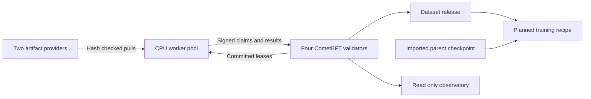

# Consensus cluster

DAWL now uses **CometBFT 0.38.26** to order work assignments, lease renewals,
audit results, dataset releases and training plans. Four validators run the same
deterministic application, with separate signing keys, application databases,
consensus databases and write-ahead logs. There is no single scheduling server.
The proposer changes under CometBFT's consensus protocol.

The initial deployment remains on one physical Windows/WSL host. This is actual
Byzantine fault tolerant consensus among admitted processes, not evidence of
independent operators, permissionless admission or Internet-scale performance.

The current workload is **complete replay of the existing corpus**: source
reconstruction, re-tokenization and input-vector verification, divided into
26 bounded jobs. It reuses the original host GPU commitments. It does not yet
schedule new source acquisition, GPU vector-production jobs or model training.

## Responsibilities

| Component | Count | Responsibility |
|---|---:|---|
| Consensus validator | 4 | Order transactions, enforce state transitions and certify application hashes |
| Artifact provider | 2 | Serve independent copies of pinned source/token artifacts and weight blocks |
| CPU auditor | 4 | Pull leased work and replay complete assigned chunk ranges |
| Publisher identity | 1 | Request dataset publication and propose a training recipe; cannot bypass coverage rules |
| Public verifier | Any | Check a quorum certificate or independently reconstruct pinned data without a private key |

Three auditors run in CPU containers and one runs on the Windows host. Each
container is limited to two CPU cores and 2 GiB RAM. Validator and worker keys are
different. Providers receive neither source-producer nor validator private keys.
The existing DirectML GPU path remains available for the production stage; the
cluster consumes its already published vector commitments.



## Consensus and deterministic scheduling

For four equal-power validators, a commit requires more than two thirds of total
voting power: **three signatures**. The intended fault model tolerates less than
one third Byzantine voting power, with eventual network synchrony for progress.
Two unavailable validators halt commits; the application does not elect a
single-node fallback or reduce its quorum.

CometBFT handles proposals, prevotes, precommits, locking, proposer changes, block
replay and synchronization. A small Go ABCI adapter connects it to the Python
application over container-local loopback. The Python application performs no
network requests, floating-point model computation, clock reads or random draws
inside a consensus transition.

- A transaction pins its chain ID, plan digest, signer, monotonic actor sequence,
  expiry height, command and payload. Signature, capability and replay checks
  apply both before mempool admission and during finalized execution.
- A claim selects eligible work deterministically from the committed queue.
  Each worker has at most one active lease. A lease generation is the claim's
  transaction ID; renewals and results must name that exact generation.
- Leases expire by **committed block height**, not a worker's wall clock.
  A stopped chain does not allow two network partitions to independently expire
  and finalize competing leases. Once progress resumes, expired work is reclaimable.
- Invalid transactions have no partial application effects. Invalid computation
  results mark a shard disputed; unavailable data can be retried. Disputed shards
  block publication and require a future explicit resolution policy.
- `FinalizeBlock` prepares tentative state in memory. `Commit` atomically persists
  the state and height in SQLite before acknowledging success. Restart reports
  the last committed height so CometBFT can replay any later finalized block.
- Idle workers poll for eligible work without continuously submitting empty
  claims. Worker outboxes retain signed transactions across uncertain responses.

The application hash is SHA-256 of canonical full state. This is currently a
bounded state representation, not a Merkle-key-value store or sharded database.
Hashing and persistence cost grow with retained job state. Current hard bounds
include 64 actors, 10,000 planned jobs, 256 positions per shard and 64 KiB per
transaction; they are input limits, not measured capacity guarantees. The
CometBFT block limit is 1 MiB. SQLite remains local to each validator.

## What publication means

The plan partitions every one of the 1,438 committed chunks exactly once. Each
job requires passing results from **two distinct admitted auditor keys**. A key
cannot fill both slots, and results with stale generations, incorrect counts,
wrong recipe fingerprints or missing coverage are rejected.

Each worker reconstructs the original book, verifies the signed token snapshot,
re-tokenizes the selected range, and compares NumPy input-vector bytes with the
host GPU commitments. The complete cluster run therefore needs 52 accepted job
results and 2,876 chunk replay executions. Whole-file integrity checks repeat
for jobs from the same book; minimizing this overhead is future work.

Two matching signatures are **attributed computation claims**, not a proof that
two independent people performed the work. CometBFT certifies that validators
agreed to the policy and recorded results. It does not turn dishonest matching
worker claims into correct computations. Public replay remains the route to
independently checking the underlying transformations. Worker collusion and
publisher admission are separate from the consensus fault threshold.

## Training inputs and the weight ledger boundary

The release pins a content-addressed training manifest. Each record identifies
its book, original chunk, token-file hash, token offset, count and chunk hash.
Books are assigned deterministically to disjoint train, validation and test
sets. This avoids splitting a book across sets; it does not establish that the
imported GPT-2 model has never seen those books or eliminate shared boilerplate.

`TrainingInput.sequences()` supplies integer inputs, shifted next-token targets
and a boolean loss mask. Windows stay within a source chunk and a split. The
final window is padded with the pinned GPT-2 EOS ID and padding is masked. No
dense input-vector dataset is required. At length 128 the current corpus yields
13,681 sequences and 1,655,725 target positions: one fewer target than tokens for
each source chunk. The reader keeps at most four token-file arrays in memory.

The existing 548,105,171-byte GPT-2 safetensors checkpoint is registered as an
**imported weight record**. A manifest names 33 blocks of at most 16 MiB each,
and both block hashes and the whole-file hash are checked during reconstruction.
This supports checkpoint artifacts larger than the ordinary 256 MiB object cap.
Its `training_history_verified` flag is false; DAWL does not invent upstream
training provenance.

A finalized training-plan record links a released dataset to this exact parent
weight record and a pinned next-token recipe. Its status is `planned` and
`executed` is false. The current application rejects training execution and
weight-promotion commands. The next increment must add the trainer's execution
contract, checkpoint publication, evaluation and acceptance rules, and resource
admission. A proposed recipe is not a training-run receipt.

## Run and inspect

Current deployment root: `artifacts/cluster-v2`. Container state is copied into
`/var/lib/dawl/cluster-v2` in the `kali-linux` WSL distribution. Native Linux
filesystems hold the live consensus databases; the Windows seed remains separate.
The original platform and swarm data are unchanged.

| Surface | Address |
|---|---|
| Cluster observatory | http://127.0.0.1:8882/ |
| Existing data observatory | http://127.0.0.1:8880/ |
| Validator RPCs | http://127.0.0.1:8920/ through port 8923 |
| Artifact providers | http://127.0.0.1:8930/ and port 8931 |

The observatory is read-only. It labels live RPC responses as observations;
hashes from different heights should not be compared as if they were a fork.

To create a **fresh** deployment after installing the repository's pinned Python
dependencies:

```powershell
wsl -d kali-linux -u root --exec podman build -f consensus/Dockerfile.build -t localhost/dawl-consensus-build:0.1 .
wsl -d kali-linux -u root --exec sh scripts/cluster_containers.sh build
.\.venv\Scripts\python.exe dawl_cluster.py prepare --root artifacts/cluster-v2
wsl -d kali-linux -u root --exec sh scripts/cluster_containers.sh seed
wsl -d kali-linux -u root --exec sh scripts/cluster_containers.sh up
wsl -d kali-linux -u root --exec sh scripts/cluster_containers.sh workers
.\.venv\Scripts\python.exe dawl_cluster.py worker --root artifacts/cluster-v2/worker-3
```

Preparation and seeding refuse to replace existing roots. For another chain,
choose a new root and set `DAWL_CLUSTER_ROOT` and `DAWL_CLUSTER_NATIVE` consistently
for the shell script. Only one deployment uses these fixed container names,
bridge and loopback ports at a time. Preserve old validators' complete private
state when retiring them; never reset signing state and rejoin an existing chain.

The current nodes are already running. To resume these same containers after a
manual stop or host restart, start their retained state instead of preparing a
new chain:

```powershell
wsl -d kali-linux -u root --exec podman start dawl-cluster-validator-0 dawl-cluster-validator-1 dawl-cluster-validator-2 dawl-cluster-validator-3 dawl-cluster-provider-0 dawl-cluster-provider-1 dawl-cluster-worker-0 dawl-cluster-worker-1 dawl-cluster-worker-2
```

For the retained **v2** chain, the exact admitted host source is preserved in
`artifacts/cluster-v2/host-runtime`, copied from its running image and checked
against its implementation pin. Resume that host worker with:

```powershell
.\.venv\Scripts\python.exe artifacts/cluster-v2/host-runtime/dawl_cluster.py worker --root artifacts/cluster-v2/worker-3
```

Run `python scripts/cluster_observer.py` in another terminal with the project
virtual environment active. Keep only one
process per worker identity. Host boot integration is not configured. Port 8882
serves the cluster observatory; stopping it does not stop consensus or workers.

Publisher operations run after full coverage:

```powershell
.\.venv\Scripts\python.exe dawl_cluster.py status --root artifacts/cluster-v2/publisher
.\.venv\Scripts\python.exe dawl_cluster.py publish --root artifacts/cluster-v2/publisher
.\.venv\Scripts\python.exe dawl_cluster.py plan-training --root artifacts/cluster-v2/publisher
```

`scripts/exercise_cluster.py` is an alternative to starting all workers manually.
It deliberately removes quorum, leaves one claimed job unattended, starts the
remaining workers, verifies stale-result rejection, releases the complete dataset,
records a training plan, and restarts a validator. It expects a fresh chain with
worker zero's actor sequence still at zero. Read the archived results rather than
rerunning the destructive availability exercise against a busy chain.

## Independent public verification

The Go verifier starts from an independently obtained genesis file and its SHA-256
pin. It validates a commit against the fixed genesis validator set using CometBFT's
verification library, checks the signed header, and compares exact application
state bytes with the certified application hash. State at height H is committed
in the header at H+1, so that next block must be available. This is a full-state
check, not a compact Merkle query proof. It does not establish freshness.

```powershell
wsl -d kali-linux -u root --exec podman run --rm --network dawl-consensus-cluster `
  --entrypoint dawl-consensus `
  -v /var/lib/dawl/cluster-v2/genesis.json:/genesis.json:ro `
  localhost/dawl-cluster:0.1 verify --rpc http://10.89.90.12:26657 `
  --genesis /genesis.json --genesis-sha256 <independently-obtained-pin>
```

The fresh verifier container mounts only public genesis data. Downloading a
genesis file and a purported pin from the same untrusted peer is not an
independent trust bootstrap. Changing validator membership requires a different
verification protocol; this version explicitly checks the fixed set.

To check training inputs and parent-weight availability without any private key,
place the pinned `plan.json` alone in a new directory and run:

```powershell
.\.venv\Scripts\python.exe dawl_cluster.py inspect-loader --root artifacts/public-cluster-v2 `
  --peer http://127.0.0.1:8930 --verify-weights
```

The earlier `dawl_platform.py verify` additionally provides complete source,
token and vector replay against either provider's original ledger API.

## Moving to independent machines

Each validator and worker already has its own state directory. Moving the cluster
off one host requires configuring real reachable peer/RPC/provider addresses,
transport protection, ingress rules and operational ownership. The validator
keys and genesis remain unchanged when moving existing identities. A validator
identity must have exactly one active signer, with its associated consensus and
anti-double-signing state. Copying a live validator into two active processes is
not a way to add capacity.

Worker count and shard size are configurable at preparation. Fixed admission,
the current single-block execution path, whole-state hashing, checkpoint storage
growth and shared artifact hot spots bound scale. Dynamic membership governance,
additional workload types, resource quotas, data availability commitments,
independent verifier implementations, larger-corpus measurements and operation
across separately administered machines remain necessary work. No rewards,
staking, open discovery or Sybil resistance are implemented.

## Implementation and protocol references

- `src/dawl_cluster/state.py`: deterministic capability, lease and release rules.
- `src/dawl_cluster/application.py`: ABCI lifecycle and crash persistence.
- `consensus/main.go`: adapter and fixed-genesis public state verifier.
- `src/dawl_cluster/worker.py`: independent CPU execution and durable submissions.
- `src/dawl_cluster/training.py`: token streaming and large checkpoint checks.
- `scripts/cluster_containers.sh`: isolated container deployment.
- `tests/test_cluster.py`: replay, fencing, atomicity, malformed input and target-mask checks.
- [CometBFT consensus specification](https://github.com/cometbft/cometbft/blob/v0.38.26/spec/consensus/consensus.md).
- [ABCI application requirements](https://github.com/cometbft/cometbft/blob/v0.38.26/spec/abci/abci%2B%2B_app_requirements.md).
- [CometBFT release](https://github.com/cometbft/cometbft/releases/tag/v0.38.26).
- [SQLite transaction semantics](https://www.sqlite.org/lang_transaction.html).
