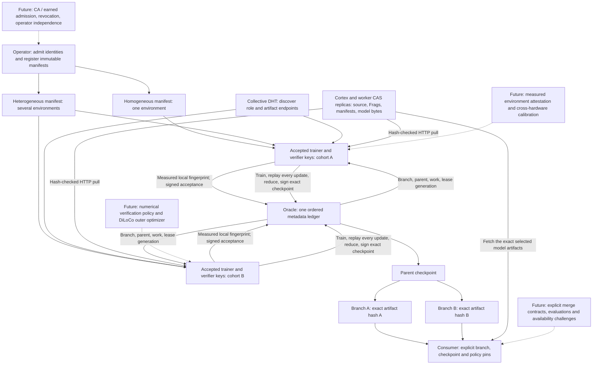

# Collaboration modes and model branches

Protocol 5 is an opt-in extension to the Oracle training state machine. It keeps
exact replay useful for a private research group and adds explicit, independent
model histories for a collaboration with several execution environments.

**Implementation status:** signed metadata transitions, worker environment checks,
operator CLI, explicit consumer selection and a public replayable rehearsal are
implemented. The existing protocol-4 training testnet remains running unchanged.
The new branch protocol has not yet been exercised by a multi-machine training
pilot. The rehearsal uses synthetic adapter descriptors and environment labels;
it is not evidence of numerical reproducibility across different hardware.

## Two supported modes

| Property | Homogeneous | Heterogeneous |
|---|---|---|
| Intended use | Invited laboratory or private collaboration | Several execution cohorts developing alternative model histories |
| Execution environments per manifest | Exactly one | One to eight |
| Participation | Explicit invited keys, existing role admission, signed acceptance | Same admission boundary in this increment |
| Training within a branch | Exact replay in the agreed environment | Exact replay within that branch's chosen environment |
| Who can create branches | Manifest owner | Owner or an accepted trainer in the chosen cohort |
| Stage scheduling | Manifest owner registers bounded work | Same; workers then claim temporary leases independently |
| Model selection | Consumer pins a branch and checkpoint | Consumer pins a branch and checkpoint |
| Automatic merging or global winning model | None | None |

The modes apply **per collaboration manifest**, not as a mutable network-wide
switch. Both can coexist on one metadata ledger. This separates the Oracle's
agreement about recorded events from consumers' decisions about which model to
use. It also lets a small academic deployment use homogeneous mode indefinitely.

Heterogeneous mode currently means a federation of execution cohorts. A GPU-A
branch can fork a checkpoint produced by GPU-B, but its subsequent trainers and
verifiers must match the new branch's environment. A single round cannot yet mix
hardware and replace exact replay with an epsilon comparison.

## Architecture and data flow



DHT role announcements still confer no authority. Membership in the validator
ring remains governed by its genesis; the collaboration manifest does not admit
new Oracle validators or change their voting power. The Console is read-only.

## Immutable contracts

Identifiers are SHA-256 over the existing canonical JSON encoding:

\[
  m = H(\operatorname{canonical}(\text{participation manifest})),\qquad
  e = H(\operatorname{canonical}(\text{execution environment})).
\]

A participation manifest binds mode, approved model/tokenizer profiles, invited
public keys, allowed execution environments, explicit admission and the exact
replay policy. Every worker signs its acceptance of **that manifest and one
environment**. Acceptance is immutable. Changing the agreement requires a new
manifest and explicit acceptance; existing checkpoints retain their old policy.

The measured environment includes implementation digest, Python and package
versions, OS/architecture, Torch build configuration hash, device model and
capability, GPU driver, and deterministic execution settings. The first executor
supports eager FP32 fixed-A LoRA, deterministic Torch algorithms, two CPU threads,
TF32 disabled and `CUBLAS_WORKSPACE_CONFIG=:4096:8`. It does not use `torch.compile`.

Matching these declarations is a practical admission filter, not a mathematical
guarantee of identical arithmetic. The worker also performs actual exact replay.
A dishonest node can sign false environment claims; these are not remote hardware
attestations. Equal device names do not establish independent operators.

A branch binds its manifest, execution environment, profile, certified token
Blueprint, imported base-model digest, adapter model contract and initial adapter.
The model contract hashes the fixed A projection, A/B layouts, base-model digest,
profile and adapter interpretation. This prevents continuing the same B bytes
under a different fixed projection or tensor layout.

Each new stage pins the exact current branch checkpoint and starting adapter.
There is at most one active or disputed stage on a branch. Promotion atomically
advances the stage and branch heads. A second stage cannot overwrite an active
stage or start from a stale checkpoint. Exact replay and reduction still require
every named independent verifier key; a conflicting vote freezes that branch's
stage. Other branches can continue.

Branches currently have one parent. Forking preserves the parent's exact adapter,
base model, profile and model contract. A new certified token Blueprint can be
chosen on the fork. Multi-parent merges and changes of model structure require a
future migration contract; they are rejected by the current schema. Root branches
have declared imported starting weights, not an assertion that their upstream
pretraining was audited. A root or unverified contribution cannot be selected as
a replay-attested checkpoint.

## Forks, verification and consumer choice

For two descendants of the same checkpoint \(\theta_0\):

\[
  \theta_A = T_{e_A}(\theta_0,D_A),\qquad
  \theta_B = T_{e_B}(\theta_0,D_B).
\]

Both may be valid recorded outcomes even when
\(H(\theta_A) \ne H(\theta_B)\). Their hashes identify exact bytes; they do not
measure quality or similarity. The ledger retains both histories, each with its
own verifier receipts. Forking does not waive the verification requirements of a
branch or convert an unverified candidate into an accepted checkpoint.

Within a cohort, the existing reduction is unchanged:

\[
  B_{t+1}=\operatorname{FP32}\!\left(
    \sum_i \frac{n_i}{\sum_j n_j}B_{t,i}\right),
\]

using canonical shard order and FP64 accumulation. Each verifier first replays
every submitted update against the same exact parent. The B-only adapter method
requires a shared frozen base and A projection. This is local SGD with a
token-weighted mean; it is not DiLoCo or a general merge of independently trained
full models.

A consumer selection explicitly pins:

```json
{
  "branch": "<branch-id>",
  "checkpoint": "<checkpoint-id>",
  "collaboration": "<manifest-id>",
  "environment": "<environment-id>",
  "profile_id": "<profile-id>",
  "verification": "full-replay-and-reduce/1"
}
```

The resolver reads quorum-certified state and returns the exact adapter,
executable manifest, base model and source Blueprint. It rejects policy
substitution and a checkpoint from a sibling branch. Historical selections remain
valid after the branch advances. Resolution does not download the artifacts or
score the model; the consumer must still hash-check downloaded bytes and apply
its own evaluation criteria.

## Operator workflow

Use a fresh development chain with the updated implementation on **all validators**,
or plan a coordinated protocol upgrade separately. Do not hot-swap one validator
in the running run-003 chain. Activation is explicit, requires protocol 4, and
rejects active training stages. Protocol-4 histories keep their original state
hashes; once protocol 5 is activated, newly registered stages must use governed
stage schema 2.

The operator CLI is `dawl_collaboration.py`. Network operations require
`verify_state=true` and the existing pinned genesis/plan. Read-only commands do not
load a private key. Run fingerprints inside the exact worker environment.

```sh
# Capture the actual worker software, driver and device settings.
python dawl_collaboration.py fingerprint --device cuda:0 --output environment.json

# Select the operating mode explicitly. members.json contains admitted public keys.
python dawl_collaboration.py manifest --mode homogeneous --name "Research cohort" \
  --environments environment.json --members members.json --profiles PROFILE_ID \
  --output collaboration.json
# Heterogeneous alternative: --mode heterogeneous --environments gpu-a.json gpu-b.json

# Activate the updated protocol, register the shared agreement, then accept as each member.
python dawl_collaboration.py activate --root publisher
python dawl_collaboration.py register --root publisher --file collaboration.json
python dawl_collaboration.py join --root trainer --file collaboration.json --device cuda:0
python dawl_collaboration.py join --root verifier --file collaboration.json --device cuda:0

# Hash a reviewed branch body; fork and stage use existing signed transaction clients.
python dawl_collaboration.py seal --file branch-body.json --output branch.json
python dawl_collaboration.py fork --root publisher --file branch.json
python dawl_collaboration.py stage --root publisher --file stage.json
python dawl_collaboration.py status --root observer
python dawl_collaboration.py select --root observer --file selection.json
```

`join` measures the environment, submits the member's signed acceptance and saves
the two explicit pins in that node's `cluster.json`. The worker rejects absent
pins, a different measured fingerprint or the wrong branch cohort before fetching
training data. Its existing `training_stage` setting still selects the stage;
workers do not autonomously switch between collaborations.

Use the generated rehearsal files as **schema examples only**. They contain
synthetic descriptors and cannot run a real model. For an executable stage, use
the real training manifest, its `model_contract(manifest)` digest, actual work
catalog and certified Blueprint. Stage schema 2 adds `branch`,
`parent_checkpoint` and `model_contract` to the existing stage schema. A continued
stage's executable manifest must use the selected checkpoint's initial adapter.

Fresh roots may import known weights, but direct forks from legacy checkpoints
without a model contract are rejected. An audited migration/import mechanism is
needed before treating a run-003 checkpoint as a protocol-5 parent. This avoids
silently claiming that legacy records pinned fields they did not contain.

## Validation and remaining research

The [signed rehearsal](results/collaboration-rehearsal-001/README.md) records a
homogeneous parent and two heterogeneous descendants with distinct execution
environments and adapter hashes. Anyone with the repository can replay its
signatures and policy decisions offline:

```sh
python scripts/rehearse_collaboration.py --output docs/results/collaboration-rehearsal-001 --verify
python -m unittest discover -s tests -p test_collaboration.py
```

Adversarial tests cover missing acceptance, wrong cohort, invalid manifests,
unapproved tolerance policies, competing stages, stale heads, conflicting votes,
incompatible forks, consumer policy substitution and exact replay of the archived
protocol-4 state. The Console's **Branches & modes** page distinguishes this
synthetic rehearsal from the still-running protocol-4 training network.

Future increments need separate evidence:

- Calibrate per-tensor update tolerances across actual hardware, kernel and driver
  combinations. Compare against the same exact candidate and parent; approximate
  closeness is not transitive. Keep transport hashes exact.
- Define numerical verifier receipts, rejection/recovery rules and quality gates
  before admitting cross-cohort updates into a single round.
- Introduce committed optimizer state, counters, RNG and scheduler state for
  resumable training and a versioned DiLoCo-style inner/outer optimization contract.
- Define explicit multi-parent merges, compatibility checks and evaluation records.
- Add revocation, verifier replacement, availability challenges, operator diversity
  and permissionless admission policy as separate protocols.
- Replace prototype bounds (16 manifests, 64 branches, 8 stages per chain and 64
  admitted actors) with a tested retention, indexing and checkpoint scheme.

None of these is necessary to keep the homogeneous, invited-cohort research mode
useful. They must not silently change its existing exact-replay acceptance rules.
