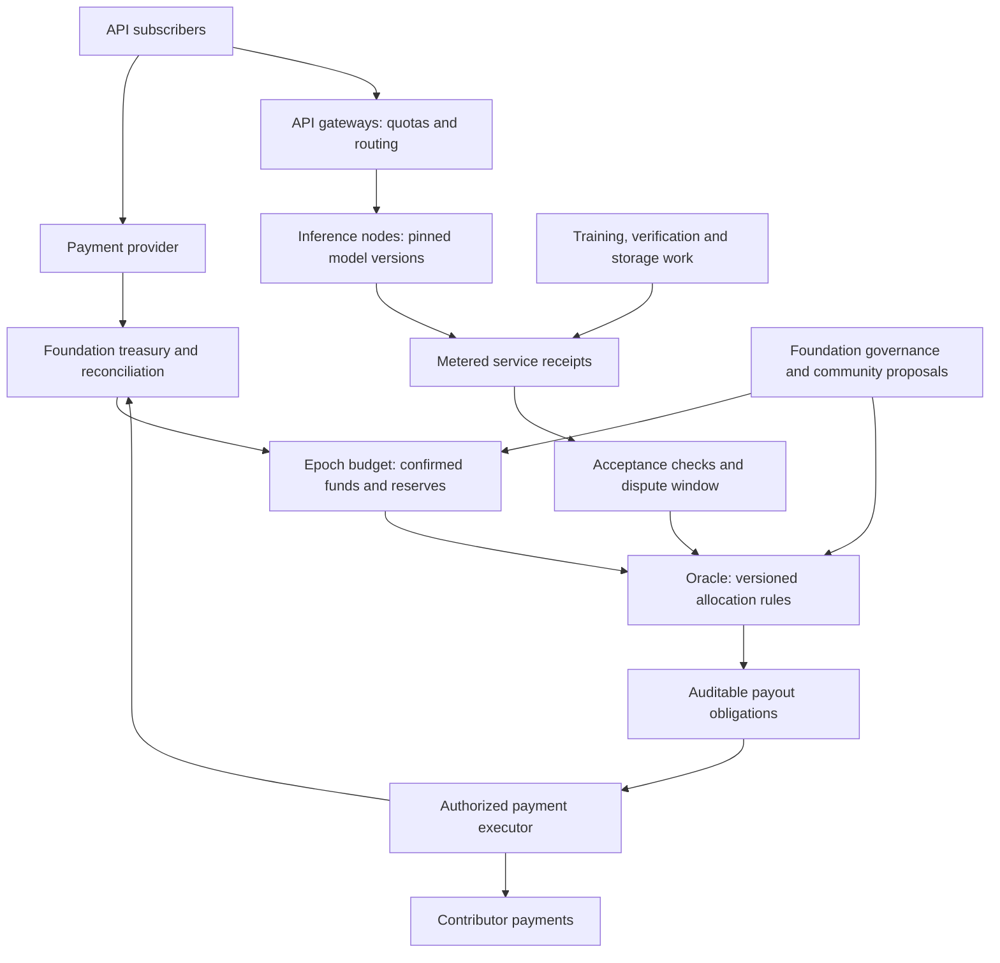

# A foundation supporting a service-funded Collective

Design proposal, 15 October 2026. No payment integration, financial commitment,
token issuance or payout mechanism is activated by this document.

## Purpose and organizational model

Offer paid, tiered API access to open models hosted, trained and fine-tuned by
the network. Service revenue funds a dependable base of node resources,
accepted network contributions and continued development. Customers pay for
available compute, useful models and a documented service; the model artifacts
remain open under their respective licences.

A foundation is the proposed accountable entity for payment contracts, treasury,
infrastructure contracts and necessary administration. The Collective supplies
compute and evidence and participates in technical and funding governance. The
foundation's purpose should protect the open project and publish its allocation
policies, budget decisions and independently reviewable accounts.

For a Norwegian foundation, the regulator describes it as self-owning, without
owners or members with membership rights. Its board remains the supreme
governing body. Consequently, network participation does not automatically
confer legal control: community representation, appointment mechanisms and
delegated spending authority need to be reflected in an appropriate governance
structure. [Stiftelsestilsynet: what a foundation is](https://lottstift.no/for-stiftelser/hva-er-en-stiftelse/),
[foundation governing bodies](https://lottstift.no/for-stiftelser/hvordan-opprette-og-registrere-en-stiftelse/stiftelsens-organ/).

Recurring API sales also make classification of the foundation's commercial
activity relevant. The regulator's guidance provides the criteria; this proposal
does not determine the eventual registration or tax treatment.
[Commercial and ordinary foundations](https://lottstift.no/for-stiftelser/styrearbeid-i-stiftelser/er-vi-en-naeringsdrivende-eller-en-alminnelig-stiftelse/).

Administration can grow with the service: begin with a small board and essential
accounting/operations, introduce paid responsibilities when actual workload and
revenue justify them, and review budgets periodically. Publish administrative
spending separately from node rewards, with explicit authorization limits and
conflict-of-interest procedures. Avoid a rigid percentage that would starve
essential operations during a small pilot or reward bureaucracy at larger scale.

## Proposed architecture

Payment credentials and private customer records stay outside consensus state.
The Oracle records approved budgets, policy versions, opaque receipt references,
allocation results and settlement status. It should not call a payment API from
its deterministic state machine.

A payment adapter verifies provider callbacks, deduplicates events and reconciles
them against provider/account records. Callbacks can be repeated or arrive out
of order, as documented by [Stripe](https://docs.stripe.com/webhooks). A webhook
authentication secret is not a public proof of available bank funds. Independent
reconciliation and appropriately separated authorizers are needed for the
treasury's funding assertions; validator consensus cannot make a false external
funds assertion true.

The first implementation can use a small, versioned accounting state machine in
the existing Oracle. A general smart-contract VM and a tradable token are not
prerequisites. A later contract could execute allocations, but fiat custody,
payment-provider access and disputes still cross an external trust boundary.

## Budget and allocation invariants

For epoch e, define verified available cash C, existing liabilities L, required
reserve H and an approved spending cap K, all in integer minor currency units:

\[
B_e = \max(0,\min(K_e, C_e-L_e-H_e)).
\]

This is a proposed budget constraint, not a revenue forecast. Never count an
unpaid invoice as available funding. Keep currencies separate unless an explicit
conversion transaction has occurred. Refunds, disputes and payment reversals
need reserves and compensating entries; do not erase historical allocations.
Marketplace payment flows can leave refund/dispute costs with the platform,
depending on the charge configuration.
[Stripe's marketplace refund and dispute documentation](https://docs.stripe.com/connect/marketplace/tasks/refunds-disputes).

Allocate this budget among explicitly approved purposes: inference capacity,
baseline network services, training, verification, storage/curation and
administration. Already-booked liabilities must not be allocated a second time.
Scheduled obligations are covered before discretionary research spending.

Within a contribution category r, a possible bounded allocation is:

\[
p_{i,r}=B_r\frac{q_{i,r}}{\sum_j q_{j,r}},\qquad
\sum_r B_r\le B_e.
\]

Use integer rounding with a deterministic remainder rule. An empty category
carries its budget forward. The score q represents accepted, commissioned work
under a published policy, not self-reported FLOPS. Fixed-price job contracts may
be easier to audit than proportional scores for the first implementation. Lock
the rule and maximum job obligation before work starts.

| Role/work | Candidate payment basis | Necessary controls |
|---|---|---|
| Inference | Authorized requests delivered within the model and service contract | Gateway/worker receipts, bounded metering, model identity checks, sampled execution checks, replay and duplicate prevention |
| Training | A commissioned contribution accepted into its specified branch/stage | Data and parent pins, execution verification, bounded job price and separate quality policy |
| Verification | Assigned checks completed with usable evidence, including valid rejection reports | Independent assignment, anti-collusion checks, challenge quality; no bonus for merely approving |
| Storage | Retained, retrievable committed objects over an agreed interval | Ongoing availability challenges, repair obligations and replica diversity |
| Curation | Reviewed data releases or specific commissioned improvements | Rights, deduplication, admission and quality checks; no reward for uploading arbitrary bytes |
| Baseline services and administration | Approved capacity or service contracts | Published budgets, cost review, accountability and conflicts handling |

## Attacks and service constraints to test

Rewarding an approval creates an incentive to rubber-stamp. Rewarding claimed
compute creates an incentive to fabricate work. Rewarding traffic creates an
incentive to send requests to oneself. An attacker must not be able to receive
more network reward by buying its own traffic than the irrecoverable cost of
that traffic. Keep request rewards bounded by authorized customer budget,
including the cost of reserves and required service operations.

Distinct keys are not independent operators. The present single-operator testnet
cannot establish that trainers, verifiers, gateways and payout accounts are
independent. Receipt signatures prove who signed; additional assignments,
audits and governance must address collusion and Sybil identities.

Customers' prompts must not appear on a public ledger. Ordinary hash commitments
can also leak guessable content; use opaque request identifiers and a separately
controlled evidence store, with an explicit privacy and retention design. An
open worker receives the prompts it processes unless a stronger confidential
execution scheme is added. Confidential service tiers therefore need an
explicitly governed serving pool.

Inference and training have different scheduling needs. Reserve baseline serving
capacity and quota subscription tiers by model/cost class, tokens, concurrency
and latency objectives. Admit burst work only against measurable spare capacity.
Train in separately scheduled pools so background experiments cannot consume
promised inference capacity. The initial funding and demand problem remains:
measure the cost of reliable inference plus verification before setting prices
or promising contributor earnings. Grants or donations can fund the baseline
before subscriptions cover it.

## Implementation sequence

1. Benchmark a pinned model behind a local API: latency, concurrency, utilization
   and actual serving cost. Define metering and immutable request identifiers.
2. Add a **simulation-only** treasury journal: epoch budgets, accepted-work
   references, liabilities, allocations and settlement states. No redeemable
   balances or payouts yet.
3. Fault-test duplicated/out-of-order payment events, refunds after allocation,
   duplicate work receipts, self-dealing traffic, conflicting authorizers and
   a payment executor crashing after an external payout but before recording it.
   Exactly-once obligations and idempotent reconciliation are mandatory.
4. Run a foundation-administered limited service with provider sandbox payments,
   a published budget and independent review of the accounting.
5. Enable real subscriptions and bounded payouts only with the agreed entity,
   payment-provider setup and operational responsibilities in place.

The technical target is auditable collective funding with gradual administrative
growth. Formation of the foundation, payment onboarding and actual spending are
separate decisions, not side effects of accepting this design proposal.
