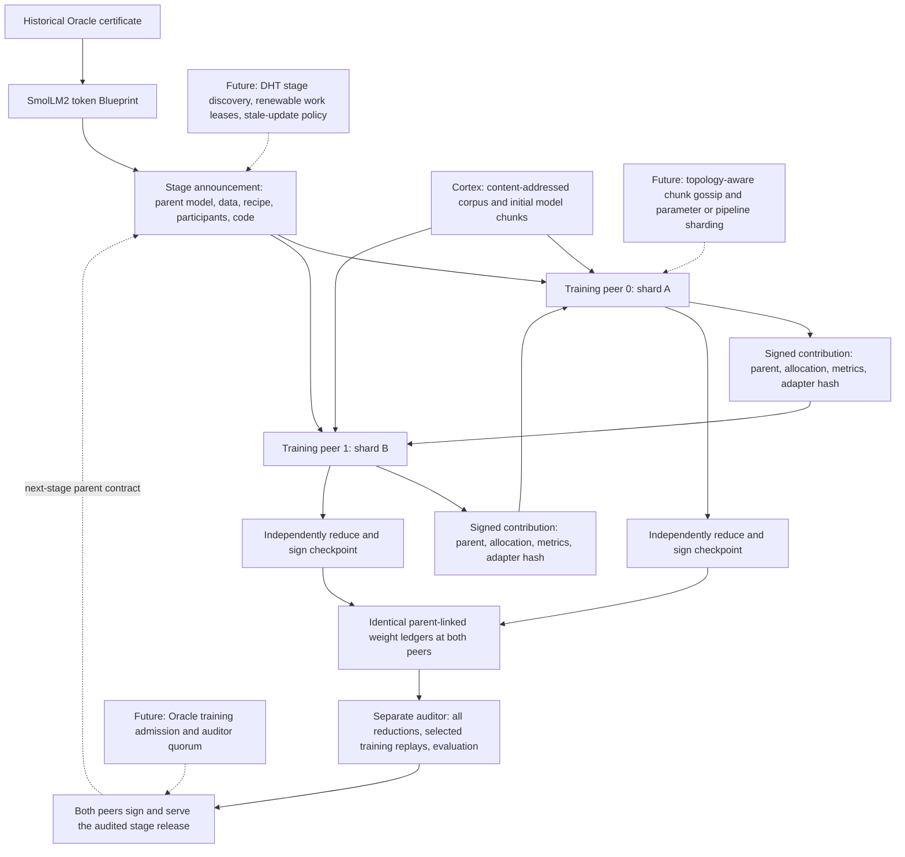

# Training stages and a replicated weight history

This page preserves the first, fixed-roster experiment. The next implementation
is [Oracle-managed training](oracle_training.md), with stage registration,
renewable shard leases, replacement trainers and quorum-recorded checkpoints.
The limitations below describe run 001 rather than the newer protocol.

The first training adapter continues the pinned SmolLM2-135M base model with two
independent training peers. Each peer trains different data, verifies the other
peer's signed contribution, computes the next checkpoint itself and serves a
complete copy of the resulting model artifacts and weight history. There is no
permanent gradient server or sole checkpoint publisher.

This is an admitted local training branch. The existing Oracle chain certifies
its **source token Blueprint**; it does not yet certify these training updates or
promote the resulting model. The training branch uses unanimous participant
signatures, followed by a separate sampled numerical audit and jointly signed
stage release. Results belong in [training-run-001](results/training-run-001/README.md).

## Architecture and stage lifecycle



1. **Announce a stage.** Its content hash pins the certified profile and token
   Blueprint, the entire imported model checkpoint, source/config hashes,
   deterministic data split and order, adapter layout, learning recipe, code
   digest, core runtime versions and participant public keys. Preparation is an
   operator bootstrap action, not an ongoing privileged trainer.
2. **Announce work.** Before every local job, a peer signs its stage, round,
   parent checkpoint, exact allocated windows, optimizer-step count and target
   token count. Assignments are disjoint and deterministic. The prototype uses
   a fixed roster and round allocation, not renewable time-based leases.
3. **Train and publish a candidate.** A durable signed contribution contains
   the allocation, adapter artifact descriptor, loss, device and duration. The
   weights remain available through the peer's bounded hash-addressed service.
4. **Verify and reduce independently.** Every peer verifies identities, stage,
   parent, data assignment, tensor size, finite values and update norm, then
   computes the same weighted mean in a specified order. Each signs that exact
   result. A round enters the local weight ledger only with the full roster's
   matching signatures. These checks alone do not prove the claimed training.
5. **Audit and release.** After the full candidate chain is committed, a separate
   auditor chooses two contributions using a fresh nonce and the committed head.
   It replays their actual forward/backward/optimizer computation, recomputes
   every round's aggregate, verifies both replicas and repeats evaluation. Both
   peers then sign and publish a release binding the audit and composite model.

Updates and round records are immutable files. A restarted peer reuses its
durable contribution and re-verifies the earlier chain; it does not retrain that
allocation or invent a new parent. A missing participant pauses the round.
Unanimity provides an understandable safety baseline but poor availability;
membership changes and timeout recovery need an explicit later protocol.

## Data and executable model

The source is the existing 13-book SmolLM2 Blueprint. Book 1342 is held out for
validation and book 84 for testing. Eleven books supply training windows. The
split prevents overlap within this experiment; it cannot establish that the
imported base model never saw those books during pretraining.

Each window contains at most 128 next-token targets from one Frag. Targets are
shifted exactly once, padded positions are excluded from loss, and windows never
cross a Frag or book. No chat template, BOS/EOS insertion or new tokenizer is
introduced. A deterministic hash order distributes selected windows across peers.

The pilot stage specifies 32 rounds, four local SGD steps per peer per round,
and two sequences per step: 128 optimizer steps per peer and 512 distinct
training windows overall. This is a **bounded partial corpus pass**, not an epoch
over the full corpus. Evaluation uses 16 pinned windows in each split, with no
hyperparameter tuning against their results. These small checks measure the
pipeline; they are not a general model-quality benchmark.

The complete pinned pretrained checkpoint is verified before loading through
the installed Llama implementation. Missing or unexpected tensors are rejected,
except the documented tied output-head alias. Remote model Python and pickle
checkpoint loading are not used. The imported pretraining history remains an
explicit unverified boundary.

## Update mathematics and communication

For each adapted query/value projection, use

\[
W_{\mathrm{effective}} = W_0 + (\alpha/r)BA,
\quad r=8,\quad \alpha=16.
\]

The base weights \(W_0\) and shared random projection \(A\) are frozen. Only
\(B\) is learned. This fixed-A construction follows the general idea described
in [LoRA-FA](https://arxiv.org/abs/2308.03303); the present implementation uses
plain SGD, not the paper's complete optimizer or experimental setup.

At round \(t\), every peer starts with the same \(B_t\), performs four local
steps and publishes \(B_{t,k}\). With \(n_k\) valid targets in that allocation,
every peer independently computes

\[
B_{t+1} = \operatorname{FP32}\left(
\sum_{k=1}^{K}\frac{n_k}{\sum_j n_j}
\operatorname{FP64}(B_{t,k})\right).
\]

Participants are accumulated in their pinned order. Because A is fixed,
averaging B also averages the effective low-rank weight changes algebraically.
This avoids the cross-term issue of independently averaging both learned LoRA
factors. Floating-point execution still follows the explicit rounding contract.
Several local steps followed by averaging are local SGD; they are not generally
equivalent to one optimizer operating on the combined global batch. See the
[original communication-efficient averaging work](https://arxiv.org/abs/1602.05629).

There are 184,320 trainable FP32 values, or **737,280 bytes per contribution**.
All base weights and fixed projections are fetched once and cached. Peers exchange
adapter payloads and signed metadata each round. A composite checkpoint consists
of the immutable base, fixed projection, final adapter, configuration and recipe;
another node can load it without requiring a designated publisher to merge and
upload a full model file. The input embedding stays frozen in this first adapter.

## What BitTorrent-like scaling does and does not provide

Content addressing, bounded pieces, deduplication and multiple replicas make
artifact distribution independent of a single origin. The pilot deliberately
stops the original Cortex before the cold auditor downloads its inputs, so the
training peers must also serve the base model, data and training artifacts.

The current two-peer exchange is full mesh. Its all-to-all traffic and redundant
full reduction will not scale indefinitely. The next measurements should compare
ring/tree exchange, gossip, piece scheduling and additional replicas. Peers need
independent identities, admission policies, availability records and transport
authentication before this becomes an Internet-facing training network.

Training coherence is a separate problem from distributing bytes. Unrelated
parents, stale gradients, differing optimizer states and mixed tokenizers cannot
be merged merely because their artifact hashes are valid. Asynchronous training
needs an explicit staleness rule and reproducible acceptance policy, or separate
candidate branches. The existing profiles already provide tokenizer/model
namespaces; a later stage can attach training work to those network namespaces.

Data parallelism is the first implemented distribution axis. Model, tensor,
pipeline and optimizer-state sharding remain experiments: they trade per-node
memory for activation/gradient communication and tighter coordination. They
should be measured against WAN latency and heterogeneous hardware before being
selected for the Collective. Adding participants must not be claimed to provide
linear training throughput without measuring it.

## Trust and hardening

- Both trainers and the auditor are operated locally. Distinct keys and process
  boundaries exercise the protocol; they are not independent administrative trust.
- The two training containers share one physical GPU. This tests distributed
  work and publication semantics, not multi-machine speedup or WAN reliability.
- Exact numerical replay currently assumes the pinned implementation, runtime
  and matching GPU behavior. Broader heterogeneous execution needs declared
  tolerances and semantic checks rather than an assumed universal bitwise result.
- Two sampled replays do not prove all contributions. If m of N updates are bad
  and two are sampled uniformly without replacement, detection probability is
  \(1-\binom{N-m}{2}/\binom{N}{2}\). A local nonce is not distributed randomness.
- Norm limits and signatures do not prevent subtle poisoning, collusion or
  copied work. Future acceptance needs multiple auditors, unpredictable
  challenges, held-out evaluation policies and explicit attribution of equivocation.
- The auditor key is a fixed stage trust input. It is a temporary acceptance
  bottleneck to replace with a policy-defined auditor quorum; no economic reward
  or slashing mechanism is enabled.
- The branch's unanimously signed release is separate from Oracle-certified
  production model admission. Existing validator histories and runtime pins are
  preserved. Integrating stages, claims, audit policy and releases into Oracle
  requires a versioned state-machine upgrade and adversarial tests.

## Run locally

`Dockerfile.training-runtime` pins PyTorch 2.11.0/CUDA 12.8, Transformers 5.19.0,
Safetensors 0.8.0 and the existing tokenizer runtime. The training image adds the
new source code without modifying historical node images.

```powershell
wsl -d kali-linux -u root -- podman build -f Dockerfile.training-runtime -t localhost/hypertrix-training-runtime:v1 .
wsl -d kali-linux -u root -- sh scripts/training_pilot.sh build
wsl -d kali-linux -u root -- sh scripts/training_pilot.sh prepare
wsl -d kali-linux -u root -- sh scripts/training_pilot.sh start
# Peer 0 deliberately exits after its durable round-1 contribution.
wsl -d kali-linux -u root -- sh scripts/training_pilot.sh status
wsl -d kali-linux -u root -- sh scripts/training_pilot.sh resume
# Wait for both public final.json files, then run a cold independent auditor.
wsl -d kali-linux -u root -- sh scripts/training_pilot.sh audit
wsl -d kali-linux -u root -- sh scripts/training_pilot.sh export
.venv\Scripts\python.exe scripts/verify_training.py
wsl -d kali-linux -u root -- sh scripts/training_pilot.sh stop
```

Each node has its own volume under `/var/lib/dawl/training-001/state`. Only public
bootstrap files and that node's own key are mounted into its process. Corpus and
model artifacts are pulled over HTTP. Reproduction requires the preceding local
profile testnet public store and pinned SmolLM2 checkpoint. Use new directories,
identities and destinations for a new stage; existing evidence is not overwritten.
