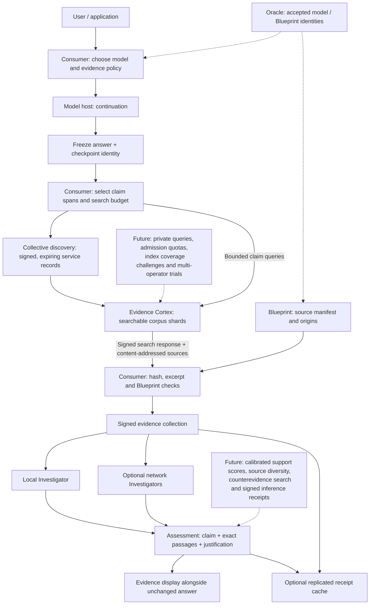

# Evidence retrieval and assessment in The Collective

The consumer owns an evidence investigation associated with an unchanged model
answer. Cortex peers supply searchable, committed source material. An Investigator
uses that material to explain which claims it supports, contradicts or leaves
unresolved. The Investigator may run beside the consumer or as a separate network service.

This design adds a network capability without changing a model's training or
injecting retrieved text into its generation context. The same interface can
later support retrieval before generation as an explicitly different mode.

The [first live trial](results/evidence-network-001/README.md) indexed 145,011
training documents and independently verified saved evidence collections from
a real Seed III continuation and two labeled controls.
The [Investigator trial](results/investigator-001/README.md) adds a discovered,
CPU-only semantic assessment service, signed judgments and draft bilingual
evaluation. [Four actual Seed examples](results/seed-architecture-samples-001/README.md)
show its retrieved passages and unedited outputs.

## Responsibilities and flow



The Oracle certifies versions and agreed records; it need not approve each search
or inference. A consumer can continue during an evidence-provider outage and
show the investigation as incomplete. Missing evidence is distinct from a false
claim. Retrieval and assessment are asynchronous jobs; neither blocks token
generation. Failure to complete an assessment must not inherit a previous pass.

The protocol separates physical machines from roles. One machine can host a
consumer and an Investigator, or serve both model weights and an evidence index.
Each service still has its own limits, identity and observable work.

## Placement alternatives

| Mode | Assessment runs at | Benefit | Cost / constraint |
|---|---|---|---|
| Consumer-led, preferred first step | Consumer's chosen agent | Direct control over policy; full answer can remain local | Consumer supplies assessment compute |
| Delegated | Admitted Investigator | Lightweight clients; specialist evaluators | Selected claims and evidence leave the consumer; evaluator identity and method must be pinned |
| Multiple Investigators | Several independently operated Investigators | Exposes disagreements and evaluator-specific errors | More work; agreement among correlated models is not independent evidence |
| Reusable assessments | Consumer checks cached receipts | Repeated public claims can avoid repeat work | Cache must bind claim context, source versions, evaluator, policy and calibration; time-sensitive claims expire |

Independent assessment work is naturally parallelizable by claim or source
group. Corpus search can shard by Blueprint, language or domain and replicate
hot shards. A global total ordering of inference requests is unnecessary.
Receipt publication is opt-in: private prompts and answers never belong in the
public ledger by default.

## What each record means

1. **Retrieval candidate:** a passage ranked by a search method. Ranking helps
   select work; it is not a probability of correctness or support.
2. **Verified passage:** the fetched UTF-8 document hashes to the committed
   source identity, and the excerpt matches exact Unicode codepoint offsets.
3. **Blueprint membership:** a source-manifest entry is bound to the pinned
   Blueprint. The entry includes origin, revision, split and rights metadata.
4. **Training exposure:** a separate check must map the passage's token range to
   scheduled windows consumed before the selected checkpoint. Membership alone
   does not establish exposure; a scheduled book can be only partly consumed.
5. **Semantic assessment:** an evaluator states support, partial support,
   contradiction or insufficient evidence, quoting the relevant passages and
   explaining the relationship. This is an external justification.
6. **Estimated training influence:** a separate experimental claim, requiring
   validated influence methods or controlled training interventions.

Source authenticity, source reliability/currentness and inference correctness
remain separate measurements. A signed outdated source stays outdated. Ten
replicas of one source count as one source for corroboration.

For claim `c`, evidence `E` and fixed assessment policy `p`, the intended support
score is an empirically calibrated estimate of

\[
\hat{s}=\widehat{P}(Y=\text{supported}\mid c,E,p).
\]

It does not estimate which training document caused an output. Calibration uses
independently labeled, held-out claim/passage pairs, with source-family splits,
English/Norwegian checks, negations, plausible wrong claims and omitted context.
Measure citation precision, claim coverage, missed contradictions, abstention,
reliability by confidence band, Brier score, latency and transferred bytes.
Semantic confidence must remain absent until a calibration artifact and its
applicability are established. The first implementation returns `null`.

## Implemented foundation

`src/dawl_evidence` provides CPU-only index building, a network source service,
DHT discovery, consumer collection and offline evidence verification. It uses
the existing Ed25519 envelope and Blueprint format; there is no new consensus
engine or economic mechanism.

* SQLite FTS5/BM25 indexes deterministic source passages. The index manifest
  records its source commitments, split scope, method, SQLite version and hash.
  The default scope is training documents; validation/test text is excluded.
  Search policy 2 separately records its version, removes fixed English/Norwegian
  function words and selects at most twelve distinct content terms. This bounded
  lexical baseline is not yet semantic/hybrid retrieval.
* `/catalog` describes the signed index, `/search` returns signed candidates,
  and `/sources/{sha256}` serves a complete normalized source object. Consumers
  independently hash it and check excerpt offsets. Large books are fetched in
  full in this first version; authenticated chunk proofs are a future bandwidth
  optimization. A provider's signature establishes who returned a ranking,
  rather than proving search completeness.
* Lab peer schema 3 extends the existing signed, expiring discovery records with
  `CONSUMER`, `EVIDENCE_PROVIDER` and `EVIDENCE_ASSESSOR` (Investigator) roles. The evidence route
  is port 8914; discovery stays on 8913. `profiles` advertises Blueprint hashes.
  Schema 4 adds the implemented Investigator route on port 8915 and signed
  evaluator/policy capability digests. Older schema-3 reserved advertisements
  remain readable but do not advertise an assessment endpoint.
* Consumers pin both the Blueprint and admitted service keys. A discovered role
  is not authorization. URLs must fall within the pinned private network policy;
  redirects are disabled. Request sizes, result counts, search execution,
  concurrent searches and response sizes are bounded.
* A collection binds an answer hash, selected claim spans, caller-supplied
  checkpoint identity, queries, provider replies, verified excerpts and failures.
  The exact original answer remains separate. The current checkpoint association
  is explicitly `consumer_asserted`; a signed inference receipt is the next
  binding needed to authenticate the model host's generation assertion.
* Every candidate remains `semantic_support: not_assessed`,
  `training_exposure: not_checked`, `training_influence: not_assessed`.
  There is no support badge or numeric probability produced by lexical search.
* `verify` checks a saved collection offline against the answer, consumer key,
  Blueprint and source objects. It checks nested signatures and rederives exact
  excerpts and provenance rather than trusting signed verdict fields.
* The Investigator rechecks that collection and its source objects before
  running a pinned multilingual NLI model. It signs a separate assessment;
  retrieval records and original answers remain unchanged. Support and
  contradiction use a frozen 0.90 threshold and 0.20 margin. Complete pairs
  exceeding 512 evaluator tokens abstain without truncation. Scores are raw
  model outputs; confidence and calibration remain null.
* Signed assessment requests require an admitted consumer key, a fresh nonce,
  evaluator/policy pins and bounded size. One CPU inference request executes at
  a time. Requests cannot select a model or source-server URL. Each receipt
  binds the answer, collection, Blueprint, checkpoint assertion, passages,
  evaluator/runtime/implementation and policy. Receipt verification checks
  signatures and policy arithmetic; semantic replay is a distinct operation.

The trial adds separate CPU containers; it does not modify Seed III's running
training recipe, frozen source or model studio. Peer-schema-3 nodes discover one
another in a separate pair. Older deployed schema-1/2 mesh processes require an
explicit upgrade before they can route these new role records.

## Running the first trial

From this repository in the current WSL lab:

```sh
sh scripts/evidence_trial.sh
```

This prepares `/var/lib/dawl/evidence-001`, indexes the current Seed III training
split and starts an Evidence Cortex on `127.80.0.13:8914`, with discovery peers
on `127.80.0.13:8913` and `127.80.0.14:8913`. The script freezes a source snapshot
for the trial and reuses completed artifacts; choose a new trial root for changed
code/data. No public firewall changes are made.

The commands below also run through the lab's CPU runtime, with the repository
`src` on `PYTHONPATH`. Supply real paths and pins from your chosen model package.

```sh
python -P -m dawl_evidence index --dataset DATASET --corpus CORPUS \
  --index NEW_INDEX --blueprint BLUEPRINT_SHA256

python -P -m dawl_evidence serve --dataset DATASET --corpus CORPUS \
  --index INDEX --blueprint BLUEPRINT_SHA256 --identity PROVIDER_IDENTITY \
  --bind 127.80.0.13

python -P -m dawl_evidence collect --dataset DATASET --blueprint BLUEPRINT_SHA256 \
  --identity CONSUMER_IDENTITY --network NETWORK_JSON --network-id NETWORK_SHA256 \
  --discovery http://127.80.0.14:8913 --admit PROVIDER_PUBLIC_KEY \
  --answer ANSWER_JSON --output NEW_RECEIPT_JSON

python -P -m dawl_evidence verify --dataset DATASET --blueprint BLUEPRINT_SHA256 \
  --corpus CORPUS --answer ANSWER_JSON --receipt RECEIPT_JSON --consumer CONSUMER_PUBLIC_KEY
```

The answer JSON contains `text`, `checkpoint` (SHA-256), and `claims`, a list of
`{"start":0,"end":42}` selections into that exact text. An agent can provide
these selections; automatic claim decomposition is not implemented here. Select
at most eight claims per collection. Only selected claims are sent for search,
although they can themselves contain private material. Service access logging
is disabled. The CLI writes a receipt only to the explicitly chosen output.

## Next experiments and hardening

The pinned NLI adapter and a 48-pair draft diagnostic are implemented. The next
step is independent annotation and a representative support/contradiction
benchmark, including full retrieved passages and incomplete continuations.
The first live positive control abstained despite containing an explicit
supporting sentence; this is an observed quality gap. Future evaluators should combine exact quotations with
textual entailment checks, explicit counterevidence queries and executable
checks where relevant. Corpus passages are inert, untrusted data: instructions
embedded in a passage must never grant tool privileges or alter assessment policy.

Compare lexical retrieval with semantic/hybrid retrieval on that benchmark.
Then compare local assessment, one delegated evaluator and independent evaluators,
reporting both accuracy and resource use. Preserve disagreements rather than
turning a count of matching signatures into a truth certificate.

Further deployment work includes authenticated transport and query admission,
rate limits across identities, source-group diversity, poisoning tests, malicious
omission/coverage challenges, authenticated small-fragment transfer, receipt-cache
invalidation, and multi-operator/WAN trials. Pinned evaluator/runtime/policy
identities are recorded in current assessment receipts. Independently validated
calibration-set versions remain a future extension.
Publication and rewards remain separate policy decisions.

For Yngvar's study, keep the advice wording fixed and the documentation varied.
These records can later feed the separate study UI. The primary question is
whether participants better distinguish supported and flawed advice; increased
trust in all answers would not establish that result. This change does not alter
the study, collect participant responses or revise its approved scenarios.

## Related research

* [RARR](https://aclanthology.org/2023.acl-long.910/) investigates evidence after
  generation and then revises answers. This design preserves the original answer
  and exposes an independently inspectable evidence layer.
* [ALCE](https://aclanthology.org/2023.emnlp-main.398/) evaluates correctness and
  citation quality, providing useful baselines for assessing this layer.

The research opportunity is the combination of measured evidence assessment with
verifiable source membership, training records and independently repeatable
checks. Post-generation source retrieval itself is established prior work.
