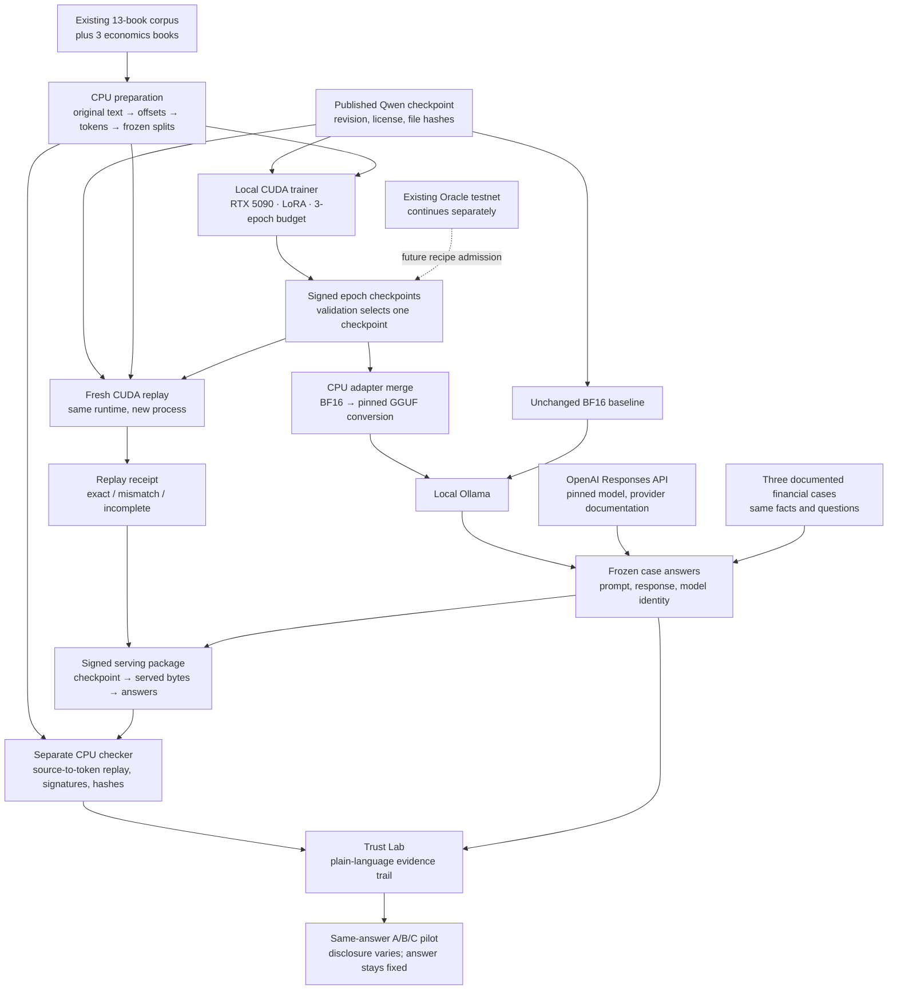

# Local economics adaptation and trust lab

This experiment continues official **Qwen/Qwen3-0.6B** weights on the existing 13-book corpus plus Adam Smith's *Wealth of Nations* (Gutenberg 3300), David Ricardo's *Principles* (33310), and Walter Bagehot's *Lombard Street* (4359). It is a separate local calibration branch. The existing Oracle testnet remains operational, but it does not certify this new training recipe.

## Execution and evidence flow

The roles run as separate processes; the trainer and replay verifier use separate containers. Training replay is sequential because they share the same physical GPU. This pilot validates a local recipe and its evidence path. It does not distribute this Qwen job across independent machines. Admission of this recipe to Oracle leases, verifier diversity, public artifact availability and stronger serving attestation are subsequent integration work. The local lab binds to loopback and does not expose its credential endpoint publicly.

## Reproducible inputs

The baseline is pinned to Hugging Face revision `c1899de289a04d12100db370d81485cdf75e47ca`, under Apache-2.0. The original model, configuration, tokenizer and license are hashed. The model provider's [card](https://huggingface.co/Qwen/Qwen3-0.6B) and [technical report](https://arxiv.org/abs/2505.09388) describe its development; this experiment does not establish complete upstream pretraining lineage.

Original Gutenberg bytes and rights metadata are preserved. Training derivatives exclude the Gutenberg wrapper using recorded byte offsets. Each book is divided into roughly 24 KB contiguous segments. A stable hash ranking assigns approximately 80% to training, 10% to validation and 10% to testing, with at least one segment in each holdout. We discard 128 tokens at each segment boundary, then form non-overlapping 513-token windows with 512 next-token targets. Exact duplicate windows are removed globally. This prevents direct window overlap but does not eliminate repeated prose or overlap with Qwen's pretraining.

The resulting training set contains **3,647 windows / 1,867,264 next-token targets per epoch**: 581,120 economics targets and 1,286,144 literature targets. Validation and test subsets are fixed before optimization. Each reported domain NLL uses the first 64 frozen windows, or 32,768 target tokens. This is a bounded descriptive evaluation, not a population-level estimate of economic knowledge.

## Optimization and selection

The RTX 5090 Laptop GPU runs CUDA through WSL. The base weights remain frozen. LoRA trains both factors A and B at rank 16, alpha 32, over attention q/k/v/o and feed-forward gate/up/down projections. There are 10,092,544 trainable parameters. The model uses BF16 base computation with FP32 trainable adapters and AdamW state, SDPA attention, a batch of four sequences and four accumulated microbatches. Learning rate is 1e-4, with 3% warmup and cosine decay to 10% of the starting rate, weight decay 0.01 and gradient clipping at norm 1.

For a frozen linear map W, the adapted map is:

\[
y = (W + (\alpha/r)BA)x.
\]

Each optimizer update averages losses over its actual microbatch sizes, including the final smaller group. The objective is next-token negative log likelihood:

\[
L(\theta)=-\frac{1}{N}\sum_t\log p_\theta(x_t\mid x_{<t}),\qquad \mathrm{PPL}=e^L.
\]

The plan allows three epochs, subject to the user's two-hour GPU budget. A runtime timeout also bounds the process. Checkpoints are saved at each completed epoch, or a safe partial-epoch boundary near the budget. Selection minimizes economics validation NLL while requiring literature NLL no worse than 1.15 times the baseline. If none qualifies, the selected model remains the baseline. Test results and the 18 fixed multiple-choice probes do not select checkpoints.

The main run is continued language-model training on books, not supervised financial-advice instruction tuning. A lower NLL does not establish improved financial advice. Fixed closed-book probes and sampled explanations provide additional descriptive evidence. Since the books may already have appeared in pretraining, even improved factual answers cannot prove first-time acquisition of their contents.

A separate synthetic codebook adapter tests acquisition of invented station-to-color associations with held-out question wording. It never enters the economics checkpoint or financial study. Its exact-match score measures a small memorization task, not general reasoning.

## Verification boundaries

The local experiment ledger signs source and dataset commitments, recipe, baseline results, checkpoint artifacts and merged exports. Its operator public key is:

`3eedb69bceac39ca67320c3a6d704fe12dc4462cac7a56171ab804f2bc3ec537`

`scripts/verify_finetune.py` is a separate CPU artifact checker. It rechecks the Ed25519 chain, source bytes, base files, derivative offsets, dataset commitments, non-overlap, duplicate windows and checkpoint/export hashes. It does not trust the trainer's claim that those hashes match.

The checker also independently tokenizes every preserved source segment with the frozen tokenizer and compares every token ID with the stored training and holdout windows. Once serving is ready, `scripts/seal_finetune.py` signs a package connecting the actual GGUF files, Ollama digests, case definitions and nine frozen model responses to the same local lineage. This is an operator attestation made after serving; it is not an independent timestamp service. Artifact verification checks that package and its response-to-model links.

`scripts/replay_finetune.py` separately reconstructs the optimization from the baseline in a fresh container. It compares every tensor in each published economics adapter. **Exact equality is the pass condition.** Numerical distances are reported on mismatch, not treated as an implicit tolerance policy. Replay is bounded by the original GPU deadline. A partial or failed replay must remain labelled as such.

The same machine, runtime and operator perform this replay. It is computational replication, not an independent institution, proof of human identity, cross-hardware reproducibility, or Oracle certification. Neither kind of verification proves that an answer is financially correct or identifies which training passage caused it.

## Local serving and real case comparison

The model is merged and converted to BF16 GGUF with llama.cpp commit `6868a52cb337450658006ad2f9281c2eb63f1666`. Both baseline and adapted checkpoints use the same conversion path. Ollama model digests and GGUF hashes identify the served artifacts. The converter runs separately from the training runtime because its tokenizer dependencies differ.

The [Trust Lab](http://127.0.0.1:8885/) has four views: model comparison, trust experiment, live training evidence and exploratory checkpoint chat. It links from the [Collective Console](http://127.0.0.1:8882/). The fine-tuning process and replay verifier appear in the console with explicit labels indicating their scope outside Oracle state.

Three real, public financial situations are frozen in `research/finance-trust-cases-v1.json`: published Norwegian green-mortgage examples, Norges Bank's June 2025 policy-rate reduction, and the March 2023 SVB deposit intervention. Every model receives exactly the same dated facts and question. No private customer data is used. These cases are evaluation material and are not added to the training corpus.

The comparison uses the unchanged Qwen baseline, the selected local economics checkpoint and OpenAI's pinned `gpt-5.4-mini-2026-03-17` through the [Responses API](https://developers.openai.com/api/reference/python/resources/responses/methods/create). API requests have no retrieval tools and set `store=false`. Local requests use Ollama with thinking disabled, fixed sampling settings and a recorded seed. Runtime differences are recorded; a seed does not imply identical sampling across engines.

Responses are generated once, stored without rewriting, and hashed with the exact prompt, case and model metadata. Errors do not produce substitute answers. Truncation metadata is retained. Exploratory chat is kept separate from study records.

Both local models generate the frozen case answers on CPU using the same Ollama settings. This keeps the training/replay GPU available and preserves the baseline's execution placement. Exploratory chat can use the GPU after replay has stopped. BF16 merging is a derived serving step: the adapter update is rounded into base-weight precision, so the served merged model is recorded separately from the FP32 adapter used during evaluation and replay.

PEFT 0.21.2 safe merge uses two rounding points: `BF16(BF16(W) + BF16((alpha/r) * FP32(B) @ FP32(A)))`. The separate CPU script `verify_finetune_merge.py` recomputes this arithmetic and checks every exported tensor, including unchanged weights. This distinction matters: a single final rounding computes different bytes. The conversion view uses the original frozen tokenizer/config because the training runtime's newer tokenizer serialization is incompatible with the pinned converter runtime. Original signed exports remain unchanged.

OpenAI keys come from a local environment variable or Windows DPAPI storage under ignored `secrets/`. Keys are not put into prompts, response records or public evidence. The local server enforces loopback hosts and a per-session request token. Its conservative API reservations stop at USD 0.25. This is a small local pilot, not a hardened internet deployment.

## Two distinct human-trust comparisons

The three-model comparison shows real differences in advice and available provenance, but also changes capability, model size and training. It cannot isolate a causal provenance effect.

Yngvar's controlled design keeps a **single generated Hypertrix answer identical** across randomized conditions:

- **A — no training disclosure:** evaluate the advice alone.
- **B — developer declaration:** show the developer's description of the local development process.
- **C — checkable documentation:** show the same description, plus the actual artifact and verification records.

Condition C is gated on successful artifact verification. Full-training replay is disclosed separately, including failure or incompleteness. The label must never imply that the complete pretraining corpus is known or that provenance certifies the advice.

Participant text describes sources, processing, training, checks and the served model in ordinary language. It does not introduce advice disclaimers as a warning intervention or claim that documentation should increase trust. The detailed local trail begins at the published Qwen checkpoint; earlier development is represented by the provider's documentation. Clickable steps show actual checked, recorded, declared or pending status. Technical details remain available in a separate inspector. This wording and presentation still require a comprehension pilot before a formal study.

A separate blind-then-reveal pilot records trust before and after inspecting provenance. That design is useful for interface testing but is vulnerable to order and demand effects. It is not a replacement for a randomized controlled study.

The interface records trust, intended reliance (follow/check/reject), decision text, confidence and responsibility attribution. It executes no financial transaction. Advice quality and decision quality are deliberately left unscored until domain experts review the real outputs against the frozen case rubrics. The original proposal also calls for research questions, ethics, participant comprehension, power analysis and analysis plans to be led with Yngvar. No participants have been recruited through this tool.

## Operator entry points

The native experiment directory is `/var/lib/dawl/finetune-economics-001` in `kali-linux`. Runtime images and completed runs are preserved. Source scripts refuse to overwrite immutable artifacts.

- `scripts/finetune_pilot.sh`: acquisition, build, prepare, train, export and status. Run 002 is a compatibility repair after run 001 failed during baseline tokenization, before optimization; the original GPU deadline is preserved.
- `scripts/finetune_replay.sh`: launch bounded fresh-process replay after training/control completion.
- `scripts/finetune_awake.py`: Windows process-scoped system/display keep-awake request, released at replay completion or the original GPU deadline. It does not edit the power plan or override explicit sleep/lid policies. Start it on the host for long laptop runs; Windows Modern Standby can otherwise stall WSL/CUDA despite an active container.
- `scripts/verify_finetune.py`: artifact verification with an explicitly pinned operator public key.
- `scripts/finetune_convert.sh` and `scripts/finetune_register.py`: exact checkpoint conversion and local Ollama registration.
- `scripts/trust_lab.py`: local study/comparison server; `scripts/generate_trust_cases.py` captures actual model responses.

Completed measurements and any failures belong in the run report, not in this methodology document as anticipated results.

The subsequent [repeatability investigation](results/finetune-repeatability-001/README.md)
tests attention backends and strict execution settings in separate short runs.
New schema-2 recipes can opt into these policies; the original schema-1 pilot
and its verification outcome remain preserved. See the
[training verification design](training_verification.md) for the next validation gates.
