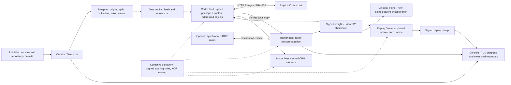

# Seed III and the home training lab

Seed III is a new generative pretraining experiment: a 125,857,536-parameter
causal decoder trained from random weights on a broader English, Norwegian and
code corpus. The lab separates data preparation, training, replay, storage,
discovery and inference into independent processes/containers. The existing
Seed I/II models and Oracle training experiments remain available.

## Model design

| Component | Seed II | Seed III |
|---|---:|---:|
| Dense parameters | 40.6 million | 125.9 million |
| Decoder layers | 12 | 18 |
| Residual width | 512 | 768 |
| Query / key-value heads | 8 / 8 | 12 / 4 |
| SwiGLU intermediate width | 1,408 | 2,048 |
| Context | 512 tokens | 1,024 tokens |
| Byte-level BPE vocabulary | 4,096 | 16,384 |
| Normalization / positions | RMSNorm / RoPE | RMSNorm / RoPE |

Both generations already use generative pretraining: predict the next token from
the preceding tokens, with a causal attention mask. Seed III increases capacity,
context and vocabulary and changes the training mixture. It uses tied input/output
embeddings and scales residual output initialization by `1/sqrt(2L)`.

Grouped-query attention shares each key/value head among three query heads.
The KV cache is one third the size of a twelve-KV-head implementation at the same
width and context. This is principally an inference/cache benefit. The measured
training improvement came from compilation, not from assuming GQA is faster.
See the [GQA paper](https://arxiv.org/abs/2305.13245) and
[PyTorch SDPA](https://docs.pytorch.org/docs/2.11/generated/torch.nn.functional.scaled_dot_product_attention.html).

The next-token objective is

\[
L(\theta)=-\frac{1}{N}\sum_{i\in\text{nonpadding targets}}
\log p_\theta(x_i\mid x_{<i}).
\]

Documents never share an attention window. Consecutive windows overlap by one
token, so their prediction targets do not overlap. Padding is excluded from the
loss. Microbatches contribute in proportion to their nonpadding target counts,
not equally regardless of length. For `W` DDP ranks, each rank's local objective
is multiplied by `W/N` before DDP averages gradients. Thus uneven document lengths
still represent the intended global token-weighted objective.

The optimizer is AdamW with FP32 master weights and moments, betas `(0.9, 0.95)`,
weight decay `0.1`, gradient clipping at norm `1`, 5% warmup and cosine decay to
10% of the initial learning rate. BF16 forward/backward uses FlashAttention;
held-out evaluation uses FP32 math attention. Compilation is part of the pinned
recipe. A trained continuation model is not automatically an instruction/chat
model; instruction tuning and its evaluation would be a separate stage.

## Curated corpus

The reviewed acquisition contains **162,497 documents** and approximately
**724 million Unicode characters** before tokenization. The Blueprint records
the actual token counts, so characters are not treated as tokens.

| Domain | Documents | Requested share of training targets |
|---|---:|---:|
| Gutenberg fiction | 54 | 20% |
| Gutenberg nonfiction | 24 | 10% |
| English / Simple English Wikipedia | 84,683 | 25% |
| Norwegian Bokmål / Nynorsk Wikipedia | 65,620 | 20% |
| Norwegian parliamentary speech | 3,898 | 2.5% |
| Historical Norwegian literature | 378 | 2.5% |
| Public source code | 7,840 | 20% |

The schedule balances **actual prediction targets**, not files or padded windows.
Each domain is shuffled without replacement before cycling. `schedule.json`
records total presentations and unique windows/targets separately. Smaller
domains can repeat more often; validation by domain makes that visible.

Sources and acquisition rules:

* Gutenberg: pinned catalog/RDF/text downloads, English editions, known contributor
  death dates no later than 1945, removal of distribution boilerplate, and manual
  review of title/domain assignments and duplicate editions. This is a documented
  selection rule; the source metadata is retained for review.
* [Wikimedia's Wikipedia dataset](https://huggingface.co/datasets/wikimedia/wikipedia):
  2023-11-01 dump, revision `b04c8d1ceb2f5cd4588862100d08de323dccfbaa`.
  English is a bounded sample of two shards; all three selected Norwegian shards
  contribute. Article URLs, revision/history links, dump identity, dataset license
  declaration and downloaded-file hashes are retained. The dataset declares
  CC BY-SA 3.0 / GFDL. These are attributed web documents, not an unlicensed
  general web scrape.
* [NPSC, Nasjonalbiblioteket](https://www.nb.no/sprakbanken/ressurskatalog/oai-nb-no-sbr-84/):
  CC0 parliamentary speech transcriptions from 2017–2018, repository revision
  `e906435cc445e38961d86f3ebf53a7b38603b903`. Consecutive original speaker turns
  are assembled from normalized sentence text. Audio and machine translations
  are not ingested. The upstream meeting splits are retained.
* Historical Norwegian sources retain the prior Seed II source and split records.
* The owner's public `drcircuit` repositories were refreshed at pinned commits.
  The acquisition lock lists 99 repositories: 93 candidates, three empty and three
  needing rights review. Generated outputs and detected secret-like text are
  filtered; repositories awaiting rights review are excluded. Source is handled
  as inert text, never executed during ingestion.

The previous intake already covered the eligible public repository files. This
refresh added no new file identities: it retained 7,840 files after stricter
filtering, removed 343, and changed 6,286 normalized text hashes. Those changes
are largely normalization and are not counted as thousands of new source files.
Additional formats such as C# views, Bicep, shaders and notebooks are candidates
for a subsequent reviewed Blueprint; they are not silently added to this run.

Exact normalized duplicates are removed. Training documents with over 20% exact
long-paragraph overlap with held-out documents are excluded. Whole book-author,
repository, article or parliamentary-meeting families determine splits; existing
holdouts never move into training. Review promoted whole nonfiction families to
validation/test where domain corrections left a split empty. The review and the
original intake remain separate immutable manifests. This is bounded exact and
paragraph deduplication, not a claim of exhaustive semantic deduplication.

The new tokenizer is fitted only on training text: hashed chunks throughout long
documents, with character quotas proportional to the intended mixture. It does
not fit on held-out text. `verify data --full` retokenizes every retained document
and compares the actual token windows byte for byte.

That full check has passed for all 162,497 documents. The resulting arrays contain
183,742,710 training targets, 14,685,177 validation targets and 11,779,388 test
targets. The Blueprint SHA-256 is
`4b7331add9246e4c966cbb67478687755f9daf5bfe5c19124effcb41affb7c63`.
The first phase schedules 6,000 optimizer updates and 432,302,192 target
presentations, covering 170,864,438 unique targets. Mixture balancing means this
phase does not visit every historical-text window. These counts distinguish
new material from repeated exposure.

## Roles, artifacts and data flow

Discovery uses a hash-pinned private IPv4 subnet policy, signed expiring role
records and bounded XOR-distance routing. Artifacts move by resumable HTTP Range
requests; every completed object and package signature is checked. Replicas serve
the original package identity and publisher signature. Peer discovery does not
authorize jobs, grant validator authority or establish data availability by itself.

Each machine generates its own signing keys. Public packages omit private keys.
A consumer checks the publisher key and package ID, then the operator's signed
lineage, Blueprint, frozen code, schedule and selected checkpoint. Continuing
another operator's checkpoint creates a new identity and parent-linked phase.
The `fork` command currently requires the same Blueprint; changing tokenizer IDs
would require an explicit compatible vocabulary migration or new initialization.

The new full-model lab lineage has its own schema. It is not passed off as an
Oracle quorum certificate. Existing Oracle adapter-training certificates remain
separately inspectable. Integrating full-model jobs into Oracle acceptance is a
protocol extension, rather than renaming these operator signatures.

## Training across the three machines

The package targets Windows with WSL2. The first deployment step is a hardware
doctor on each machine, followed by signed artifact replication. The RTX 4090 and
RTX 6000 Ada have not been accessed or benchmarked by this run.

1. **Independent branches:** each GPU can continue the same verified parent,
   run a measured experiment, publish a checkpoint and compare results. Work can
   proceed while another machine is offline. Exact replay is scoped to a measured
   compatible runtime/hardware cohort; byte hashes still identify every artifact.
2. **Joint DDP training:** one rank per GPU shares a global batch and exchanges
   gradients. A real two-process CPU Gloo test checks the full implementation,
   including signed rank receipts and an agreed final tensor digest. Multi-machine
   CUDA/NCCL validation is the next deployment test. DDP stores a complete model
   and optimizer on each rank; it does not pool VRAM or tolerate a missing rank.

For a 125.9M model, FP32 gradients alone are about 503 MB. A ring all-reduce
communicates roughly `2(W-1)/W` times that payload per rank per optimizer update;
with three ranks, about 671 MB/rank/update before protocol overhead. Accumulating
microbatches delays synchronization until the final backward pass and amortizes
that cost. This is why measured branch work is useful alongside DDP on a home LAN.
Low-communication outer-loop optimization remains a separate experiment.

## Measurement and interpretation

Synthetic measurements on the RTX 5090 Laptop GPU, 24 GB:

| Configuration | Tokens/s | Peak allocated tensor memory |
|---|---:|---:|
| Eager GQA, microbatch 16 | 14,703 | 15.75 GB |
| Eager MHA, microbatch 16 | 15,408 | 16.55 GB |
| Compiled GQA, microbatch 16 | 22,998 | 11.54 GB |
| Compiled GQA, microbatch 32 | 25,494 | 21.22 GB |

These are six timed optimizer updates after warmup on random full windows.
Actual corpus throughput, padding, compilation startup, validation and checkpoint
overhead are measured separately in the training run. GQA was slightly slower
than MHA in the eager training comparison; its cache reduction is still useful.

Every training session records elapsed time, process CPU time, peak process RSS,
peak allocated GPU tensor memory, five-second GPU utilization/power/temperature
samples, and target-token counts. Integrated GPU power estimates device energy;
it is not a wall-socket measurement. Estimated training FLOPs use `6*N*T`, excluding
quadratic attention, padding, evaluation and replay. Resource sample files are
hashed into signed result receipts. DDP attributes tokens per rank to prevent
double counting global work in aggregate dashboards.

The legacy `wall_seconds` field uses the runtime's monotonic clock; under WSL it
can exclude time spent suspended. Retained UTC timestamps provide calendar time.
Independent replay receipts explicitly record both calendar and monotonic elapsed
time. Device-energy integration should likewise be interpreted with its sampling
coverage, rather than as measured whole-machine electricity consumption.

Before the long phase, the real 125.9M model completed a 20-update GPU calibration:
10 updates, a fresh-process resume for 10 more, then an independent process
replayed updates 10–20. All 164 model tensors and AdamW state matched exactly.
This establishes that interval in the recorded 5090 runtime cohort. A separate
CPU fixture also passed public-package replay in a container with read-only
inputs, its own verifier key and no trainer private key mounted. It does not
establish cross-family GPU reproducibility.

The real calibration package was published by one Cortex process and downloaded
by a second node: 40 objects, 4,440,400,883 bytes. The receiver verified the pinned
publisher signature, every file hash, Blueprint, recipe, schedule, operator chain
and checkpoint. Object-transfer timings summed to 96.84 seconds on this host;
this is a loopback transfer measurement, not LAN/WAN bandwidth evidence.
Package ID: `7f7ec5a3f9913868932962bc6c0ca04764772fafb7ff140ccd3072d01922c745`.

Checkpoint selection minimizes mixture-weighted held-out validation NLL. Final
test evaluation happens at the selected checkpoint when the planned phase ends.
Losses from different tokenizers cannot be compared as if their units were equal.
Qualitative comparisons must use the same raw prompts and record sampling settings;
improved loss alone does not demonstrate context following or instruction ability.

## Development milestones

* [x] Curated, attributed acquisition and source-family split review.
* [x] Larger decoder, GQA, cached decoding and compiled GPU throughput measurements.
* [x] Token-weighted accumulation, checkpoint resume and CPU exact replay tests.
* [x] Signed packages, interrupted-transfer resume, replica recovery and parent-linked branches.
* [x] Two-process CPU distributed backpropagation and signed rank evidence.
* [x] Full new-corpus verification, including retokenization of every document.
* [x] Compiled GPU calibration, fresh-process resume and exact tensor/optimizer replay.
* [x] Isolated public-package CPU replay with a distinct verifier identity.
* [x] Pinned OCI archive imported into an empty container store; GPU doctor passed.
* [ ] Completed 6,000-update Seed III phase, selected-checkpoint replay and quality comparison.
* [ ] RTX 4090 / RTX 6000 Ada hardware doctors and multi-machine deployment measurements.
* [ ] Full-model Oracle acceptance, multi-operator quality gates and availability challenges.
* [ ] Authenticated encrypted peer transport, role admission and resource quotas.
* [ ] Low-communication model-update aggregation and heterogeneous numerical acceptance policies.

See [the portable lab guide](../lab/README.md) for executable setup and job commands.
