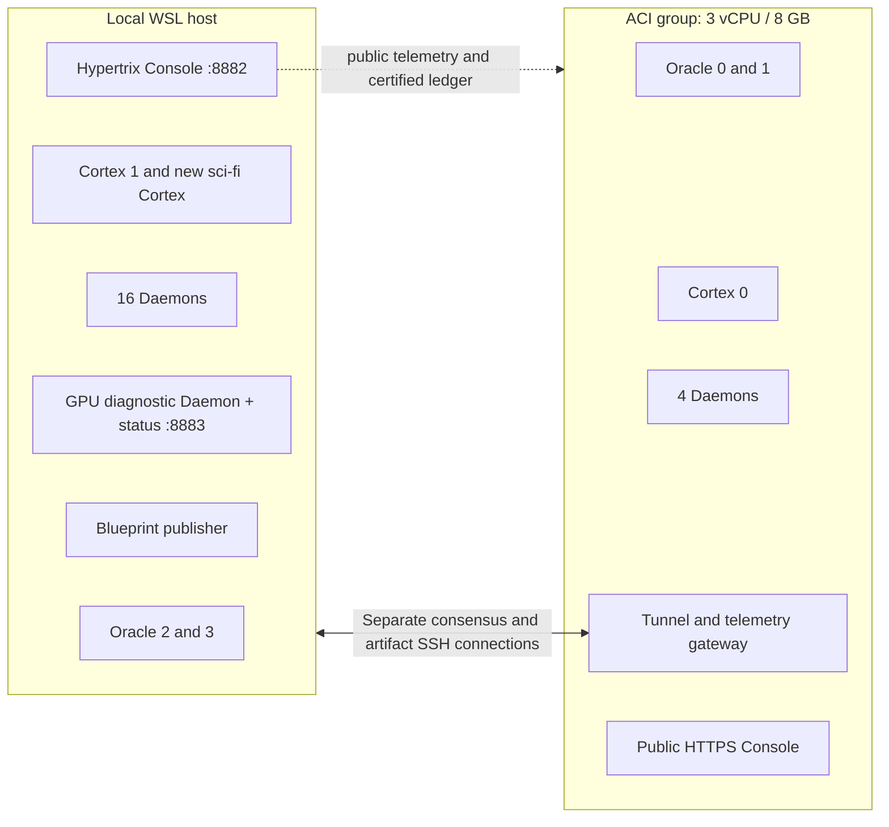

# The Hypertrix hybrid testnet

This pilot connects local WSL/Podman nodes to **Azure Container Instances in
Norway East**, in resource group **DAWL**. Each admitted node has its own
container, keys, logs and private state mount. Azure shares **3 vCPUs and 8 GB**
across nine containers. Local compute is additional. No training is scheduled.

Updated 14 October 2026 after the same-chain contribution upgrade and GPU replay.
The [hybrid research update](hybrid_research_update.md) consolidates the executed
results; [GPU run 001](gpu_run_001.md) records the separate CUDA diagnostic node.

The [terminology guide](hypertrix_terminology.md) maps platform names to their
technical meaning. The read-only **Hypertrix Console** is at
`http://127.0.0.1:8882/`.
See the [executed Hypertrix pilot report](hypertrix_run_001.md) for results and limits.

## Topology

| Role | Azure containers | Local containers | Total |
|---|---:|---:|---:|
| Oracle validators | 2 | 2 | 4 |
| Cortex Units, including newcomer | 1 | 2 | 3 |
| Admitted CPU Daemons | 4 | 16 | 20 |
| Diagnostic GPU Daemon | 0 | 1 | 1 |
| Blueprint publisher | 0 | 1 | 1 |
| Tunnel gateway | 1 | 0 | 1 |
| Console / observer | 1 | 1 | 2 |
| **All containers** | **9** | **23** | **32** |

There are 29 node containers plus the gateway and two Console containers. The GPU
node advertises `AUDITOR` for discovery but is not in the admitted auditor set;
its signed diagnostics do not count toward the 68 accepted consensus receipts.
The current main Consoles list 28 ledger/topology nodes. GPU status is separately
available at `http://127.0.0.1:8883/`; its telemetry is also in the site feed.

`deploy/hybrid-topology.json` assigns identities, sites, addresses and resource
requests. Six role image targets in `Dockerfile.nodes` separate validators,
providers, auditors, publisher, gateway and observer. Nodes of the same role
reuse the same immutable image; they do not share private volumes.

Cloud requests are two validators at 0.5 vCPU/0.8 GB each, one provider at
0.5 vCPU/1.1 GB, four auditors at 0.25 vCPU/1.1 GB each, a gateway at
0.3 vCPU/0.4 GB and a Console at 0.2 vCPU/0.5 GB. Compute CPU limits permit
borrowing idle capacity within the shared pool;
these limits do not reserve three cores per container. ACI infrastructure can use
some of the group's resources.



These are **two shared host failure domains, under one operator**. Containers
separate jobs and state; they do not create independent machines or operators.
ACI schedules and stops a container group together. It does not offer an
individual-container restart operation. Local Podman supports per-container
restart, while controlled cloud process pauses can test individual role outages.
Moving cloud nodes into separate groups/hosts is the next physical-failure test.

Four equal-weight validators require more than two-thirds of voting power:
at least three signatures. A 2/2 site partition therefore halts both halves.

## Identity, isolation and transport

The fresh chain generates its own node keys, registrations and genesis. The
public bootstrap commits the plan, source digest and immutable image for each
role (`dawl.external-network/2`). Its identities explicitly sign the
`ssh-loopback/1` transport and unique addresses in `127.70.0.0/24`. Nodes reject
changed network pins, a mismatched role image or mismatched implementation.

Each node mounts only its own private state and archive. A separate exchange
volume carries public registrations, bootstrap materials, seed artifacts,
telemetry and operator control gates. This is a trusted-operator pilot; shared
control files are not an adversarial multi-tenant isolation boundary.

Validator application interfaces use Unix sockets on the validator's private
filesystem. Other containers sharing the ACI network cannot reach a loopback
ABCI listener. The public gateway has neither validator volumes nor signing keys.
The Console has public trust inputs and its own verified-head database, with no
container-runtime socket or SSH private key.

Two outbound local SSH sessions reach Azure on TCP 2222. One carries consensus,
RPC and telemetry; the other carries bulk artifact HTTP. This avoids putting
large transfers in the same SSH queue as consensus. The gateway restricts
forward destinations and accepts only the operator's public key. Its SSH host
key is obtained from authenticated Azure API logs and independently pinned.
Public ports are SSH 2222 and Console HTTP/HTTPS 80/443. Consensus, artifact and
DHT traffic travels inside the tunnel. Discovery now uses signed, expiring
Kademlia-style role records with configured seeds. Admission remains fixed for
auditors and validators. A temporary third SSH connection carries only the GPU
peer's private DHT route, without restarting the existing sessions.

The old local cluster-v2 remains a separate network. Only its public plan,
historical lineage and allowlisted corpus artifacts are reused. Its validator
keys and signing databases are not migrated.

## Data flow and evidence

The original eight-book release contained 1,438 Frags and 1,657,163 tokens.
The current release contains **13 books, 1,807 Frags and 2,061,330 tokens**.
Twenty admitted Daemons completed 34 jobs. Every job needs two distinct admitted
auditors, giving **68 accepted audit Cipher-Logs and 3,614 Frag replays**.
The GPU diagnostic separately replayed all 1,807 Frags against NumPy and the
committed hashes; it adds no consensus receipts.

1. Cortex Units serve content-addressed source bytes, token artifacts, pinned
   tokenizer assets and the Source Code Matrix.
2. A Daemon claims an Execution Lease through The Oracle, fetches missing pieces,
   checks their hashes and repeats the source/token/vector checks locally.
3. For token ID `t_i`, the input embedding is `v_i = E[t_i]`. Each node reconstructs
   the pinned float32 rows and checks the exact vector commitment. Dense vector
   fields are not transported. The matrix itself must be available locally.
4. The Daemon signs its result. The Oracle orders and validates the transaction
   under the pinned release rules. A valid signature does not establish replay honesty.
5. After complete independent coverage, the publisher commits The Blueprint.
   A keyless reader verifies the resulting state certificate against pinned genesis.

An Ed25519 signature authenticates a key and bytes. A content hash detects changed
bytes. A quorum certificate authenticates committed state under the admitted
validator set. None proves that a malicious auditor really performed the replay.
This is not a zero-knowledge proof, permissionless incentive system, or proof of
the imported GPT-2 model's upstream training history.

The Console shows validator height, peer count and RPC latency; current certified
state; per-node phase, age, cgroup CPU/memory and transfer counters; leases,
accepted receipts, failures, recent events, genesis and image pins. Node telemetry
is observational. The certificate verifier is the ledger trust boundary.

## Reproduction and operator commands

Build consensus, then the exact source image used for assembly and replay:

```powershell
wsl -d kali-linux -u root --exec podman build -f consensus/Dockerfile.build -t localhost/dawl-consensus-build:0.1 .
wsl -d kali-linux -u root --exec podman build -f Dockerfile.cluster -t localhost/dawl-cluster:node-base .
$roles = 'validator','provider','worker','publisher','gateway','observer'
foreach ($role in $roles) {
  wsl -d kali-linux -u root --exec podman build -f Dockerfile.nodes --target $role -t "localhost/dawl-${role}:node-v1" .
}
.\.venv\Scripts\python.exe -m unittest discover -s tests -v
wsl -d kali-linux -u root --exec python3 scripts/node_operator.py rehearse --root /var/lib/dawl/hypertrix-rehearsal-001
```

The rehearsal needs unused container names, loopback ports and a fresh directory.
It creates 27 separately containerized identities, verifies the fresh chain,
tests the private ABCI boundary and partitions/reconnects the two sites. Preserve
prior state rather than reinitializing used validators. Do not rebuild source
under a running chain: an implementation change needs a new agreed source pin.
The per-node profile installs its state at `/node/state`; use its node operator
and container wrapper for this layout. It has not validated arbitrary host-path
installation through the generic external Compose export.

The current Azure replacement controller uses the original pilot's foundations,
saved budget window and stopped baseline. It refuses a second deployment attempt
or an expired window:

```powershell
.\.venv\Scripts\python.exe scripts/azure/nodes.py --subscription <subscription-id> --topology deploy/hybrid-topology.json
wsl -d kali-linux -u root --exec python3 scripts/node_operator.py launch --root <native-root>
wsl -d kali-linux -u root --exec python3 scripts/node_operator.py complete --root <native-root>
wsl -d kali-linux -u root --exec python3 scripts/node_operator.py node-faults --root <native-root>
wsl -d kali-linux -u root --exec python3 scripts/node_operator.py partition --root <native-root>
wsl -d kali-linux -u root --exec python3 scripts/node_operator.py export-public --root <native-root> --output artifacts/azure-hybrid-001/node-evidence
```

These are pilot-specific controllers, not yet a generic production provisioner.
If Azure rejects provisioning before creating any container group, the controller's
`--resume-unstarted` option reuses the recorded images and operator key. It refuses
to proceed if a group or installed operator configuration exists. This is not a
validator recovery or identity-reset command.
`scripts/azure/hybrid.py` and `scripts/hybrid_operator.py` retain the original
pooled baseline workflow. Its evidence remains separate in
`artifacts/azure-hybrid-001/evidence/`.

## Deadline and signing state

The authorized limit is EUR 50 for four hours. The saved Norway East quote is
EUR 0.698 for 3 vCPU/8 GB for four hours, with a total planning envelope of
EUR 7.34 including supporting services and allowances. It is an estimate, not a
subscription-wide billing cap. See `artifacts/azure-hybrid-001/estimate.json`.

The replacement preserves the original deadline: **2026-10-13 22:41:52 UTC**
(00:41:52 Oslo on October 14). Each node terminates its own processes and archives
closed state. A separate Azure Logic App requests group stop from 22:51:52 UTC,
on a five-minute interval. Registry and storage remain billable after compute stops.

Live CometBFT/SQLite state is on each node's private filesystem. Each cloud node
has a separate Azure Files archive share and persistent start fence. If a used
node loses its private state, it refuses to generate replacement signing keys.
A same-state local container restart may resume its existing identity; restoring
a potentially stale validator snapshot is not automatic. Host loss can therefore
end this pilot. Production needs durable signing state and a tested recovery design.

Private archives contain keys: never publish or commit them. Public evidence is
exported using an explicit allowlist. The baseline cleanup controller deliberately
refuses to delete resources it does not recognize, including this newer layout.
Preserve each node's closed archive before removing its storage.

The per-node lifecycle helper verifies the exact resource tag and container roster:

```powershell
.\.venv\Scripts\python.exe scripts/azure/node_lifecycle.py status --subscription <subscription-id>
# Stop early only when finished with the live pilot:
.\.venv\Scripts\python.exe scripts/azure/node_lifecycle.py stop --subscription <subscription-id>
.\.venv\Scripts\python.exe scripts/azure/node_lifecycle.py export-closed-state --subscription <subscription-id>
wsl -d kali-linux -u root --exec python3 scripts/node_operator.py stop-local --root <native-root>
```

The stop helper requests graceful closure at both sites, waits for cloud node
containers to terminate, then stops their ACI group. Export reads and hashes each
private archive without extracting it. An abrupt failure may prevent a closed
archive; investigate that case instead of resetting the signing identity.

## Azure references

- [Container groups, shared resources and lifecycle](https://learn.microsoft.com/en-us/azure/container-instances/container-instances-container-groups)
- [Stop/start behavior](https://learn.microsoft.com/en-us/azure/container-instances/container-instances-stop-start)
- [Temporary emptyDir volumes](https://learn.microsoft.com/en-us/azure/container-instances/container-instances-volume-emptydir)
- [ACI pricing](https://azure.microsoft.com/en-us/pricing/details/container-instances/)
- [Retail Prices API](https://learn.microsoft.com/en-us/rest/api/cost-management/retail-prices/azure-retail-prices)
