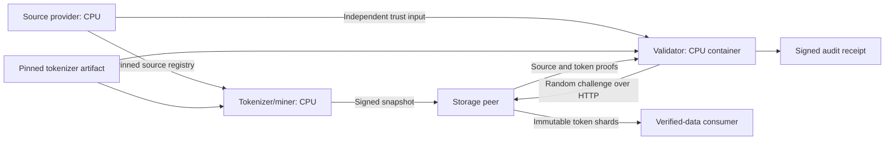

# DAWL ingestion nodes: role-separated pilot

This increment advances ingestion beyond the synthetic Stage 1 experiment. It
uses a real pinned ByteLevel BPE tokenizer, persistent data, signed manifests,
independent validator processes, and an HTTP peer boundary. It performs no model
training, tokenizer fitting, embedding generation, or gradient updates.

## The hats

| Hat | Input and responsibility | Output | Placement in the pilot |
| --- | --- | --- | --- |
| Source provider | Admit source documents and record their exact bytes and declared provenance | Independently pinned source registry | Local CPU, `register` |
| Tokenizer/miner | Reproduce that registry from the supplied documents, tokenize bounded chunks | Signed immutable snapshot and source objects | Local CPU, `mine` |
| Storage peer | Retain published artifacts and answer bounded read/challenge requests | Token shards and Merkle evidence over HTTP | Local process or CPU container |
| Validator | Choose unpredictable samples, verify commitments, and re-tokenize using its own artifact | Signed audit receipt | Separate process or CPU container |
| Consumer | Fetch and verify complete published token shards | Local verified snapshot | Local CPU, `consume` |

One physical node can wear several hats, but each HTTP process exposes one role.
The current code does not equate a role with a machine, an identity with a trusted
organization, or CPU versus GPU with validator versus miner. Tokenization and
hashing use CPU here. The available local GPU is reserved for a future hat with a
defined GPU workload; this increment does not allocate GPU work for its own sake.



The Compose deployment runs storage and validator as two CPU containers on a
private container network. Local CPU ingestion prepares their input. Both roles
can instead run as local processes; the interface and trust inputs are identical.
No shared private key or shared Python object is required between those processes.

## Source contract

Input is strict UTF-8 JSONL. Each line has exactly four fields:

```json
{"id":"document-001","text":"Exact source text.\r\n","source_uri":"https://example.org/source","license":"Declared source licence"}
```

The source URI and licence are provenance declarations; registration does not
fetch that URI or independently establish rights or factual quality. The provider
decides what is admitted. Its registry digest reaches the validator through
configuration, independently of the miner's response.

Each document is bounded to 1 MiB of UTF-8. The registry is limited to 10,000
documents, 100,000 chunks, and 32 MiB of metadata. Document data is streamed one
document at a time; metadata and deduplication hashes are retained in memory.
This is bounded batch ingestion, not an unlimited streaming service.

Exact duplicate documents are tokenized once. Their identifiers, declared sources,
licences, and canonical-document association remain in the registry. Reusing a
document ID is an error. Near-duplicate detection and semantic filtering are
separate future policies.

Each admitted document is split into bounded UTF-8 chunks (4,096 bytes by default)
without splitting a code point. Whitespace, line endings, normalization, and all
source bytes are preserved. Records bind document identity, whole-document hash,
byte offset, byte length, and chunk hash. Registered chunk ranges must cover every
canonical document without gaps or overlap.

## Tokenization and persistent publication

The tokenizer is an existing `tokenizer.json` file, pinned by SHA-256. The manifest
also pins the exact `tokenizers` runtime version and encoding contract. Supported
artifacts use lossless ByteLevel BPE, no normalization, no stochastic dropout, no
truncation, and no padding. Every encoded chunk must decode to the exact source
text. Loading an artifact does not download or execute model code.

Chunks are tokenized independently with `add_special_tokens=False`. The ingest
layer inserts no BOS, EOS, separator, or padding tokens. A future model-consumer
hat must apply its own explicit sequence construction policy. Independent chunk
tokenization can produce different token boundaries from whole-document encoding;
the contract records this choice. Audits re-tokenize complete committed chunks,
which avoids comparing context-dependent BPE tokens against arbitrary snippets.

Tokens are persisted as uint32 little-endian files. Shards have at most 262,144
tokens and 256 chunk records. Each record identifies its source chunk and contiguous
token range, with a hash of those token bytes. Merkle leaves commit to records;
the records commit to the bytes. The source and token roots remain distinct.

Ed25519 signatures bind the tokenizer, registry ID, source coverage, all shard
hashes, all token-record roots, and the miner identity. A consumer or validator
must pin the expected miner public key; accepting whatever key appears in a
manifest would establish only self-consistency. Signatures establish authorship
under a pinned key, not that an operator is honest or unique.

```text
store/
  objects/<source-chunk-sha256>       # source bytes retained for audits
  snapshots/<signed-body-sha256>/
    manifest.json                   # signed envelope
    source.json                     # complete source registry
    tokenizer.json                  # exact tokenizer artifact
    000000.u32le                    # bounded token file
    000000.records.json             # indexed chunk-to-token mapping
    ...
  .staging/                         # never served to peers
```

Complete snapshots are made visible by directory rename. Identical repeated jobs
produce the same snapshot ID for the same identity, source, tokenizer, and shard
layout. Existing snapshots are verified before being reused. Interrupted work
does not publish a partial snapshot; re-running currently starts the bounded job
again. This is idempotent restart, not a durable mid-job checkpoint system. Unused
content-addressed source objects can remain after failure; garbage collection and
storage quotas are future operational work.

## Challenge and trust boundary

The validator pins three independent inputs: registry ID, tokenizer artifact hash,
and miner public key. It validates the signed manifest before selecting positions.
The storage response returns raw text, token IDs, and Merkle paths for each selected
chunk. The validator checks both proofs, hashes and lengths, and then reproduces
the token IDs. Replayed, missing, duplicated, unsolicited, or mismatched evidence
fails. A fresh nonce binds a response to the validator's retained challenge.

Uniform sampling is over **chunks**, not individual tokens. For N chunks, m bad
chunks fixed before the challenge, and k distinct samples:

```text
P(detect) = 1 - C(N-m,k) / C(N,k)
```

A token error in one chunk has k/N detection probability, regardless of how many
other tokens that chunk contains. Retokenization checks the whole selected chunk.
Sampling a fraction of bytes is not a guarantee of an equally small runtime cost.
Receipts record positions, nonce, coverage, the one-bad-chunk probability, response
bytes, timing, and failure details. The validator signs the receipt using its own
identity. Consumers of receipts must separately pin that validator key.

Signed receipts describe one observation against one immutable commitment. There
is no claim of persistent storage, proof of expenditure, data quality, training
utility, or zero-knowledge. Receipt freshness/expiry and challenge replay ledgers
must be defined before receipts become inputs to an incentive system.

Full-file consumer verification checks every token file's signature-bound hash,
record root, per-chunk hash, ID range, and coverage before publishing the local
copy. It does not establish source/token consistency on unsampled chunks. The
adversarial test suite explicitly includes a miner that signs internally consistent
but incorrect tokens: full-file integrity passes and retokenization auditing fails.

## HTTP role interfaces

| Role | Route | Meaning |
| --- | --- | --- |
| Both servers | `GET /health` | Minimal unauthenticated liveness and role identification |
| Storage | `GET /v1/snapshots/{id}/manifest` | Signed manifest |
| Storage | `GET /v1/snapshots/{id}/files/{name}` | Allowlisted token/index files only |
| Storage | `POST /v1/snapshots/{id}/challenge` | Evidence for 1–256 distinct chunk positions |
| Validator | `POST /v1/audits` | Issue a fresh challenge to its configured peer and return a signed receipt |

All artifact and audit routes require a bearer token read from a secret file.
The validator's peer is configured at startup; requests cannot supply arbitrary
upstream URLs. The client rejects redirects, bounds downloads, and uses timeouts.
Non-loopback plaintext requires an explicit lab option. Production traffic needs
HTTPS termination. Source snippets and reversible token IDs are not confidential
representations.

POST bodies are limited to 16 KiB even with chunked transfer encoding. Sample
counts, chunk sizes, file sizes, vocabulary size, and service concurrency are
bounded. Role processes have different route sets. Container mounts are limited
to their role inputs; validators do not receive miner private keys. The image runs
as an unprivileged user with a read-only root filesystem in Compose, and no GPU
devices. API tokens and private keys must be managed as secrets outside published
artifacts.

## Run the pilot

```powershell
python -m venv .venv
.\.venv\Scripts\python.exe -m pip install -r requirements-ingestion.txt
.\.venv\Scripts\python.exe scripts/fetch_ingestion_assets.py
.\.venv\Scripts\python.exe scripts/prepare_ingestion_demo.py
.\.venv\Scripts\python.exe -m unittest discover -s tests -v
docker compose --env-file artifacts/ingestion-demo/deploy.env up --build -d
```

This workspace also has a tested WSL Podman route. Run from the repository in
PowerShell (Podman is installed in its existing `kali-linux` distribution):

```powershell
wsl -d kali-linux -u root --exec sh scripts/ingestion_containers.sh build
wsl -d kali-linux -u root --exec sh scripts/ingestion_containers.sh up
.\.venv\Scripts\python.exe scripts/check_ingestion_deployment.py
wsl -d kali-linux -u root --exec sh scripts/ingestion_containers.sh status
# Stop/remove only the labelled pilot containers and network; retain all data:
wsl -d kali-linux -u root --exec sh scripts/ingestion_containers.sh down
```

The WSL Podman daemonless runtime runs as WSL root, while application processes
inside both containers run as UID 1000. The script creates a private bridge with
DNS disabled and resolves the storage IP at startup. Published ports bind to
localhost only. The bridge permits outbound traffic; it is not an egress firewall.
Compose instead uses its standard service-name DNS. Choose one runtime at a time
because both examples use host ports 8765 and 8766. Docker Compose is provided as
a deployment definition; the recorded container execution uses Podman.

The deployment checker validates the two service hats, checks separately signed
receipts for eight chunks and up to 256 chunks, then downloads every token shard
to a fresh consumer directory. With the bundled 43-chunk fixture the second audit
covers every chunk. It saves evidence under `artifacts/ingestion-demo/deployment-check`.
Recreating containers with `down` and `up`, then repeating this check exercises
disk persistence across process and container replacement.

Snapshot staging inherits the store's Windows ACLs and uses mode 0750 on POSIX.
This avoids publishing a Windows `TemporaryDirectory` ACL that WSL cannot read
as an ordinary container user. On a native Linux host, provision bind directories
and files for the container's UID/GID 1000, including write access to `receipts`;
the scripts do not change ownership of arbitrary user directories. Use OS access
controls for the store and secret directories. Files on Windows/WSL mounts do
not inherit POSIX secret protection merely from a requested mode of 0600.

The download script fetches only the pinned GPT-2 tokenizer and a Project Gutenberg
text. It records exact hashes in `assets.lock.json` and rejects changed cached
assets. The preparation script creates separate miner and validator identities,
registers the source before mining, and writes immutable snapshots. Re-running
preparation reuses those identities and verifies an existing snapshot.

The primary tokenizer example is [GPT-2's tokenizer at revision
210ab4c33a01af45a1914b1cf1928eb915565697](https://huggingface.co/openai-community/gpt2/commit/210ab4c33a01af45a1914b1cf1928eb915565697).
The source fixture is [Project Gutenberg's Alice's Adventures in
Wonderland](https://www.gutenberg.org/ebooks/11), including its source notice. Their
catalogue describes the underlying work as public domain in the USA; the original
notice remains in the downloaded fixture. No medical or user-private dataset is
needed for this experiment.

Run `python dawl_node.py --help` for individual role commands. A source provider
can register its own JSONL, then hand the registry commitment to separately
configured miners and validators. The consumer command downloads token shards
without requiring the miner's filesystem or private key.

## Acceptance and next boundary

This increment is accepted when real tokenization survives persistence/restart,
distinct processes agree on deterministic output, signed bad work is detected
when sampled, complete-file corruption is rejected, a consumer independently
copies verified artifacts, and the CPU role image runs without model training.
Actual execution evidence is recorded separately from the deployable files.
See [the recorded ingestion-node results](ingestion_nodes_results.md).

Before admitting untrusted public operators, the project still needs operational
load testing, durable job scheduling, storage quotas, identity admission policy,
network abuse controls, and a reviewed trust/bootstrap mechanism. These are
deployment-hardening milestones rather than assumptions silently granted by the
pilot. Future training consumes this format through a separate hat.

Technical references: [Hugging Face tokenization pipeline](https://huggingface.co/docs/tokenizers/python/latest/pipeline.html),
[Ed25519 signing and verification](https://cryptography.io/en/latest/hazmat/primitives/asymmetric/ed25519/).
