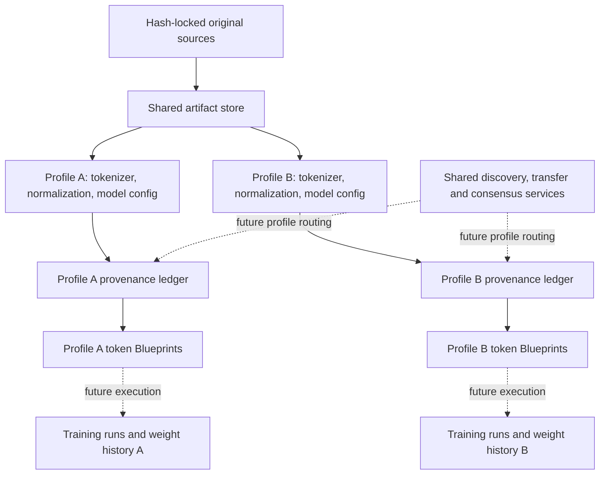

# Multiple tokenizer and model profiles

The Hypertrix supports a local experiment with several immutable processing
profiles concurrently. GPT-2 remains a reproducible baseline. Adding another
tokenizer creates a new branch of derived data, without rewriting old evidence.

## Architecture



The artifact pool deduplicates identical bytes. A source book and its raw Frags
can be referenced by several ledgers without storing a copy for every profile.
Token IDs, vector commitments and compatible model weights are profile-specific.
Equal integer IDs in different vocabularies need not mean the same token.

Weights can evolve within a model profile. A vector commitment must therefore
bind both the profile and the exact weight/table manifest used for reconstruction.
Profile identity alone does not identify a learned checkpoint. Token artifacts
can be reused where their recipe matches; old vector claims cannot silently be
reinterpreted under newer weights.

A logical ledger per profile does not require a new physical blockchain or
validator fleet for every model. Independently addressed streams and releases can
share infrastructure where trust policy permits. Separate consensus domains
remain an option for communities with different governance requirements.

## Implemented local foundation

`src/dawl_profiles/` provides a separate research path. It preserves the legacy
GPT-2 adapter and does not activate a change on the existing hybrid chain.

- Content-hashed profiles bind tokenizer bytes and runtime, encoding and
  normalization rules, model configuration, input-table shape and the source
  partition recipe.
- Each profile has its own trust-policy hash, SQLite provenance ledger, author
  sequences and parent-linked token Blueprints. Profile ID is bound inside each
  signed payload and its trust policy.
- One artifact store holds raw sources, normalized text, token IDs and metadata.
  Verification checks content hashes, repartitions original books, retokenizes
  and checks complete coverage before accepting a token Blueprint.
- Deterministic ByteLevel BPE pipelines may combine splitting, digit handling
  and byte tokenization. Normalization is explicitly `none` or `NFC`. Original
  bytes remain available even where normalized text differs.
- Token IDs must fit the declared matrix. Padding rows are allowed: vocabulary
  cardinality need not equal the number of model embedding rows.
- Named dense weight manifests describe different tensor names, shapes and
  float32/float16/bfloat16 layouts. Ordered lists of bounded artifact chunks
  avoid a single-object size limit for large tensors. Validation checks profile
  binding, hashes, byte lengths and the declared input-table shape.

The encoding contract adds no automatic special tokens. Special spellings in
source text are still recognized literally as defined by the pinned tokenizer.
Training/chat formatting and the interpretation of such tokens need a separate
recipe before these outputs become training-ready datasets.

The real-tokenizer pilot uses `input_embedding.weight` as a logical tensor name.
Candidate shapes are projections from pinned upstream configs. No candidate model
weights were downloaded; their actual tensors have not been validated. Weight
layout tests use explicit synthetic byte fixtures, not pretrained models.
For tensors other than the input embedding, the present checker verifies the
declared layout and bytes. It does not prove that the tensor set is complete or
executable for a particular neural-network architecture.

## Addressing the shared network

The next protocol version should distinguish these identities:

| Identity | Meaning |
| --- | --- |
| Source/content hash | Exact reusable bytes, independent of model choice |
| Profile ID | Immutable tokenizer/runtime/normalization/model/partition contract |
| Ledger policy ID | Profile plus the admitted signing policy and ledger domain |
| Blueprint ID | One immutable corpus release in that ledger, with explicit parents |
| Weight-manifest ID | One model-compatible named-tensor snapshot |
| Training-run ID | A future claim binding inputs, parent weights, recipe and outputs |

The local implementation already separates profile ID, policy hash, Blueprint ID
and artifact hashes. Network requests should carry the relevant namespace rather
than relying on a node's single current model or release. A future shared Oracle
can certify `profiles[profile_id]` and per-ledger release/job state while workers
execute only supported contracts. Per-profile quotas and scheduling are needed
so one large model cannot monopolize audit or storage capacity.

Dataset branches and revised editions also need explicit identities. This local
pilot permits one acquired edition per book ID in each profile ledger; it does
not yet implement edition replacement, arbitrary release branching or
cross-profile weight conversion. Those should be explicit lineage operations.

## Evidence and remaining integration

The completed local pilot used the same 13 books and 1,807 source Frags in every
profile. All five token Blueprints passed full replay. Thirteen raw book objects
served 65 profile-level references. Each profile ledger contains 27 signed
records: 13 sources, 13 token manifests and one Blueprint.

| Profile | Corpus tokens | Reduction from GPT-2 | Projected float32 input table |
| --- | ---: | ---: | ---: |
| GPT-2 baseline | 2,061,330 | 0.00% | 154.4 MB |
| SmolLM2 | 1,933,422 | 6.21% | 113.2 MB |
| Qwen3 | 1,763,536 | 14.45% | 622.3 MB |
| Qwen3.5 | 1,780,226 | 13.64% | 1,017.1 MB |
| SmolLM3 | 1,761,415 | 14.55% | 1,050.7 MB |

MB is decimal. Table sizes are projections from model configs, not measured
downloads. Token counts compare these exact recipes on this English corpus;
they do not rank model quality or multilingual performance. No corpus Frag
changed under NFC in this run. Decomposed-accent smoke fixtures did change under
the Qwen normalization contracts, with their raw bytes preserved.

All nine smoke cases per profile completed: empty text, whitespace/CRLF,
Norwegian, decomposed accents, CJK, emoji, code, literal special-token spellings
and an embedded NUL. These are compatibility checks, not language benchmarks.
The six profile tests, 22 existing ingestion tests and ten existing platform
tests passed. All five Blueprint signatures and recorded implementation hashes
were checked after the run.

`results/multiprofile-run-001/report.json` records the corpus pilot. It retains
profile definitions, acquisition revisions/hashes, public trust policies, signed
Blueprints, ledger checkpoints and per-book replay counts. The original book
hashes are checked first. GPT-2 must reproduce the historical 2,061,330 tokens and
1,807 Frags before candidate results are accepted.

These are **local token-only Blueprints**. They do not claim vector audit
coverage, Oracle certification, training readiness or trained-weight provenance.
The cloud chain still pins one tokenizer, matrix and dimension. The subsequent
[protocol 3 implementation](profile_protocol_v3.md) now provides the registry,
profile-bound jobs and independent release heads, plus worker/DHT routing. It is
tested locally before cloud activation. The stages are:

1. **Implemented in v3:** register immutable profiles in certified state, with explicit admission.
2. **Implemented in v3:** bind contributions, jobs, leases, receipts and releases to profile IDs; track
   completion and release heads separately per profile.
3. **Implemented in v3:** advertise supported profile IDs in discovery and route
   compatible workers, while verifying authorization separately.
4. **Implemented as a separate local diagnostic:** import and hash actual compatible
   input tensors, apply explicit F32/F16/BF16-to-F32 recipes, then replay CPU/GPU
   vector commitments against certified token Blueprints. See the
   [GPU verification run](results/profile-gpu-run-001/README.md). These diagnostic
   receipts are not yet accepted as Oracle vector jobs; the CUDA Gather operates
   on the canonical float32 table.
   The [o200k extension](results/o200k-gpu-run-001/README.md) adds GPT-OSS input
   weights through a separate model-bound profile, verified ordinary-token row
   compatibility and explicit source-profile links in version-2 vector receipts.
5. **Implemented as a separate local training branch:** the
   [training stage protocol](distributed_training.md) binds SmolLM2 adapter updates
   to profile, dataset Blueprint, imported parent model, recipe and environment.
   Two peers independently train, aggregate and retain the weight history; a
   separate auditor replays sampled work before the joint stage release.
6. **Oracle integration:** [protocol 4](oracle_training.md) adds stage registration,
   profile-scoped trainer admission, replaceable leased shards and weight checkpoints
   accepted after matching independent full-replay attestations. Layout integrity
   and quorum signatures alone do not prove claimed training happened.

New files change the repository implementation digest; they must not be copied
into existing pinned node images through an uncoordinated update. The deployed
images and their historical evidence remain unchanged.

General SentencePiece/Unigram support, quantized/sparse tensor execution,
multimodal preprocessing and arbitrary architecture execution are future adapters.
They need explicit versioned contracts rather than reinterpretation of old data.

## Reproduction

```powershell
.\.venv\Scripts\python.exe scripts/fetch_tokenizer_candidates.py
.\.venv\Scripts\python.exe scripts/fetch_o200k.py
.\.venv\Scripts\python.exe -m unittest discover -s tests -p test_profiles.py -v
.\.venv\Scripts\python.exe scripts/profile_corpus_pilot.py
```

The pilot uses baseline inputs in `artifacts/platform-v1/jobs` and public
newcomer exports in `artifacts/multiprofile-inputs/<book-id>/input.jsonl`, with
`scifi.lock.json`. These contain book inputs and their corpus lock; no contributor
identity or signing state is exported. For repeats, use a fresh `--root` and
`--report` path to retain earlier evidence. Local experiment signing keys stay
inside the ignored artifact directory, outside the public report.

Focused tests reject cross-profile replay, signed relabeling, substituted token
manifests, validly signed wrong token bytes, incorrect Blueprint coverage,
runtime/config mismatch, and tensor shape/dtype/chunk/profile mismatch. They
also verify raw-source preservation under NFC and padded embedding rows.

Candidate tokenizer/config sources are the official repositories for
[Qwen3-0.6B](https://huggingface.co/Qwen/Qwen3-0.6B),
[Qwen3.5-0.8B](https://huggingface.co/Qwen/Qwen3.5-0.8B),
[SmolLM2-135M](https://huggingface.co/HuggingFaceTB/SmolLM2-135M) and
[SmolLM3-3B-Base](https://huggingface.co/HuggingFaceTB/SmolLM3-3B-Base).
Revision pins and downloaded-file hashes are in the acquisition locks and result.
No one family is designated mandatory for the Collective.
