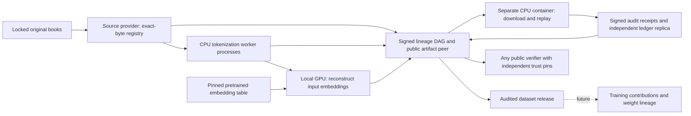

# DAWL platform prototype

This is the technical foundation for the Linux-for-AI platform. Human trust experiments
will use models and training traces built on it later. No training happens in this version.
The development branch is `codex/platform-prototype`; the research worktree remains on
`codex/verifiable-provenance-research`. The original baseline is preserved by the tag
`dawl-ingestion-baseline-2026-10-13`.

## What runs



| Hat | Placement in this run | Output |
| --- | --- | --- |
| Source provider | Host CPU | Locked source bytes, reversible parts, registries, public bootstrap policy |
| Tokenization workers | Separate host CPU processes, configurable 1–8 | Per-book signed token snapshots and lineage entries |
| Vector worker | Host GPU through DirectML | Per-chunk commitments to reconstructed real input embeddings |
| Artifact peer | Read-only CPU container, port 8890 | Public hash-addressed artifacts and ledger export; no private keys mounted |
| Auditor | Separate CPU container, port 8891 | Independent artifact cache, own ledger database, full replay, own signed receipts |
| Public verifier | Fresh local directory or another machine | Reproducible verification report without any signing key |
| Observatory | Host, loopback port 8880 | Read-only pipeline state, lineage, artifact downloads and measurements |

The role separation is real, but every node in the recorded deployment is operated on
one physical computer. The token workers currently share a host filesystem. They are
not independently operated internet miners. Source and vector publication use local
commands; replication and remote auditing cross actual HTTP process/container boundaries.

## Artifact contracts

The eight-book corpus retains original text and licence notices. The corpus lock and
book hashes are inherited unchanged from the research fixture. Books become reversible
parts of at most 512 KiB, then independently tokenized chunks of at most 4,096 UTF-8 bytes.
Each book gets its own source registry and signed snapshot. This permits independent
book jobs while preserving the original byte ranges and document boundaries.

The ingestion tokenizer is the existing lossless GPT-2 ByteLevel BPE artifact. Its hash
and exact runtime are checked. Token shards are uint32 little-endian. The earlier
Merkle spot-check protocol remains available; the new platform acceptance run checks
every chunk, so its coverage is exhaustive rather than a sampling probability.

The vector contract is **the real GPT-2 token-input embedding lookup**:

`uint32 token IDs → pinned 50,257 × 768 float32 table → per-token float32 rows`

The table comes from tensor `wte.weight` in a hash-pinned safetensors checkpoint. The
fetch script checks the full upstream checkpoint digest, extracts the table with
safetensors, records the resulting hash, and checks tokenizer compatibility. It does
not unpickle a model or execute downloaded model code. The upstream model card is
retained with its licence declaration. See the [GPT-2 model repository](https://huggingface.co/openai-community/gpt2)
and the [safetensors format](https://github.com/safetensors/safetensors#format).

On Windows, ONNX Runtime DirectML executes a single `Gather` graph over that table.
Runtime profiling must contain GPU Gather events before the run report claims GPU
execution. The CPU auditor uses a separate NumPy indexed-lookup implementation. Gather
performs no floating-point arithmetic, permitting byte-exact comparison across these
backends. This result must not be generalized to arbitrary GPU numerical kernels.
DirectML's [documented sequential execution requirements](https://onnxruntime.ai/docs/execution-providers/DirectML-ExecutionProvider.html)
are applied. The production path hashes each bounded vector chunk, then releases it;
it never writes the multi-gigabyte dense sequence to disk.

These are input embeddings, not contextual activations, sentence embeddings, semantic
search vectors or generated answers. Position embeddings, attention, gradients and
training are outside this contract. GPT-2's prior training history remains an imported
dependency; recording a weight hash does not establish its pretraining-data lineage.

## Ledger and verification semantics

Each signed ledger record includes protocol and policy digests, author key, author
sequence and previous entry, explicit lineage parents, typed payload, and content
hashes. Lineage parents must already exist, giving a DAG. An author has a local chain;
unrelated authors may publish in different arrival orders. There is no global clock,
global total order, token, proof of work or blockchain consensus.

SQLite transactions and append-only triggers preserve the local record history during
normal operation. Signature/link replay detects altered signed history. Triggers are
not protection against an administrator editing the database; independent retained
checkpoints are needed to detect removal of a valid history suffix. An advertised peer
checkpoint is checked against the complete export. Local records are never deleted by
replication. A signer fork conflicts with the retained chain and stops import; this
version does not implement cross-peer equivocation adjudication or automatic recovery.

The policy explicitly admits keys to source, tokenizer, vector and auditor hats. It
also pins the corpus-lock, tokenizer and embedding-table hashes. Identity admission is
federated and configured, not permissionless. A key does not establish a unique person,
honest behaviour or computational expenditure. Bootstrap pins need an independent
channel. Downloading a key from the same peer as its claims is not independent trust.

The CPU auditor reconstructs each original book's parts and registry, verifies the
token snapshot's signature and complete files, retokenizes every chunk, reconstructs
every input-vector chunk, and compares the committed bytes. Its receipt identifies
the exact input entries, checked coverage, environment, implementation hash and scope.
A signature on a receipt is an attributed observation; anyone may repeat the checks.
The ledger authenticates assertions. It does not turn an arbitrary signed assertion
into a true one. Source URLs and licence statements remain declarations.

Dataset assembly requires an accepted receipt for each selected book. It records the
resulting data release, not evidence that any training process consumed that release.
Training later needs its own configuration, input sequence, checkpoint and execution
evidence contracts; causal attribution from a datapoint to an answer remains separate.

## Run from a fresh checkout

Use Python 3.12 for the tested dependency set. Commands below assume the repository root.
The model asset download is about 548 MB; its extracted shared table is about 154 MB.
The Windows GPU path uses DirectML. Linux/CPU-only users can run `vectors --provider cpu`;
the container auditor needs NumPy and ingestion dependencies only.

```powershell
python -m venv .venv
.\.venv\Scripts\python.exe -m pip install -r requirements-platform.txt
.\.venv\Scripts\python.exe scripts/fetch_ingestion_assets.py
.\.venv\Scripts\python.exe scripts/fetch_platform_assets.py
.\.venv\Scripts\python.exe scripts/book_corpus.py fetch
.\.venv\Scripts\python.exe dawl_platform.py prepare
.\.venv\Scripts\python.exe dawl_platform.py tokenize --workers 4
.\.venv\Scripts\python.exe dawl_platform.py vectors --provider directml
.\.venv\Scripts\python.exe dawl_platform.py serve
```

`prepare` requires a new root. It does not overwrite existing identities. Tokenization
and vector stages resume at already committed book jobs. Interrupted uncommitted work
is recomputed; atomic artifact publication prevents partial snapshots becoming visible.
This is bounded job restart, not a durable distributed scheduling/lease system. Use a
new root and policy for a different corpus; this version has no live upload/admission API.

The recorded run reused the exact raw-book cache from the research worktree using the
`prepare --raw <path>` option. No study scenarios are inputs to this platform.

## CPU containers and replication

First initialize the auditor's separate data directory using a locally reviewed public
trust policy. Substitute the SHA-256 of canonical `trust.json` from your preparation
output; fresh identities produce a different digest.

```powershell
.\.venv\Scripts\python.exe dawl_platform.py init-replica --root artifacts/platform-auditor-v1 --trust artifacts/platform-v1/trust.json --trust-sha256 <PINNED_POLICY_DIGEST>
wsl -d kali-linux -u root --exec sh scripts/platform_containers.sh build
wsl -d kali-linux -u root --exec sh scripts/platform_containers.sh up
wsl -d kali-linux -u root --exec sh scripts/platform_containers.sh audit
.\.venv\Scripts\python.exe dawl_platform.py sync --peer http://127.0.0.1:8891
.\.venv\Scripts\python.exe dawl_platform.py assemble
```

The artifact container receives public objects and the producer ledger read-only.
The auditor receives only its own key, its own writable database/cache and public
bootstrap policy. No producer keys or producer store are mounted into it. Both run as
UID 1000 without GPU devices, with read-only root filesystems, resource limits and
loopback-only published ports. Internal plaintext HTTP is explicitly enabled for the
lab bridge. Containers share one operator and host, despite separate keys and state.

The script's `status`, `down`, then `up` commands inspect or replace only containers
labelled for this platform. Mounted data survives. `audit` after restart imports new
entries and reuses completed immutable receipts. `verify` forces recomputation when
fresh execution evidence is needed. `sync` copies and verifies all referenced public
artifacts as well as signed records. Peer discovery and periodic gossip are not yet built.

## Verify as a public consumer

No private key is required:

```powershell
.\.venv\Scripts\python.exe dawl_platform.py init-replica --root artifacts/public-verifier --trust reviewed-trust.json --trust-sha256 <INDEPENDENT_POLICY_PIN>
.\.venv\Scripts\python.exe dawl_platform.py verify --root artifacts/public-verifier --peer http://127.0.0.1:8880
.\.venv\Scripts\python.exe dawl_platform.py verify-ledger --root artifacts/public-verifier
```

The verifier creates its own cache and ledger, reproduces all vector lineages in the
downloaded checkpoint, and saves a report. It exits unsuccessfully if any check fails.
The web page is read-only; verification commands are explicit, allowing users to run
their own verifier implementation instead of trusting a green indicator in this UI.

## Measurements and engineering boundary

```powershell
.\.venv\Scripts\python.exe -m unittest discover -s tests -v
.\.venv\Scripts\python.exe scripts/benchmark_platform.py --output artifacts/platform-benchmark-001
```

The benchmark performs three interleaved runs each with 1, 2 and 4 real worker
processes, producing fresh immutable stores from identical books and signing keys.
Every output snapshot ID must equal its baseline; complete-file consumer checks run
inside the measured task. Pool startup is included. OS caches, other workloads and
OneDrive filesystem behaviour are not controlled. This measures one host's CPU
ingestion throughput, not distributed network scale or GPU speedup.

The remaining platform milestones are multi-machine pull-based job assignment,
leases/retries and backpressure; incremental source admission; artifact retention and
quotas; peer discovery and availability; admission/reputation and fork handling; and
measured behaviour under bandwidth limits, churn, dishonest operators and larger
heterogeneous datasets. These are real gaps, not evidence against the foundation.
Only after those contracts are stable should the training hat consume a dataset release.
