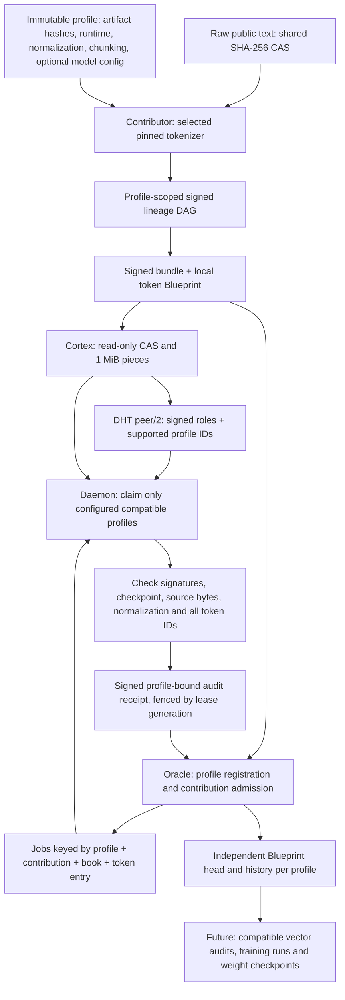

# Hypertrix profile protocol 3

Protocol 3 lets multiple tokenizer/model profiles share the Collective and Oracle
while keeping their jobs, receipts and certified token Blueprints separate. The
implementation includes a signed artifact exporter, read-only Cortex service,
profile-aware Daemon, DHT capability records, operator CLI and local cluster pilot.

The [completed local cluster run](results/profile-testnet-002/README.md) certified
all 78 book/profile jobs with 156 signed audit receipts and six Blueprint heads.

This release implements **token ingestion and full retokenization audit** for six
profiles. It does not add model training or claim new vector reconstruction
results. The earlier GPT-2 dense-vector experiment remains separate evidence.

## Namespace and data flow



Identical raw books reuse CAS objects. Token artifacts and lineage policy IDs
remain bound to an immutable profile hash. A book can appear once in each profile;
a duplicate book within the same profile is rejected. Source edition replacement
and branching need a separate explicit policy. A logical profile ledger does not
require a separate validator fleet or physical blockchain.

## Ordered commands and checks

All commands use the existing signed `dawl.cluster-tx/1` envelope: chain ID, plan
hash, signer, monotonically increasing signer sequence, expiry, command and payload.
The envelope's signature covers profile IDs and the entire payload. Invalid
transactions leave state unchanged.

| Command | Authority | Result |
|---|---|---|
| `activate_profiles` | Existing publisher | One-time v2→v3 activation, exact implementation/runtime-manifest hashes |
| `register_profile` | Publisher | Immutable content-addressed profile registry, up to 32 profiles |
| `contribute_profile` | Registered Cortex | Signed bundle descriptor + profile-bound catalog; deterministic jobs |
| `claim_profile` | Admitted CPU auditor | Deterministic assignment filtered by explicit supported profile IDs |
| `renew_profile` / `result_profile` | Lease owner | Profile, job and generation checked; expiry fences stale work |
| `publish_profile` | Publisher | Requires complete coverage by distinct admitted keys for that profile |
| `register_profile_weights` | Publisher | Named tensor layout registration; bytes/training explicitly unverified |

Activation requires a v2 release, completed legacy jobs and no outstanding legacy
leases. Legacy state and the legacy release are retained byte-for-byte as fields
of the new state. Existing v1/v2 histories retain their transition rules. After
activation, new contributions must select a registered profile. The legacy
`dataset_release` is not repurposed as a global head for new profiles.

Contributions are bounded to 32 books per bundle, 256 bundles and 10,000 profile
jobs. Each job replays one entire book, bounded to 8 MiB of raw UTF-8. Signed
bundles are at most 4 MiB. Providers expose only a generated public object index.
Workers accept routes from certified admission plus signed discovery, never from
fetched artifact contents. CAS uses the existing piece protocol; whole-object
hashes remain authoritative even if a provider supplies dishonest piece hashes.

Transfer counters and the bounded recent-event buffer are batched to avoid a
disk commit for every piece/request. A process crash can lose unflushed telemetry
since the last batch (up to the next flush during active transfer); signed outbox
entries and consensus audit receipts use their original durable paths. This
optimization followed an interrupted local pilot and is tested independently.

Profile receipts contain outcome, chunk/token coverage, implementation hash,
elapsed milliseconds and an error field. The signed transaction supplies signer,
profile, job, generation, chain and expiry. A pass must match the job's exact
coverage and active implementation. `unavailable` permits retry; `invalid`
disputes that job. A stalled profile does not block another profile's Blueprint.

Publisher role authorization and fixed validator membership remain inherited
from the pilot. DHT advertising does not grant either auditor or Oracle authority.
Distinct auditor keys are not evidence of independent human operators, and their
matching receipts are not a cryptographic proof of computation.

Audits check consistency with recorded source bytes and recipes. They do not
establish the truth of a contributor's external origin claim. This corpus pilot
separately checks its historical acquisition locks; broader source-origin policy
remains an admission and research question.

## o200k_base

The new profile uses `tiktoken==0.14.0`, the upstream `o200k_base` merge ranks
with SHA-256 `446a9538cb6c348e3516120d7c08b09f57c36495e2acfffe59a5bf8b0cfb1a2d`,
and an explicit ordinary-text encoding contract. Encoding is offline after
artifact acquisition. No Unicode normalization, automatic special tokens or chat
template is applied; literal control-token spellings are ordinary text.

This profile has `model: null`. It does not borrow GPT-2 weights or invent an
embedding dimension. Attaching weights to this tokenizer-only profile is rejected.
A model binding uses its own profile and actual compatible tensor layout. The
[o200k GPU extension](results/o200k-gpu-run-001/README.md) now supplies this for
GPT-OSS input weights: all ordinary row mappings and every corpus Frag's encoding
are checked before CPU/GPU replay. The original token profile and certified head
remain unchanged; the derived execution profile and version-2 vector receipts
are local diagnostic artifacts pending a later consensus integration.
`o200k_harmony` is a different encoding contract and is not silently substituted.
The definition follows [OpenAI's tiktoken source](https://github.com/openai/tiktoken/blob/0.14.0/tiktoken_ext/openai_public.py).

On the same 7,355,184 raw bytes, 13 books and 1,807 Frags, o200k_base produced
**1,753,309 tokens**, 14.9428% below the GPT-2 baseline of 2,061,330. All Frags
were replayed; nine smoke cases cover Unicode, whitespace, code, literal controls
and NUL. These counts compare tokenization on this English corpus, not model
quality or training outcomes. Evidence: [o200k report](results/o200k-run-001/report.json).

## Run locally

```powershell
.\.venv\Scripts\python.exe -m pip install -r requirements-swarm.txt
.\.venv\Scripts\python.exe scripts/fetch_o200k.py
.\.venv\Scripts\python.exe -m unittest discover -s tests -p test_o200k.py -v
.\.venv\Scripts\python.exe -m unittest discover -s tests -p test_profile_protocol.py -v
.\.venv\Scripts\python.exe scripts/profile_corpus_pilot.py --profiles o200k_base --root artifacts/o200k-repeat --report docs/results/o200k-repeat/report.json
```

`profile_corpus_pilot.py` also accepts GPT-2, SmolLM2, Qwen3, Qwen3.5 and SmolLM3
through `--profiles`. It checks existing book acquisition locks and does not
redownload books. Use fresh output paths to preserve previous evidence.

For the isolated six-profile container pilot, the acquisition and local signed
Blueprint runs `multiprofile-pilot-001` and `o200k-pilot-001` must exist first:

```sh
podman build -f Dockerfile.cluster -t localhost/hypertrix-profiles:v3 .
sh scripts/profile_testnet.sh prepare
sh scripts/profile_testnet.sh up
sh scripts/profile_testnet.sh bootstrap
sh scripts/profile_testnet.sh workers
sh scripts/profile_testnet.sh finish
sh scripts/profile_testnet.sh evidence
sh scripts/profile_testnet.sh stop
```

The script defaults to run `002`. Set `DAWL_PROFILE_RUN` to a fresh three-digit
identifier for subsequent runs. `DAWL_PROFILE_PUBLIC_CACHE` can point to an older
pilot's `state` directory to revalidate and copy only its public CAS objects and
signed bundles, avoiding repeated Windows-to-WSL input copying. New identities,
leases and receipts are still generated for each run.

After `evidence` and before stopping the validators, run
`scripts/capture_profile_testnet.py completed` from the Windows Python environment
to save the verified public certificate, report, signed receipts and lineage
bundles in `docs/results/profile-testnet-002`. Then run
`scripts/verify_profile_testnet.py` to check the individual Ed25519 signatures,
profile bindings, coverage and state-byte hash offline. The latter check does not
reimplement CometBFT vote verification: the existing Go verifier performs that
step against the pinned genesis during capture. The standalone
`consensus/cmd/check-certificate` command also verifies the exported quorum
offline using CometBFT's own `VerifyCommitLight`: fixed validator set, more than
two-thirds voting power, signed-header integrity and exact state-byte hash.
Supply the genesis hash obtained independently when joining the testnet. This
historical check does not establish that an archived checkpoint is current.

```sh
cd consensus
go run ./cmd/check-certificate --genesis ../docs/results/profile-testnet-002/genesis.json --genesis-sha256 YOUR_PIN --certificate ../docs/results/profile-testnet-002/completed-certificate.json
```

These commands run under WSL with the existing Podman setup. The pilot has fresh
validator identities and its own native state directory. Four Oracle containers,
one Cortex, one discovery service and two Daemons share one local host. Each
validator mounts only its own state. Daemons have a 3 GiB memory ceiling for the
larger tokenizer loaders; other services have 1 GiB ceilings. These are local
container limits, not changes to the Azure pool. The bootstrap uses a clearly labelled
synthetic one-token legacy fixture solely to exercise v1→v2→v3 transitions;
the v3 jobs use all 13 real books under all six tokenizers. Never count the fixture
receipts as measurements of vector reconstruction. Worker and publisher clients
verify actual CometBFT quorum certificates against the new genesis.

`dawl_profiles.py --help` exposes the reusable operator commands. `export` builds
a signed proposal and merges its public CAS index. Restart the Cortex service
after changing the index. Configure workers with `supported_profiles` in
`cluster.json` and optionally `profile_dht`; configure DHT services with the
sorted IDs in `profile-capabilities.json`. A local test can instead use an explicit
`profile_providers` bootstrap allowlist. Production routes still need the planned
transport/admission hardening.

## Deployment and remaining boundaries

This work prepares and exercises the upgrade locally. It does not activate it on
Azure. The cloud's pinned runtime needs a coordinated image rollout followed by
the signed activation; copying new source files into existing nodes breaks the
implementation pin. Validator voting keys and anti-double-signing state must be
retained during that rollout.

Named dense weight manifests support multiple tensor shapes and float32,
float16 and bfloat16 layouts. Registration verifies the manifest's structure and
profile binding, not the existence or origin of the tensor bytes. The subsequent
[local GPU diagnostic](results/profile-gpu-run-001/README.md) verifies imported
input-table bytes and deterministic dtype conversion, then compares GPU outputs
with prior CPU commitments. Its signed receipts remain outside consensus. No
arbitrary model executor, training job, vector lease or weight-promotion command
is enabled by protocol 3; those remain subsequent protocol stages.

Future hardening includes authenticated encrypted peer transport, general WAN/NAT
routing, stronger admission/Sybil policy, resource metering, independent auditor
operators, dispute resolution and deliberate-fraud evidence. Lease expiry is an
availability event and does not by itself justify punishment. The existing
invited-mesh DHT address policy remains in force.
