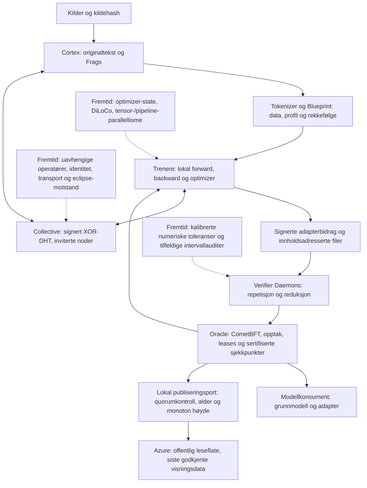

# Hypertrix: teknisk status og første deltakerpilot

Til Yngvar. Utarbeidet 14. oktober 2026. Eksperimentell plattform, én operatør.

## Kort svar på det tekniske spørsmålet

Vi har en fullført lokal finjustering av Qwen3-0.6B og en sporbar forbindelse fra
bevarte kildetekster til en ferdig modell som kan kjøres i Ollama. En separat
kontroll gjenskapte tekstvinduene, kontrollerte signaturene og filene, og
etterprøvde sammenslåingen av modellvektene. Full gjentakelse av treningen har
en annen status: første epoke ga tallforskjeller, og epoke 2 og 3 ble ikke gjentatt.
En senere kort diagnose identifiserte en løsning for repeterbar kjøring på samme
maskin. Den oppgraderer ikke den opprinnelige modellen til en fullt repetert modell.

Det finnes også et separat SmolLM2-forsøk som faktisk har fordelt trening og
verifisering mellom flere noder. Dette må ikke forveksles med Qwen-finjusteringen.

## Én fullført kjede: data til lokal modell

1. **Utgangspunkt:** Qwen/Qwen3-0.6B, publisert med Apache-2.0-lisens, revisjon
   `c1899de289a04d12100db370d81485cdf75e47ca`. Filhashene er registrert.
   Historien før dette sjekkpunktet er representert ved leverandørens dokumentasjon.
2. **Datagrunnlag:** 16 bøker, inkludert økonomitekster av Adam Smith, David Ricardo
   og Walter Bagehot. 11 016 386 byte originaltekst, 453 kildesegmenter og 4 427
   tokenvinduer. Bevarte originalfiler, kildeadresser, deklarerte rettigheter,
   rensegrenser og partisjonering er registrert. Partisjoneringen kan ikke avgjøre
   om grunnmodellen tidligere har sett de samme bøkene.
3. **Trening:** 3 epoker, 684 AdamW-oppdateringer, 5 601 792 neste-token-mål.
   LoRA med rang 16 og alpha 32 oppdaterte 10 092 544 parametere; grunnvektene
   var frosset. NVIDIA RTX 5090 Laptop GPU, CUDA 12.8, PyTorch 2.11.
   Oppskrift, datarekkefølge, programversjoner og sjekkpunkter er registrert.
4. **Utvalg og eksport:** epoke 3 ble valgt med en på forhånd fastsatt
   valideringsregel. LoRA ble slått sammen med grunnvektene og eksportert til BF16
   GGUF. Ollama serverer `hypertrix-economics-epoch-3:001`.
5. **Forbindelse:** 15 Ed25519-signerte poster binder innganger, resultater,
   sjekkpunkter og serveringspakken. Den opprinnelige pakken inneholder også ni
   faktisk genererte svar fra det tidligere modellforsøket. Yngvars nye seks
   rådstekster er forskerskrevne stimuli og inngår ikke som modellgenererte svar.

Testtapet (NLL) for økonomitekst falt fra 2,998768 til 2,424236; litteratur fra
3,713823 til 3,246297. Økonomispørsmålene gikk fra 8/12 til 7/12 riktige.
Dette er små, beskrivende målinger: lavere språktap viste ikke bedre oppgaveløsning.

## Hva en utenforstående kan kontrollere

**Med den offentlige dokumentpakken:** lese den spesifiserte oppskriften, kontrollere
signaturkjeden mot en separat innhentet offentlig nøkkel, sjekke hashene til de
medfølgende filene, undersøke resultatene og feilkvitteringene, og kontrollere
sertifikater fra det separate Oracle-forsøket mot en festet genesis-hash.
En hash som bare ligger ved siden av en fil gir integritetskontroll; tillit til
avsender krever at nøkkelen eller genesis-forankringen er kjent fra en annen kanal.

**Med originaltekstene, tokenizer og modellfilene i tillegg:** gjenskape alle
tokenvinduer, kontrollere modell- og adapterfiler, etterprøve sammenslåing og
eksportforbindelse, og kjøre treningsoppskriften i den dokumenterte programvaren.
De delbare ZIP-pakkene inneholder offentlig metadata, ikke hele korpuset eller
alle modellvektene. En annen forsker må derfor få disse separat eller laste ned
de festede kildene og sammenligne hashene. Nettadressene alene garanterer ikke at
samme fil fortsatt leveres.

**Observerte kontroller:** alle 4 427 tokenvinduer ble gjenskapt identisk;
15 signerte poster ble kontrollert; CPU-kontroll av sammenslåingen bestod for
310/310 eksporterte tensorer, inkludert 196 adapterte lineære avbildninger.
Kontroll av original treningsepoke 1 ga 0/392 identiske adaptertensorer,
relativ L2-avstand 0,00797163 og maksimal absolutt forskjell 0,00240201.
Dette var en mislykket eksakt kontroll, ikke en godkjenning med toleranse.

Den separate diagnosen fant avvik allerede i første bakoverpassering:
190/392 gradienttensorer var forskjellige med den opprinnelige automatiske
attention-banen. Math attention fjernet avviket i to firestegs kjøringer.
Streng deterministisk policy med math attention ga 392/392 identiske
adaptertensorer etter 12 oppdateringer per prosess. En hel epoke med den nye
policyen og validering på forskjellig maskinvare gjenstår.

Signaturer og replikasjon viser hvilke byte og beregninger som er dokumentert.
De etablerer ikke uavhengige organisasjoner, årsakssammenhengen mellom en
bestemt boksetning og et svar, eller komplett historikk for grunnmodellens trening.
Qwen-kjøringen har lokale signaturer, ikke et Oracle-sertifikat.

Offentlig operatørnøkkel: `3eedb69bceac39ca67320c3a6d704fe12dc4462cac7a56171ab804f2bc3ec537`.
Signert slutthode: `9e43d4e9ac8be1467131f457d947881c2286b005792f5501cb4d70b6c7d46e64`.
GGUF SHA256 for valgt modell: `5c0030da683551e25f3f1eb5fc02312ca3246b3e5ae8dd44bd0b2605a26fd173`.

## Arkitektur og distribuert tilbakepropagering

**Implementert i SmolLM2-testnettet:** fire separate CometBFT-validatorer,
midlertidige treningsleases, to vellykkede trenere, to GPU-verifikatorer og
replikerte vektsjekkpunkter. Fire runder ga åtte bidrag og 16/16 eksakte
repetisjoner. En utløpt lease ble overtatt av en ny trener; sen innsending fra
den gamle eieren ble avvist. En kald konsument hentet og kjørte modellen fra én
gjenværende verifikator. Alle nodene i dette forsøket brukte én fysisk vert og GPU.

Modellen er `W = W0 + (alpha/r) BA`. I dette distribuerte forsøket er A fast og
bare B trenes med lokal SGD. Etter lokale steg beregnes
`B_next = FP32(sum_k (n_k / sum_j n_j) * FP64(B_k))` i fast rekkefølge.
Dette er reell lokal tilbakepropagering med periodisk adapteraggregering.
Det er ikke kontinuerlig gradient-allreduce eller oppsplitting av én modell
mellom maskiner. Å gjennomsnitte både lærte A og B separat gir normalt ikke
gjennomsnittet av produktene BA; Qwen-kjøringen kan derfor ikke kobles direkte
til denne reduksjonen uten en ny kontrakt.

**Gjenstår:** distribuert Qwen/AdamW, kontrakt for optimizer-tilstand, eventuell
DiLoCo-ytre optimizer, brede maskinvareforsøk, asynkrone foreldrekonflikter,
tilgjengelighetsutfordringer og utskifting av verifikatorer. Homogen eksakt modus
beholdes. Heterogene grener får egne artefakthasher og eksplisitte vurderinger;
SHA256 blir aldri en «tolerant hash». Cosinus alene fanger ikke endret størrelse
på oppdateringen. Et ferdig numerisk akseptkriterium er ikke implementert.

**Nettverkssplitt nå:** Azure brukes som offentlig leseflate. Lokale ressurser
utfører beregningene; publisering krever en kontrollert quorumkvittering.
Ved bortfall beholdes siste godkjente bilde og merkes foreldet. Dette er
visningskontinuitet, ikke konsensusfremdrift uten quorum. Den nyere lokale
treningskjeden og den eldre hybride kjeden har forskjellige genesis-forankringer;
de blir ikke automatisk slått sammen ved gjenoppkobling.

## Deltakerpilot etter Yngvars innspill

Rådsvisning og proveniensvisning er separate komponenter. De seks rådstekstene
er lagret ordrett. Dokumentasjonsbetingelse A viser ingen ekstra dokumentasjon;
B viser en utviklingsbeskrivelse; C viser de samme setningene med dokumentlenker.
Én deltaker beholder samme betingelse gjennom tre scenarioer. Rekkefølgen trekkes
tilfeldig, og hver deltaker ser bare én rådvariant per scenario. Blokker på 24
tildelinger balanserer tre betingelser og åtte kombinasjoner av rådvarianter.
Avbrutte økter beholdes i tildelingsoversikten, ikke omfordelt etter resultatet.

Alle får samme nøytrale forklaring om at rådene er skrevet for forsøket og at
modelldokumentasjonen gjelder en reell demonstrasjonsmodell. Det skal ikke stå
at de faste rådene ble generert av denne modellen. Om forsøket trenger en slik
attribusjon, må rådstimuli og design avklares før rekruttering. Den tidligere
tre-modell-sammenligningen beholdes som et separat teknisk forsøk.

For hver oppgave registreres valg, tillit (1-7), egen sikkerhet (1-7), bruk av
rådet (følge/sjekke/avvise), opplevd vanskelighet (1-7), valgfri begrunnelse,
åpning av dokumentasjon og lenker, visnings- og innsendingsdato. Ingen tall er
forhåndsvalgt. Tilfeldig øktkode erstatter navn. SHA256 binder scenario, råd,
dokumentasjon, grensesnitt og protokollversjon. Økter tåler serverstart på nytt;
gjentatt identisk innsending dobbelttelles ikke. Tidsbruk inkluderer pauser.

Forskerdata lagres bare lokalt og kan eksporteres som JSON. Det offentlige
Azure-nettstedet har ingen innsamlingsendepunkter eller deltakerresultater.
Forskerforhåndsvisning skriver ingen økter. Fasit og rådvariantetiketter sendes
ikke med deltakerens oppgave. Dette er en lokal pilot, ikke en sikret ekstern
rekrutteringsportal; forsker- og deltakersider bør separeres med autentisering
før reell flerbrukerdrift.

Yngvar følger opp faglig vurdering av de tre scenarioene, om feilene er plausible,
vanskelighetsnivå, endelig design og analyseplan. De enkle regnestykkene er
kontrollert: 3 600 mot 1 400 kroner spart rente under oppgavens forutsetninger;
0,55 mot 0,45 prosent i fondsgebyr; 108 000 mot 122 000 kroner i nominell
utbetaling. Dette er mekaniske kontroller, ikke en erstatning for fagfellevurdering.
Ingen deltakereffekt eller konklusjon om tillit er målt i denne leveransen.

## Filer for teknisk oppfølging

- `docs/results/finetune-economics-001/`: metode, signaturer, modellmålinger og opprinnelig replay-feil.
- `docs/results/finetune-repeatability-001/`: kontrollerte tester av bakoverpassering og ny eksakt policy.
- `docs/results/oracle-training-run-003/`: sertifisert treningshistorikk, leases og replikkgjenoppretting.
- `docs/training_verification.md`: verifikasjonsdesign og forskningsreferanser.
- `research/trust-study-v2.json`: stimuli og foreløpig forskerrubrikk.
- `docs/trust-study-v2.md`: protokoll, dataordbok og operatørveiledning.

Kildekode og offentlig dokumentasjon: https://github.com/drcircuit/DAWL
