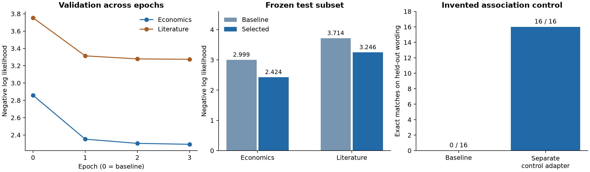
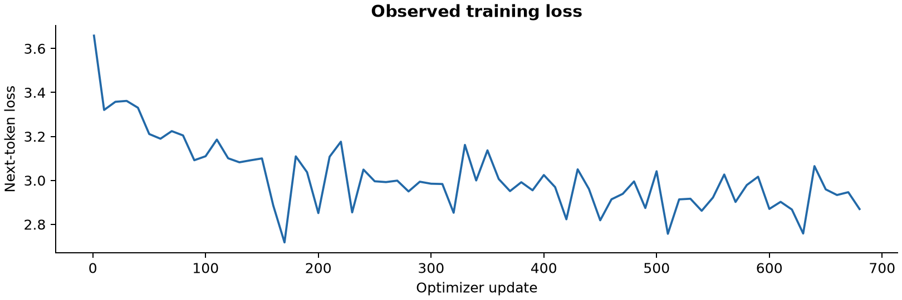

# Local economics fine-tuning and provenance pilot

Recorded 14 October 2026. This is a local calibration branch of Hypertrix. The existing Oracle testnet was kept running; these Qwen checkpoints have local signed records and are not Oracle-certified.

**Training and local serving completed. Artifact, source-to-token and CPU merge checks passed. Exact GPU training replay failed at the first epoch boundary; the later two boundaries were not compared.** The original model and every failure receipt are preserved. Improved held-out language-model loss did not translate into improved scores on the small economics question set.

## What ran

Official Qwen3-0.6B, pinned to `c1899de289a04d12100db370d81485cdf75e47ca`, continued on the existing 13 books plus Smith, Ricardo and Bagehot: **16 books, 3.00 epochs, 684 optimizer updates and 5,601,792 next-token targets processed**. LoRA updated 10,092,544 parameters on the **NVIDIA RTX 5090 Laptop GPU**, using CUDA 12.8. Peak allocated tensor memory was 9.77 GiB. Both local comparison models are served as BF16 GGUF through Ollama.

The starting weights were published by Qwen under Apache-2.0. Earlier development is represented by the provider's documentation; the detailed local trail starts at that published checkpoint. The [methodology](methodology.md) records the source selection, split rule, optimization and selection procedure.

## Measured outcomes

Selected checkpoint: **epoch-3**, chosen using economics validation NLL with the frozen literature guard. The test subset did not select the checkpoint. Each test domain contains 32,768 targets from 64 preselected windows.

| Test domain | Baseline NLL | Selected NLL | Baseline perplexity | Selected perplexity |
|---|---:|---:|---:|---:|
| Economics | 2.998768 | 2.424236 | 20.061 | 11.294 |
| Literature | 3.713823 | 3.246297 | 41.010 | 25.695 |

These results measure next-token prediction on held-out book segments. They do not establish that the books were absent from Qwen's pretraining, and they do not identify which passage caused an answer. This is one run with no confidence interval or multi-seed estimate.

| Fixed closed-book probes | Baseline | Selected |
|---|---:|---:|
| Economics | 8/12 | 7/12 |
| General | 4/6 | 4/6 |

The small probes are descriptive, not a broad economics benchmark. The original prompts, options, scores and generated explanations remain in the evidence.

The **separate invented-association control** scored **0/16 before and 16/16 after 160 updates** on held-out question wording. Its adapter is separate from the economics model. It tests a small codebook memorization task rather than general reasoning.

## What was checked

The separate CPU checker reports **15 valid signed records**, **16 preserved books**, **453 source segments** and **4,427 token windows independently rebuilt with matching token IDs**. It also rechecked checkpoint/export hashes and the signed serving package. Serving package verified: **True**.

Fresh-process training replay status: **mismatch**. Every completed comparison uses exact tensor equality, with no tolerance substituted for a failure.

| Checkpoint boundary | Exactly matching tensors | Maximum absolute difference | Relative L2 |
|---|---:|---:|---:|
| epoch-1 | 0/392 | 0.00240201 | 0.00797163 |

The replay starts from the base weights and public recipe rather than loading the trainer's adapter or optimizer state. It uses the same GPU, runtime and operator. Thus it is computational replication, not an independent institution or heterogeneous-hardware validation. The original GPU deadline was **2026-10-14T14:21:30.884571+00:00** and was not extended. The trainer reports 83.7 minutes elapsed, including pauses; the last recorded replay progress was 17.0 minutes. The replay was stopped after the first mismatch to investigate within that budget. Its intentional exit 137 is recorded. **This is a failed exact check, not merely an unfinished check.** Epochs 2 and 3 remain untested by replay.

The initialization diagnostic reproduced the initial adapter tensors and CPU/CUDA random-number states exactly (`full_vs_abbreviated_identical=True`). A second diagnostic ran two ten-update prefixes with the same initialization, seed, recipe and data order. It found **0/392 exactly matching final tensors**, with maximum absolute difference **0.000152845809**. Deterministic algorithms were enabled: **False**. This demonstrates non-repeatability of the current execution path even on this GPU; it does not isolate the responsible operation or prove that all of the full-epoch difference has one cause.

The next exact-mode recipe needs explicit deterministic execution settings, pinned backend choices and a short repeatability gate before a long run. PyTorch documents that controlling random seeds and avoiding nondeterministic algorithms are separate requirements ([PyTorch 2.11 reproducibility](https://docs.pytorch.org/docs/2.11/notes/randomness.html)). Such a recipe would be a new experiment. This run's mismatch is not retrospectively accepted using an epsilon threshold.

The signed serving package connects the selected adapter's exported weights, actual GGUF bytes, Ollama digest, case definitions and nine recorded model responses. CPU merging rounds LoRA updates into BF16; the serving artifact is explicitly recorded as a derivative. Hash verification binds those bytes and records; it is not a semantic proof of the converter implementation.

A separate CPU merge check passed: **310/310 exported tensors**, including **196 adapted linear maps / 392 adapter tensors**. Its first attempt assumed a single final rounding and failed on the adapted maps. Inspection of the pinned PEFT implementation established that safe merge rounds the update to BF16 before adding it to the BF16 base. The corrected checker reproduces that specified arithmetic exactly. Both receipts and the original checker are preserved; the model weights were not changed to make the check pass.

The training runtime's tokenizer serialization initially failed in the older converter runtime. A separate conversion view pairs the unchanged, originally pinned tokenizer/config with the merged weights, preserving the signed export untouched. Its file mapping is hashed and checked. The published base's duplicate input/output embedding tensors were also byte-identical, confirming the tied-weight omission in the merged export.

Windows logged idle-triggered Modern Standby at 14:53–15:24 and 15:39–15:42 Oslo time, coinciding with stalls. A temporary Windows keep-awake request was activated for the remaining pilot, with the original deadline unchanged. These standby intervals are recorded as execution context; they are not subtracted as an exact measurement of GPU active time.

Operator public key: `3eedb69bceac39ca67320c3a6d704fe12dc4462cac7a56171ab804f2bc3ec537`. Final signed head: `9e43d4e9ac8be1467131f457d947881c2286b005792f5501cb4d70b6c7d46e64`.

## Live human-trust prototype

Open [Trust Lab](http://127.0.0.1:8885/) locally, or follow its link from the [Collective Console](http://127.0.0.1:8882/). Three real model conditions answer the same three documented financial cases: unchanged local Qwen weights, OpenAI GPT-5.4 mini and the selected local adaptation. These nine answers are captured once and preserved without rewriting; errors are not replaced with dummy text.

The comparison page shows available provider documentation for Qwen and OpenAI, and the local development chain for Hypertrix. The participant view explains the starting model, added books, text preparation, training, replay and recorded answer through clickable steps. It describes the evidence without an advice disclaimer or a claim that the evidence should raise trust. Technical scope remains inspectable.

The signed package preserves its original interface snapshot in `evidence/lab-interface`. Final visual inspection found that the update counter preferred the last periodic log (680) over the completed summary (684). That display-only correction is included separately in `evidence/interface-current` and this bundle's checksum manifest. It changes no model, answer, metric record or signed artifact. Trial records capture the active interface hashes.

The controlled A/B/C prototype holds the exact answer constant and varies disclosure: none, developer statement, or checkable records. The three-model comparison and before/after reveal mode are exploratory and do not isolate a causal provenance effect. Domain-expert output review, comprehension testing, recruitment, power and analysis plans remain research work; this report contains no participant-effect findings.

## Rechecking and sharing

This folder includes public metadata and frozen case responses under `evidence/`. It excludes private keys, credentials, full model weights and the raw corpus. Full binary verification uses the preserved local pilot directory `/var/lib/dawl/finetune-economics-001` in WSL. The per-file SHA256 list detects changes to this shareable copy; the Ed25519 ledger anchors its signed artifacts.

Run `scripts/verify_finetune.py --root <pilot> --trusted-public 3eedb69bceac39ca67320c3a6d704fe12dc4462cac7a56171ab804f2bc3ec537` from the repository environment. The report graphs are generated from the recorded JSON, not hand-entered measurements.
