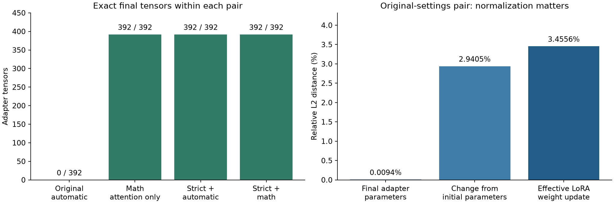

# Why the training replay diverged

**The short-run mismatch is reproducible and fixable.** The original execution selected FlashAttention and diverged during the first backward pass. Math attention alone removed the divergence; strict settings also made the automatically selected FlashAttention path repeatable. The longer strict-math pair completed 12 optimizer updates per process with every adapter tensor identical.

The diagnostic was run on 14 October 2026 on the NVIDIA RTX 5090 Laptop GPU. It took **11.18 minutes**, within a separate 20-minute cap. It uses the frozen pilot's model, data, initial adapter weights and software dependencies. The original three-epoch model and first-epoch mismatch are unchanged. No full-epoch strict replay or heterogeneous-hardware verification has yet been performed.

## Controlled comparisons

Each row compares two fresh processes under the same settings. There are four updates per process except the strict-math confirmation, which has twelve. These are instrumented training prefixes, not a new economics fine-tuning run.

| Policy | Updates per process | Observed attention path | Exactly equal final tensors | Effective update relative L2 | First observed divergence |
|---|---:|---|---:|---:|---|
| legacy-auto | 4 | FlashAttention | 0/392 | 3.455575% | Update 1, first_micro_gradient_hashes |
| math-only | 4 | Math attention | 392/392 | 0.000000% | None in recorded checks |
| strict-auto | 4 | FlashAttention | 392/392 | 0.000000% | None in recorded checks |
| strict-math | 12 | Math attention | 392/392 | 0.000000% | None in recorded checks |

The first original-settings pair had identical initial tensors and CPU/CUDA RNG states. Its first forward loss and sampled forward logits matched exactly. **190 of 392 adapter gradient tensors differed after the first microbatch**, before gradient clipping or the AdamW step. The maximum absolute gradient difference was **0.000164844096**. The math-only intervention preserves the other execution settings, isolating attention-backend selection as the effective remedy in this test. Profiling identifies the original FlashAttention backward operation. A separate low-level kernel proof or exhaustive analysis of every later divergence is not claimed.

Strict mode enables deterministic algorithms with errors on unsupported operations, sets the cuBLAS workspace before CUDA starts, disables TF32/reduced-precision reductions, and explicitly selects optimizer/clipping implementations. Strict-auto still selected FlashAttention here. Strict-math forces math attention and is the conservative reference policy. The new [verification design](verification-design.md) explains the execution contract and why seeds alone were insufficient.

## How large were the differences?

For the **new four-update original-settings pair**:

| Quantity | Measured value |
|---|---:|
| Final adapter parameter relative L2 | 0.009380% |
| Change-from-initial parameter relative L2 | 2.940529% |
| Effective LoRA update relative L2 | 3.455575% |
| Effective LoRA update cosine | 0.999402847 |
| Maximum absolute adapter parameter difference | 5.51762705e-05 |
| Maximum absolute effective-update difference | 9.72999972e-06 |
| Top-1 prediction agreement on 128 positions | 99.21875% |
| Mean KL divergence on those positions (nats) | 0.000941238951 |
| Maximum KL divergence (nats) | 0.00715136489 |
| Economics NLL difference (run 2 − run 1) | -7.35521317e-05 |
| Literature NLL difference (run 2 − run 1) | 0.00271904469 |

Effective changes are computed as `(alpha/r) * B @ A` in CPU FP64, one map at a time. The largest layer-relative discrepancy was 10.773% in `base_model.model.model.layers.3.self_attn.q_proj`. These early updates have small norms; both absolute and relative metrics matter. A tiny factor-relative number can be diluted by the much larger initialized factors.

The common output evaluator uses math attention. It measures two fixed validation windows per domain for NLL and the first 32 positions of each for logits. No free-text response equivalence or downstream advice-quality conclusion follows from this small sample. These measurements are not the original 228-update epoch comparison: its replay candidate was not retained. The updated verifier preserves future replay candidates for later analysis.

## Changes implemented

- New immutable recipe schema 2 with selectable strict execution policies; the legacy recipe remains supported and unchanged.
- A versioned runtime, `localhost/hypertrix-finetune:004`, based on the preserved 002 dependencies. Image ID: `4f6b8843409c25f443fd992b71274452bd253f8bc5c02d3e144a19585e949dc8`.
- A replay failure now takes precedence over a later timeout; incomplete work cannot obscure an already observed mismatch.
- Future replay boundaries save the verifier's actual adapter and its hash, including failed comparisons.
- The Trust Lab training page shows these short-run results separately from the original model's failed epoch replay. Diagnostic nodes are visible in the Console with their own evidence directory.
- Six execution-contract/runtime tests passed in the pinned runtime; six Trust Lab tests passed, including access boundaries for diagnostic evidence. These tests do not substitute for a new full-epoch replay.

The original run is not retrospectively certified by a successful diagnostic. The fixed source is prepared for a new lineage; no participant responses or original checkpoint records were changed.

## Observed timing

| Policy / process | Mean seconds per update after update 1 | Process wall seconds |
|---|---:|---:|
| legacy-auto / 1 | 3.769 | 48.9 |
| legacy-auto / 2 | 3.821 | 48.4 |
| math-only / 1 | 4.306 | 51.8 |
| math-only / 2 | 4.206 | 51.8 |
| strict-auto / 1 | 5.034 | 54.4 |
| strict-auto / 2 | 5.149 | 55.7 |
| strict-math / 1 | 5.616 | 106.1 |
| strict-math / 2 | 5.305 | 95.6 |

These timings include copying and hashing gradients/weights. The first update additionally invokes the profiler and is excluded from the per-update mean. Runs were sequential on one laptop and may experience thermal or background-load variation. This is not a throughput benchmark. The temporary Windows system/display keep-awake guard covered the diagnostic and released when it completed. An initial output-directory permission error occurred before GPU work; ownership was corrected and the container restarted. No training attempt was discarded to obtain an exact result.

## Recommended verification approach

Retain exact replay for homogeneous cohorts with pinned execution contracts. For larger workloads, develop commitments to complete restartable states and post-commitment random interval audits. For heterogeneous branches, investigate predeclared per-layer bounds on effective updates plus separate behavioral evidence. Keep SHA256 exact in every mode; numerical agreement is a receipt relating different artifacts, not a fuzzy hash.

Cosine similarity alone accepts a scaled update. Endpoint/output similarity alone does not prove the claimed work. Full replay also does not prove which node originally performed work: a worker could copy a valid contribution. Reward and admission rules need a separate adversarial design. Checkpoint proof-of-learning literature contains both proposals and demonstrated spoofing attacks; the [design note](verification-design.md) includes those sources and the assumptions behind sampled detection probabilities.

## Evidence and reproduction

The operator signature binds the diagnostic result manifest to original lineage head `9e43d4e9ac8be1467131f457d947881c2286b005792f5501cb4d70b6c7d46e64`. Operator public key: `3eedb69bceac39ca67320c3a6d704fe12dc4462cac7a56171ab804f2bc3ec537`. The separate artifact checker verified **73 files** against that signed manifest, including saved tensor candidates. This establishes file integrity and attribution to the same local operator; it does not create an Oracle quorum or independent organizational verification.

`evidence/` contains the pinned diagnostic implementation, actual settings, traces, comparisons, exit receipts, logs, signature and file manifest. The large tensor snapshots remain in `/var/lib/dawl/finetune-repeatability-001`; their hashes are in the signed manifest. `implementation/` contains the subsequent integration changes, separately from the exact code used for the diagnostic. The original model directory was mounted read-only throughout the experiment.

Live view: [Trust Lab training evidence](http://127.0.0.1:8885/#training). Original experiment: [economics pilot](../finetune-economics-001/README.md).
