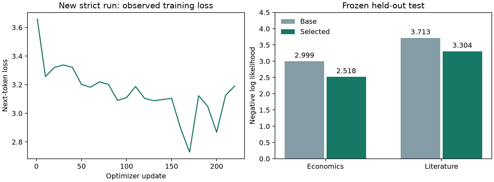

# Strict full-epoch fine-tuning and fresh-process replay

Recorded 14 October 2026. **Replay outcome: exact-match.** This is a new
Qwen3-0.6B lineage (`finetune-strict-002`), not a relabeling of the original model.
The original first-epoch mismatch and the later 12-update diagnostic are preserved.

## Frozen experiment

Same pinned Qwen revision, 16 preserved books and tokenizer as the original run.
One complete epoch: **228 AdamW updates**, **1,867,264
next-token targets**, 1.00 corpus passes. Both LoRA A and B are trained.
Strict-math policy: deterministic algorithms fail on unsupported operations,
math SDPA only, explicit nonfused/nonforeach optimizer and clipping, no TF32 or
reduced-precision reductions, CUBLAS_WORKSPACE_CONFIG=:4096:8.

Recipe schema 3 explicitly pins one epoch; its learning-rate schedule therefore
spans one epoch, unlike the original three-epoch schedule. This tests full-epoch
repeatability of a new strict recipe, not identical weights to the old epoch 1.
Runtime 005 uses the original 002 dependencies plus the pinned execution fix.
Image ID: `945ef0862c06a0458c86e85984865cb983d91b430c321e4e79081f7e25b3139f`.

Training elapsed 26.66 minutes including evaluation;
fresh-process replay elapsed 19.82 minutes. RTX 5090 Laptop GPU,
CUDA 12.8; same physical GPU/runtime/operator. These are not cross-hardware results.
The user authorized CPU/GPU through 21:30 Oslo; the orchestration applies a hard
container deadline and the session retains its shorter internal budget.

## Replay at the full epoch boundary

| Boundary | Updates | Identical tensors | Relative L2 | Maximum absolute difference |
| --- | ---: | ---: | ---: | ---: |
| epoch-1 | 228 | 392/392 | 0 | 0 |

The verifier starts in a fresh process from the frozen base and recorded recipe,
reconstructs initialization and replays all updates. It does not initialize from
the trained adapter or optimizer. The resulting candidate tensors are retained.
Tensor equality is distinct from serialized-file equality: both checkpoint file
hashes are recorded, including their serialization metadata. No epsilon is used.

## Data and export checks

CPU source-to-token replay matched **4427 windows**.
The separate CPU merge checker matched **310/310
exported tensors**, including 196 adapted maps.
The signed release manifest and all 39 bound files were rechecked.
Selected checkpoint: `epoch-1`. The merged model is executable
in Transformers. This release does not claim an Ollama import or Oracle certification.

## Descriptive evaluation

| Held-out domain | Base NLL | Selected NLL |
| --- | ---: | ---: |
| economics | 2.998517 | 2.517980 |
| literature | 3.713179 | 3.303516 |

| Small fixed probe set | Base | Selected |
| --- | ---: | ---: |
| economics | 8/12 | 9/12 |
| general | 4/6 | 5/6 |

These small probes are descriptive; training verification is separate from answer
quality. No participant outcomes were collected or inferred by this experiment.

## Rechecking

Operator public key: `a30bc71e898549c4f43320fe30c6c3ad90779c87fa39ed490fb4ef2349ba8eb5`.
Release SHA256: `fffeadd1ec58342fe2a9cfb894e65f37118e11e79f5c17ee9ea7857ebec99efa`.
Signed training lineage head: `9dbd3d40e9c67c77789d286734d41a2fa60b7ada1dddeceeba44666d15390f86`.

The public package includes metadata, recipes, implementations, signatures,
receipts and measurements. Raw corpus and large model/checkpoint tensors stay in
the preserved local experiment. Their hashes are bound in `evidence/release.json`.
For full binary checks, provide those files as well. Runtime source is preserved
from image 005, separately from later application edits. One local operator signed
both the training lineage and the release; this is no independent organizational
attestation and does not extend the upstream model's pretraining lineage.
