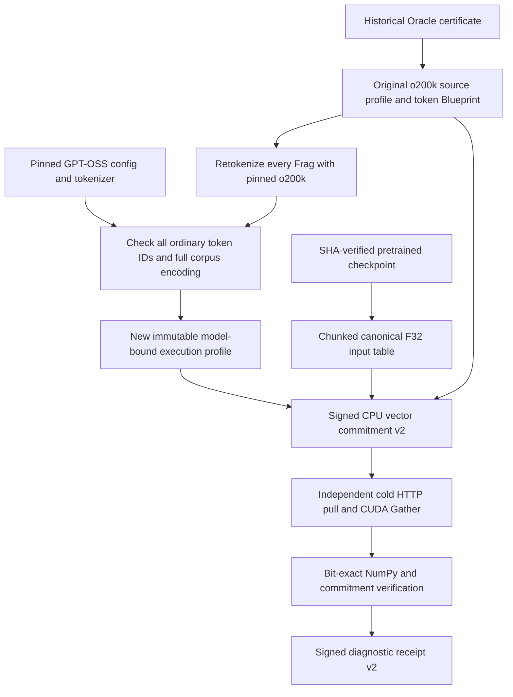

# o200k GPU verification with GPT-OSS input weights

**Passed:** all 13 books, 1,807 Frags and 1,753,309
ordinary o200k tokens. The GPU reconstructed **20.198 GB** of
dense F32 input vectors from **2.371 GB** of cold HTTP
object payload, including the full canonical input table. Every Frag matched both
NumPy replay and its earlier signed CPU vector commitment byte-for-byte.

This expands GPU coverage to **six ordinary-tokenizer profiles**, totaling
**10,842 profile/Frag executions** and **59.930 GB**
reconstructed across this run and the [five-profile run](../profile-gpu-run-001/README.md).
The prior five-profile evidence is preserved as a separate historical run.

## What makes this a valid o200k test

The actual pretrained input table comes from
[openai/gpt-oss-20b](https://huggingface.co/openai/gpt-oss-20b/tree/6cee5e81ee83917806bbde320786a8fb61efebee).
GPT-OSS uses o200k_harmony; its
[official tokenizer definition](https://github.com/openai/gpt-oss/blob/main/gpt_oss/tokenizer.py)
shares the ordinary o200k mergeable vocabulary and splitting pattern and adds
Harmony control tokens. We verified every one of the **199,998
ordinary byte-piece-to-token-ID mappings** against the pinned checkpoint tokenizer,
including the exact splitting expression and normalization policy.

We then disabled added-token/control matching in an independent Hugging Face
tokenizer reference and compared its ordinary encoding against the stored o200k
token IDs for **every corpus Frag**, during both CPU preparation and GPU replay.
Literal strings such as `<|start|>` and `<|return|>` remain text. No chat template,
control token insertion, Harmony rendering or model inference is performed.
This is an input-embedding compatibility test, not a claim that o200k_base and
o200k_harmony are interchangeable for chat. See the
[Harmony format documentation](https://developers.openai.com/cookbook/articles/openai-harmony).

The original certified tokenizer-only profile remains:
`f5f2c3a4941166019064c50b515bcbe9397f26deb36a848ae66f57a4d85acc85`.
The new model-bound execution profile is:
`5bb647b2e4fb48f08ce8d32e1ad95bf00aa2ccee9c4fca2d02011e4ee29c6bb5`.
It has 201,088 rows and 2,880 dimensions, covering the ordinary IDs plus
the model's additional rows. The o200k rank artifact and ordinary encoding contract
are unchanged. Token provenance continues to point to the existing certified
Blueprint `5bf4c0e40b8e97682b318d91568661a723acd19f1ed084f9b9dd59d481c52530`; a version-2 vector commitment explicitly
binds that source profile to the new execution profile and imported weights.
The new execution profile and vector receipts are **local diagnostics**, not newly
registered or certified Oracle vector jobs.

## Measured execution

| Measurement | Result |
|---|---:|
| Books / Frags | 13 / 1,807 |
| Ordinary tokens | 1,753,309 |
| Canonical input table | 2,316,533,760 bytes |
| Reconstructed dense vectors | 20,198,119,680 bytes |
| Successfully fetched HTTP object bodies | 2,370,796,920 bytes |
| Dense F32 / received payload | 8.52× |
| Fewer payload bytes than dense F32 transfer | 88.26% |
| Cold GPU verification pipeline | 133.51 s |
| GPU reconstruction plus CPU comparison and hashing | 42.76 s |
| GPU gather/host-return time | 12.16 s |
| CUDA kernel-event time | 191.86 ms |
| GPU launches | 1,807 |

Hardware: NVIDIA GeForce RTX 5090 Laptop GPU; CUDA driver API
13040; CPU fallback disabled.
The separate Cortex and GPU containers shared one local WSL host. The GPU had a
fresh CAS cache and fetched tokenizer/config assets, raw source, token manifests,
signed lineage, compatibility evidence, vector commitments and chunked weights.
Its read-only bootstrap contained public identities and the historical certificate,
not corpus or matrix files. HTTP framing is excluded from byte counts.
The fixed input table is counted in the cold payload above; it could be reused for
later corpora, but no warm-cache measurement is claimed here.

Initial checkpoint acquisition and prior CPU commitment preparation are separate
from the timed cold GPU verification pipeline. The complete required safetensors
shard was **4,170,342,232 bytes**, SHA-256
`a18106b209e9ab35c3406db4f6f12a927364a058b21e9d1373d682e20674b303`. That complete file was checked before extracting
`model.embed_tokens.weight` (BF16). Its other model tensors
were not imported or executed. The input table is exactly widened to F32; the
transfer comparison therefore concerns dense F32 arrays, not compressed/BF16 output.
Timings are observations from one local run, not a WAN benchmark or model-quality comparison.

## Verification chain



For each Frag f, V_f = E_GPT-OSS[t_f, :]. The compatibility check establishes
which table rows each ordinary token ID addresses. CPU and GPU both reproduce
SHA-256 of the row-major little-endian F32 bytes. The commitment binds the source
profile, token Blueprint, execution profile, import identity and each Frag's token
and vector descriptors. The receipt signs the same identities and the observed
coverage. Swapping a profile, Blueprint, rank mapping or table breaks a checked binding.

The table bound was raised from 2 GiB to 4 GiB, while preserving the kernel's
32-bit element-index constraint, 64 MiB reusable output buffer and device-memory
preflight check. A separate labelled synthetic fixture tested indexing past the
2 GiB boundary and the final model row on actual CUDA. The corpus measurement
above uses real pretrained weights, not that fixture.

Tests cover changed vocabulary rows, altered split patterns, undersized model
vocabularies, config tampering, signed source/execution-profile substitutions and
literal control strings. The corpus run also rejected a false vector hash,
flipped GPU output bit, negative/out-of-range IDs and fractional indices.
See [verification.json](verification.json) for the exported signature and coverage
check. Those checks are not a proof of remote computation; both diagnostic keys
belong to one operator. The historical source quorum is checked separately in the
runner. Source authenticity and upstream training provenance remain separate claims.

## Reproduce

```powershell
.venv\Scripts\python.exe scripts/fetch_o200k_model.py
.venv\Scripts\python.exe scripts/fetch_profile_weight_ranges.py gpt-oss-20b
wsl -d kali-linux -u root -- podman build --network none -f Dockerfile.profile-gpu -t localhost/hypertrix-o200k-gpu:v1 .
wsl -d kali-linux -u root -- sh scripts/o200k_gpu_pilot.sh init
wsl -d kali-linux -u root -- sh scripts/o200k_gpu_pilot.sh prepare
wsl -d kali-linux -u root -- sh scripts/o200k_gpu_pilot.sh provider
wsl -d kali-linux -u root -- sh scripts/o200k_gpu_pilot.sh replay
wsl -d kali-linux -u root -- sh scripts/o200k_gpu_pilot.sh finish
.venv\Scripts\python.exe scripts/verify_profile_gpu.py --root docs/results/o200k-gpu-run-001 --names o200k_base
.venv\Scripts\python.exe scripts/report_o200k_gpu.py
```

The native state directory `/var/lib/dawl/o200k-gpu-001` is created once. Use a fresh
state directory and result destination for another execution. Input artifacts come
from the preceding local profile testnet's public provider store. Private validator
keys are neither mounted nor exported. The GPU container exits after its work, and
the finish step stops the temporary Cortex at `127.70.0.29:8900`.

Public evidence includes [report.json](report.json), the full signed CPU commitment,
GPU receipt and table-import manifest, [combined coverage](combined-coverage.json)
and implementation pins. Reproducing the numerical result requires the pinned
checkpoint and corpus artifacts; offline receipt verification checks signatures,
bindings and coverage without pretending to redo the numerical work.
