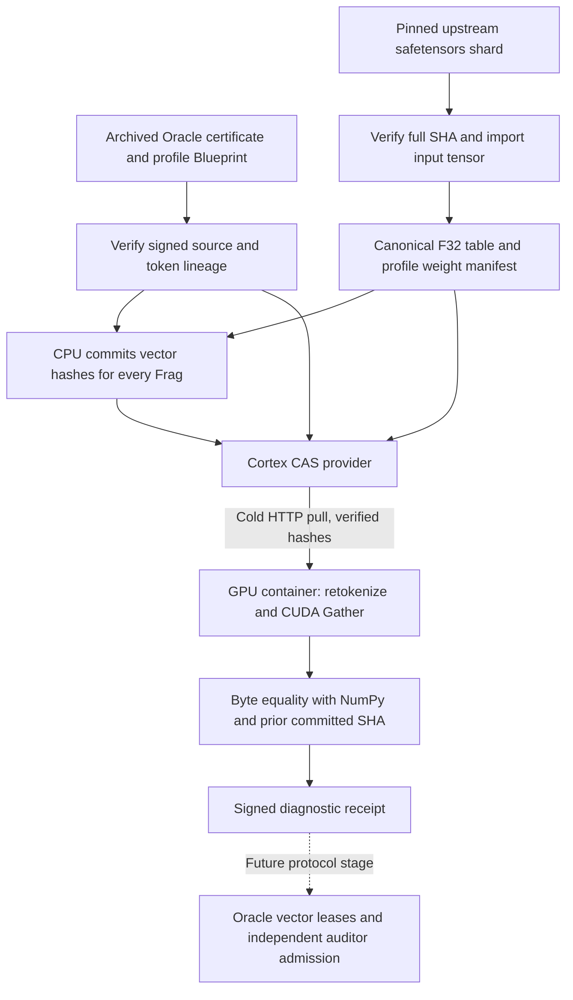

# Profile GPU verification — 14 October 2026

All five model-bound profiles passed full-corpus CUDA reconstruction against
earlier signed CPU commitments and an independent NumPy row lookup. Each profile
covered the same 13 books and 1,807 Frags: **9,035 verified profile/Frag
executions**, **39.732 GB of dense F32 vectors**, and **3.119 GB of
received HTTP object payload** across five separate cold caches. Aggregate dense
expansion was **12.74×**, or **92.15% fewer payload bytes**
than transferring the corresponding dense F32 arrays.

`o200k_base` was deliberately skipped for vector execution: its certified profile
contains a tokenizer but no bound model/input matrix. Its prior token audit remains valid.

## Measurements

| Profile | Tokens | F32 table MB | Dense vectors GB | HTTP payload MB | Dense/payload | Total seconds |
|---|---:|---:|---:|---:|---:|---:|
| gpt2-baseline | 2,061,330 | 154.39 | 6.332 | 179.75 | 35.23× | 58.40 |
| smollm2 | 1,933,422 | 113.25 | 4.455 | 138.84 | 32.08× | 52.81 |
| qwen3 | 1,763,536 | 622.33 | 7.223 | 656.57 | 11.00× | 68.73 |
| qwen35 | 1,780,226 | 1017.12 | 7.292 | 1052.81 | 6.93× | 75.02 |
| smollm3 | 1,761,415 | 1050.67 | 14.430 | 1090.69 | 13.23× | 92.19 |

MB and GB are decimal. HTTP payload counts successfully fetched object bodies,
including the canonical input table, raw source, tokens, tokenizer/config,
lineage and vector commitments. HTTP headers/TCP/TLS framing are excluded. No dense
sequence-vector objects were stored at the provider or downloaded by the GPU node.

Total time includes historical quorum verification, cold HTTP fetching, signature
and source checks, full retokenization, canonical table assembly, CUDA setup,
reconstruction, CPU comparison and vector hashing. The detailed signed receipts
also separate kernel-event time, GPU round-trip time and CPU comparison time.
Local checkpoint acquisition/preparation and ordinary host activity overlapped
some runs. These are observed end-to-end executions, not controlled performance
rankings between model families or measurements of WAN throughput.

The fixed table is amortizable across later corpora. This run measures cold caches;
it does not present a calculated warm-cache scenario as an observed download.
The dense comparison is explicitly F32. Comparing against compressed or BF16 dense
transfers would change the reduction. These are input embeddings, not contextual
representations from a model forward pass.

## What ran

One read-only Cortex container served hash-addressed objects over loopback HTTP
on `127.70.0.28:8900`. Separate CPU preparation processes created signed per-Frag
commitments before the GPU replay processes started. Each GPU process had a fresh
object cache, only its diagnostic signing key, read-only public bootstrap metadata,
and WSL GPU device access. It did not mount provider data or validator keys.
The RTX 5090 Laptop GPU held one table at a time and bounded reusable output buffers;
the CUDA driver executes a fixed 32-bit row-copy kernel with no CPU fallback.

The GPU process verifies the archived CometBFT quorum against the independently
pinned genesis, imports the corresponding signed profile lineage, fetches and
hash-checks all source/token artifacts, then retokenizes every book before gathering.
Profiles and book coverage come from the certified heads in
[the preceding protocol run](../profile-testnet-002/README.md), state height 2,235.
No new validator cluster or cloud deployment was required for this diagnostic.



## Mathematical and provenance contract

For profile p with canonical table E_p in R^(vocabulary × dimension), the Frag
token sequence t_f reconstructs V_f = E_p[t_f, :]. The CPU commitment is
SHA-256 of V_f serialized row-major as little-endian float32. GPU bytes must equal
both the NumPy replay bytes and that earlier hash, without numerical tolerance.

The import identity hashes the profile ID, named weight manifest, source
checkpoint revision/full-file hash, source tensor metadata, table hash and
conversion contract. The signed CPU commitment binds that import identity, the
certified token Blueprint, every book/token entry and every Frag's token and vector
descriptor. The GPU signature binds its result to the same import, Blueprint and
CPU commitment. A hash or profile substitution therefore breaks a checked binding.

Canonical conversion is exact for finite source values: F32 preserves its bits;
F16 widens exactly to F32; BF16 shifts its 16-bit representation left by 16 bits.
Nonfinite values are rejected. The GPU Gather then copies F32 bit patterns and
performs no floating-point arithmetic. The contract excludes positions, layers,
attention, pooling, gradients and training.

| Profile | Pinned upstream repository | Upstream input tensor | Source dtype | Shape |
|---|---|---|---|---|
| gpt2-baseline | [openai-community/gpt2](https://huggingface.co/openai-community/gpt2/tree/607a30d783dfa663caf39e06633721c8d4cfcd7e) | `wte.weight` | F32 | 50257 × 768 |
| smollm2 | [HuggingFaceTB/SmolLM2-135M](https://huggingface.co/HuggingFaceTB/SmolLM2-135M/tree/93efa2f097d58c2a74874c7e644dbc9b0cee75a2) | `model.embed_tokens.weight` | BF16 | 49152 × 576 |
| qwen3 | [Qwen/Qwen3-0.6B](https://huggingface.co/Qwen/Qwen3-0.6B/tree/c1899de289a04d12100db370d81485cdf75e47ca) | `model.embed_tokens.weight` | BF16 | 151936 × 1024 |
| qwen35 | [Qwen/Qwen3.5-0.8B](https://huggingface.co/Qwen/Qwen3.5-0.8B/tree/2fc06364715b967f1860aea9cf38778875588b17) | `model.language_model.embed_tokens.weight` | BF16 | 248320 × 1024 |
| smollm3 | [HuggingFaceTB/SmolLM3-3B-Base](https://huggingface.co/HuggingFaceTB/SmolLM3-3B-Base/tree/d78a42f79198603e614095753484a04c10c2b940) | `model.embed_tokens.weight` | BF16 | 128256 × 2048 |

Each required embedding-containing safetensors file was downloaded and verified
in full, including other tensors in that shard, before extracting the input table.
The four new checkpoint downloads total 8,485,618,744 bytes; GPT-2's previously
cached 548,105,171-byte checkpoint was rehashed. These **setup downloads are separate
from the Cortex-to-GPU payload measurements above**. Only input tensors are imported;
this does not establish completeness of the model or its upstream training history.

## Validation and boundaries

The host regression suite ran 190 tests: 187 passed and three CUDA-only tests were
skipped there. Those three tests then passed on the actual GPU in isolated containers,
along with the surrounding GPU guards. Coverage includes a table above the old
256 MiB limit, boundary/repeated token IDs, corrupt weight bytes, nonfinite values,
wrong checkpoint hashes, signed profile/Blueprint/table/contract substitution,
and a correctly signed false vector commitment. Each real corpus GPU run also
rejected a flipped output bit, false committed hash and invalid token indices.

All five CPU commitments and all five GPU receipts pass the exported offline
signature/binding verifier. The receipt records the historical quorum verification
result; that check does not establish that the archived state is the latest state.
Cryptographic signatures attribute claims and bind artifacts; they are not proof
that an arbitrary remote worker executed a GPU kernel. One operator controls both
diagnostic identities in this local experiment. Independent operators, commit/reveal
challenges and consensus acceptance of vector jobs remain subsequent work.

This run uses an explicit provider bootstrap, not a new DHT/churn/WAN experiment.
Protocol 3 still certifies token audits and structurally registers weight manifests;
these GPU receipts do not automatically become Oracle-certified vector results.
Future hardening includes authenticated transport, adversarial-provider failover,
resource quotas, independent attestations and explicit vector-job admission rules.

## Evidence and reproduction

- [Machine-readable report](report.json): exact measurements and all receipt bodies.
- [Signature and binding checks](verification.json), [runtime source/image pins](implementation.json).
- `*-table-import.json`: full checkpoint source pins, dtype recipe and chunked weight manifest.
- `*-cpu-commitment.json`: signed ordered vector commitments for every Frag.
- `*-gpu-receipt.json`: signed full-corpus results and corruption canaries.
- Historical public genesis, source certificate and token receipts remain in
  [profile-testnet-002](../profile-testnet-002/README.md).

```powershell
.venv\Scripts\python.exe scripts/fetch_profile_weight_ranges.py
wsl -d kali-linux -u root -- podman build --network none -f Dockerfile.profile-gpu -t localhost/hypertrix-profile-gpu:v1 .
wsl -d kali-linux -u root -- sh scripts/profile_gpu_pilot.sh init
```

The run script refuses to overwrite its existing native experiment state at
`/var/lib/dawl/profile-gpu-001`. For another run, choose a fresh directory in the
script and a separate result destination first. It requires the preceding local
profile testnet's public provider artifacts and the archived evidence, not its keys.
Under WSL, run `prepare NAME` for each of the five profiles, then `provider`,
`replay NAME` sequentially for each profile, and `finish`. `refresh` reloads the
provider's public index if additional prepared profiles are added in stages.
The finish step stops this diagnostic Cortex; GPU containers exit after their run.

```powershell
.venv\Scripts\python.exe scripts/verify_profile_gpu.py
.venv\Scripts\python.exe scripts/report_profile_gpu.py
```

Offline receipt checks verify signatures, profile/weight/Blueprint links and exact
coverage. Reproducing the numerical result requires the corpus and weight bytes and
rerunning the GPU replay; the small exported evidence alone is not a computation proof.
