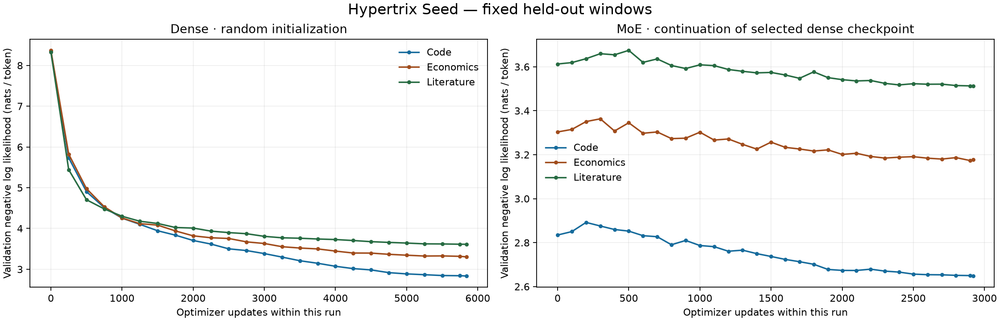

# Hypertrix Seed 001: completed books-and-code pilot

Completed overnight on 14–15 October 2026 (Europe/Oslo), using the NVIDIA GeForce
RTX 5090 Laptop GPU. No externally pretrained weights were used. A dense model
was trained from saved random tensors; the MoE branch grew from our own dense
checkpoint. Both selected checkpoints generate real completions in the
[local playground](http://127.0.0.1:8886/).

## Corpus and split

All 99 public `drcircuit` repositories were inspected at pinned commits: 93 were
admitted as local research candidates, three were empty, and three forks remain
in rights review (`highlight.js`, `msdnlive`, `website`). Intake admitted 9,211
source/documentation files (66,020,922 bytes). Removing 1,028 exact duplicate
files left 8,183 distinct code/documents. With 16 existing books, the dataset
contains **8,199 documents**.

| Split | Target tokens | 512-target windows |
|---|---:|---:|
| Training | 22,073,339 | 46,741 |
| Validation | 2,198,518 | 4,825 |
| Test | 2,661,973 | 5,627 |

The training split contains 19,645,439 code targets, 2,179,005 literature targets
and 248,895 economics targets. Whole books and upstream repository families are
held out; the model does not optimize on the validation/test documents. The
4,096-token byte BPE is fitted only on training prefixes, then used to tokenize
all admitted text. Exact duplicate documents cannot cross splits. Near-duplicate
and related-project leakage has not been exhaustively excluded.

Blueprint SHA256:
`b1e2630e4cc7ba7938408406cfc61924ae225317125a1b64decd33f2d70ebdb5`

A separate CPU process re-read original source bytes and reconstructed **all
57,193 windows / 26,933,830 targets**, with an accepted signed receipt. A second,
read-only execution also passed, without replacing the original receipt. Source
archives, original bytes and weights remain in local caches outside OneDrive;
this directory contains compact metadata and graphs.

## Training and held-out results

Dense: six decoder layers, width 256, four attention heads, tied embedding/output
weights, context 512; two complete training epochs, **44,146,678 target
presentations**. MoE: four experts with top-two routing in layers 2, 4 and 6;
one additional complete epoch, **22,073,339 target presentations**. Dense FFNs
are copied into the expert banks; routers are initialized and AdamW state is
reset for the new architecture.

| Model | Parameters | Completed updates | Selected update | Validation NLL | Test NLL | Training + evaluation |
|---|---:|---:|---:|---:|---:|---:|
| Dense | 5,773,824 | 5,844 | 5,844 | 3.2503 | 3.3860 | 12.41 min |
| MoE | 10,495,488 | 2,922 | 2,900 | 3.1122 | 3.2379 | 13.54 min |

Random-initialized dense validation NLL was **8.3485**. Reported NLLs average
code, economics and literature equally, using a fixed spread of 32 windows per
domain (96 windows per split). They are not evaluations of every held-out token.
Validation chooses the checkpoint; test is evaluated only at initialization and
on the selected checkpoint. The MoE completed update 2,922, while validation
selected update 2,900.

The MoE receives more training than the dense baseline. These results establish
that the branch trains and improves on its starting checkpoint; attributing that
improvement to MoE requires a dense continuation with a matched data/compute
budget. The panels use separate vertical scales. Expert utilization is logged;
semantic specialization has not been demonstrated.

## Replay and provenance evidence

Each row below is a fresh process using the same physical GPU and recorded FP32
runtime. Later intervals restore accumulated AdamW state from the start
checkpoint and end at the version selected for serving.

| Model | Updates replayed | Weight tensors | Optimizer state | Maximum absolute difference | Replay time |
|---|---:|---:|---|---:|---:|
| Dense | 0 to 250 | 51/51 exact | Exact | 0 | 47.13 s |
| Dense | 5,500 to 5,844 | 51/51 exact | Exact | 0 | 58.91 s |
| MoE | 0 to 100 | 72/72 exact | Exact | 0 | 44.08 s |
| MoE | 2,800 to 2,900 | 72/72 exact | Exact | 0 | 43.54 s |

These checks cover the listed intervals, not every update in either run.
The artifact checker verifies all checkpoint bytes against signed parent-linked
records, the frozen implementation, Blueprint/token-array hashes, public signing
identities, data receipt and MoE parent checkpoint. Public anchors must come from
a trusted copy of the report. The processes share one operator; this is not an
independent-organization audit or Oracle consensus certification.

- [Machine-readable report](report.json), [Blueprint](blueprint.json),
  [artifact integrity check](artifact-verification.json).
- [Signed source-to-window receipt](data-verification.json) and
  [its preserved verifier implementation](data-verifier-implementation.py).
- [Dense history](dense-lineage.jsonl), [recipe](dense-recipe.json),
  [selected result](dense-summary.json).
- [MoE history](moe-lineage.jsonl), [recipe](moe-recipe.json),
  [selected result](moe-summary.json).
- [Architecture, equations and reproduction commands](../../scratch_model.md).

## Interaction and next network step

Run `./scripts/scratch_playground.ps1 start`, then open
`http://127.0.0.1:8886/`. Choose Dense or MoE, enter a prose/code prefix and generate
a continuation. Temperature, seed and checkpoint identity are visible. Inference
runs on CPU. Prompts are not saved and generated code is never executed. The
models are not instruction-tuned; observed completions are rough and include
invented words and invalid code. The playground is an inspection tool, not a
capability benchmark.

Seven focused unit tests passed across inert corpus intake, held-out splitting,
tokenization/tamper checks, causal masking, MoE gradients, checkpoint resume and
playground boundaries. Actual GPU replays above extend the optimizer-resume
check to the trained models. The artifact checker also rejected altered
Blueprint and operator trust anchors. Both models were exercised through the UI.

This run establishes a full-model artifact and replay format for the next
network experiment. Training currently runs on one GPU. Distributing full-model
updates, choosing aggregation rules, assigning optimizer-state ownership and
admitting architecture changes still require a new Oracle training contract;
the existing fixed-A adapter reducer was not used for this model. Future corpus
growth should create new Blueprints while preserving frozen evaluation sets,
then compare fixed-capacity continuation with expert expansion.
