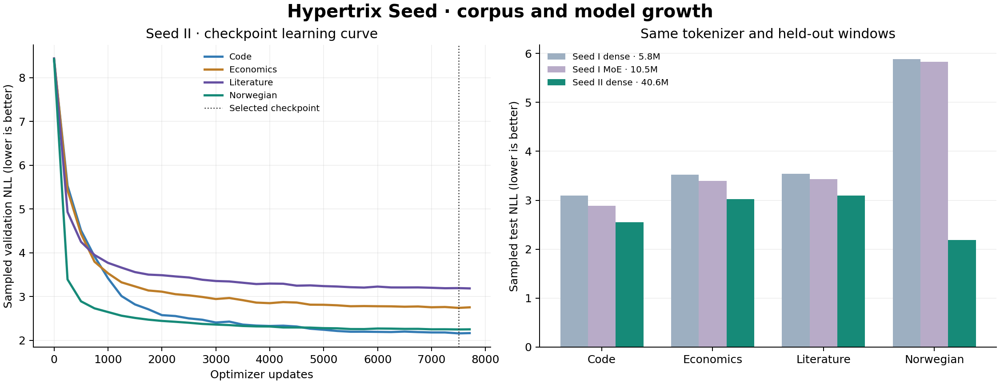

# Hypertrix Seed II — corpus and model growth

Seed II trained **40,645,120 parameters from random initialization** on a
versioned corpus of **8,577 documents**. The selected checkpoint is
step **7,500**. The run finished with status **complete** after
**7,708 / 7,708 updates**, processing
**244,791,732 nonpadding target tokens** in
**68.52 minutes** including training-time evaluation and saving.



## Data and architecture

The corpus retains 8,183 public repository files and 16 Gutenberg books and adds
378 texts from the National Library's
[bokselskap.no 2023 distribution](https://www.nb.no/sprakbanken/ressurskatalog/oai-nb-no-sbr-81/),
also listed on [data.norge.no](https://data.norge.no/en/datasets/246b8421-5aa8-3efe-ac4b-3b05fe243ef3/bokselskapno-2023).
Both catalogues declare CC0. Four unresolved multi-author anthologies are
quarantined. Reviewed author aliases, coauthors and edition families stay in one
split. The source lock preserves the original XML and text hashes, distribution,
licence, catalogue snapshots and transformation identity.

Each full training epoch contains **61,197,933 targets**.
The original 4,096-token byte-BPE vocabulary is unchanged. Seed II has 12 layers,
width 512, eight attention heads and a 1,408-wide SwiGLU feed-forward block, with
RMSNorm, RoPE and tied input/output weights. It uses AdamW and a batch of
64 windows of up to 512 tokens. The recipe requests
4 epochs with bf16 precision and
flash attention. Master weights and optimizer state are FP32.

## Paired held-out evaluation

The table reports token-weighted negative log-likelihood within each domain's
fixed sample of 32 held-out windows; **lower is better**. All three checkpoints
use the identical tokenizer and test windows. Test sample sizes are code: 15,015 targets; economics: 16,105 targets; literature: 16,307 targets; norwegian: 16,280 targets.
Checkpoint selection uses validation, not this table.

| Model | Parameters | Code | Economics | Literature | Norwegian |
|---|---:|---:|---:|---:|---:|
| Seed I dense | 5,773,824 | 3.0948 | 3.5236 | 3.5396 | 5.8833 |
| Seed I MoE | 10,495,488 | 2.8872 | 3.3927 | 3.4337 | 5.8302 |
| Seed II dense | 40,645,120 | 2.5473 | 3.0253 | 3.0995 | 2.1880 |

The models differ in size, architecture, corpus and training exposure. This is a
comparison of complete configurations; it does not isolate the effect of any one
change. The four-domain mean must not be compared directly with Seed I's original
three-domain mean. These are sampled evaluations, not full-holdout scores.

## Reproduction and verification

The data replay reconstructed all 378 added XML texts and their token windows,
checked all 8,199 parent documents and unchanged parent arrays, and verified
disjoint source families and exact content hashes. A separate exact-paragraph
audit found no cross-split matches of at least 200 Unicode characters in the
Norwegian domain. Broader near-duplicate detection is outside that audit.

Fresh processes replayed update intervals **0–250, 7,250–7,500** on the same GPU and
pinned runtime. Every interval reproduced **86 /
86 model-state tensors exactly**, with maximum absolute
difference zero and identical AdamW state. These receipts cover the specified
intervals. The public artifact checker checks hashes and signatures; it does not
run those numerical replays again.

The signed lineage binds random initialization, configuration, recipe,
implementation, imported local dependencies, checkpoint descriptors, tensor-file
hashes, final summary and replay receipts. The release seal additionally binds
this explanation, figures and supporting files. Signatures authenticate the
recorded operator key. This is single-GPU full-model training with separate
replay processes; it is not multi-host full-model backpropagation or an Oracle
certificate.

Blueprint SHA-256: `9d66f8302d3244334eda0430f93c1e9612bf4c48f74cc162cd20c26eeaa13c4e`

Release operator key: `487126ddb843e78c4ed992362c9e84878a32460909310e4f536f187b8c5b5f34`

From the repository, verify the downloaded and extracted metadata bundle:

```console
python scripts/verify_seed_release.py --root PATH_TO_BUNDLE --expected-public-key 487126ddb843e78c4ed992362c9e84878a32460909310e4f536f187b8c5b5f34
```

The bundle contains metadata, code, public keys and receipts. Full numerical
replay also needs the source/token arrays and checkpoint tensors identified by
the manifests. Those artifacts and private signing keys remain in experiment
storage. `docs/seed_expansion.md` documents the methodology and source admission.

## Fixed continuation prompts

These are the actual outputs from the paired comparison: temperature 0, up to 64
new tokens, 512-token context, and the same three prompts for every model. They
are completions rather than instruction-following chat responses.

### Seed I dense

```text
PROMPT
The traveller looked up at the stars and

CONTINUATION
 the
fluk.

“It is not a little,” said the Miss Havisham, “It is a little
little,” said the Miss Havisham, “It’s a lit
```

```text
PROMPT
function fibonacci(n) {
  if (n <= 1) return n;
  

CONTINUATION
 * @param {object} n - The number of pulse.
   * @param {function(number)} [n] - The number of pulse.
   * @param {function(number)} [n] - The number of pulse.
   * @param {function(
```

```text
PROMPT
Det var en stille kveld, og langs fjorden 

CONTINUATION
omestore, ogco, ogco, ogco, ogco, ogco, ogco, ob, ob, ob, ob, ob, ob, ob, ob, ob, ob,
```

### Seed I MoE

```text
PROMPT
The traveller looked up at the stars and

CONTINUATION
 the
suddenly slashed down the boat.

“It’s a slash of the boat,” said the boat, “that’s a boat,
and slipped down the bo
```

```text
PROMPT
function fibonacci(n) {
  if (n <= 1) return n;
  

CONTINUATION

  var n = n.length;
  
  var n = n.length;
  
  for (var i=n.length; i<n; ++i) {
    n = n[i];
    for (i=0; i<n; ++i) {
      n[i
```

```text
PROMPT
Det var en stille kveld, og langs fjorden 

CONTINUATION
erjorden erjorden erjorden erjorden erjorden erjorden erjorden erjorden erjorden erjorden erjorden erjorden erjorden
```

### Seed II dense

```text
PROMPT
The traveller looked up at the stars and

CONTINUATION
 the
great flash of the water, and the sun was still flashing.

“It’s a little flashing,” said the Mock Turtle, “and the sun’s
murder
```

```text
PROMPT
function fibonacci(n) {
  if (n <= 1) return n;
  

CONTINUATION

  return n ? n ? n ? n ? n ? n ? n ? n ? n ? n ? n ? n ? n ? n ? n ? n ? n ? n ? n ? n ? n ? n ? n ? n ? n ? n ? n ? n ? n ? n ? n ?
```

```text
PROMPT
Det var en stille kveld, og langs fjorden 

CONTINUATION
et stykke fra havet, som laa saa langt borte, at det var saa langt borte, at det var saa langt borte, at det var saa langt borte, og saa
```
