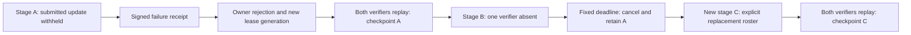

# Live training recovery — trial 003

Completed 2026-10-15T10:51:09.918764+00:00. Protocol 6 was activated on four fresh
CometBFT validators. Real SmolLM2-135M GPU training recovered from a withheld
submitted update and from a missing verifier. Two checkpoints were promoted,
each carrying the complete two-verifier replay quorum.

## Measured outcomes

| Test | Observed result |
| --- | --- |
| Source lineage | 13 books, 26 fresh CPU audit receipts |
| GPU contributions | 7: five in completed/recovered stage attempts, two in the cancelled attempt |
| Numerical replay | 10 bit-exact contribution checks; eight support the two promoted checkpoints, two belong to the cancelled attempt |
| Withheld update | Trainer stopped after its signed submission; verifier emitted a content-addressed failure receipt; owner rejected the exact contribution; another trainer completed that shard under a new lease generation |
| Deterministic replacement | Replacement adapter matches the original withheld commitment: True |
| Missing verifier | One approval remained insufficient; cancellation after the fixed 300-block deadline preserved the last verified parent |
| Replacement | New immutable stage explicitly changed verifier roster and referenced the cancelled stage; both verifiers replayed both contributions |
| Late vote | Correctly signed approval against the cancelled stage rejected online; rejection reproduced offline |
| Ledger reconstruction | 160 signed transactions across 1952 blocks, byte-identical certified final state |
| Retained availability | All trial GPU workers stopped; a fresh HTTP client retrieved 737,280 bytes from the Cortex and matched the certified final adapter hash |
| Training compute | 141.423 seconds summed across seven contribution computations; excludes bootstrap, replay, transfer and consensus waits |

Each stage used two shards, two local SGD steps per shard, batch size two and
sequence length 128. Each attempt processed the same eight training windows
(1024 next-token targets); stages B and C extend A's verified adapter. This
is a recovery experiment with a small pinned workload, not a full corpus epoch
or a model-quality comparison. The base model and LoRA A projection are frozen;
184,320 FP32 B values are trained and reduced in canonical shard order.

## Sequence on the ledger

| Event | Committed block height |
| --- | --- |
| Stage A registered | 481 |
| Unavailable update reported | 897 |
| Owner rejects exact update | 902 |
| Replacement shard and full quorum | 1105 |
| Stage B registered | 1153 |
| One verifier approves | 1390 |
| Fixed round deadline | 1453 |
| Stage B cancelled | 1458 |
| Replacement stage C registered | 1499 |
| Stage C full quorum | 1785 |



Recovery cannot vote a checkpoint into existence. The promotion condition
remains `approved verifier keys = immutable stage verifier keys`, with matching
candidate commitments. Rejection increments a recovery revision and discards
earlier votes. Cancellation releases the branch slot while retaining the
verified head, submitted work, votes and failure history.

## Independently checkable evidence

The archive contains genesis, the final quorum certificate, every signed
application transaction, the frozen application source, executable manifests,
measured execution environment, stage definitions, failure objects and worker
replay records. `verify_recovery_pilot.py` checks the certificate, replays the
entire ledger, reproduces the late-vote rejection and verifies the links between
recovery events, submitted artifacts, replay receipts and promoted checkpoints.

Genesis pin (obtain through a trusted channel):

`c01049042db83678873cb366cba6a91869a818d16b7a3c50a9246c37d6744df7`

Final checkpoint:

`a066ead7a666e8fae7176b205cd6d640e0322784167f82e3d9ebd51af0659d0a`

With Python dependencies and the repository's `check-certificate` binary on PATH:

```sh
python scripts/verify_recovery_pilot.py --root . --genesis-sha256 c01049042db83678873cb366cba6a91869a818d16b7a3c50a9246c37d6744df7
```

Full numerical replay additionally needs the corpus and model objects identified
by the manifests. They remain in the trial's node stores; bulk model tensors
and node private keys are excluded from this public archive. Running the archive
checker verifies signatures, acceptance policy and evidence bindings; it does
not itself rerun the GPU training.

## Deployment boundary

Separate containers, keys, databases and artifact stores shared one RTX 5090
Laptop GPU and one operator. The faults were real process stops and an absent
verifier, controlled by the trial driver. This establishes supervised recovery
on actual workers. Independent operators, WAN partitions, automatic replacement
selection, durable availability challenges and malicious-input quality gates
remain separate validation work.

The source-audit bootstrap retains the explicitly labelled synthetic v1/v2
fixture. The 13-book profile, training computations and numerical replays are
real. Initial setup attempts 001 and 002 stopped before training because their
provider routes violated existing allowlists; their private deployment records
are retained. Trial 003 used admitted routes without relaxing those policies.

The historical protocol-4 demo, identities and certificates were unchanged.
The GPU trial has finished; completed compute containers are stopped and their
artifacts retained. The protocol-6 validators and provider remain available.

The first archive attempt refused to overwrite an immutable completion
observation with a newer height. The exporter now uses height-qualified
observation filenames; both observations are retained. This packaging correction
did not alter the activated application or rerun training. The archive includes
the executed helper, corrected exporter, shell driver and deployment image ID.
