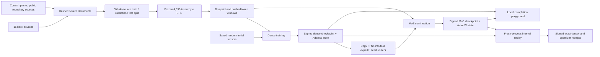

# Hypertrix Seed: books, source code and a model trained from scratch

The Seed experiment starts with random weights and trains a small causal language
model on a frozen mixture of Gutenberg books and public source repositories. A
separate MoE branch copies the learned feed-forward layers into expert banks.
Both checkpoints can be loaded in the local model playground at
`http://127.0.0.1:8886/`. It performs text and code continuation. The dataset does
not contain a conversational instruction-tuning stage.

The completed run's measurements and replay coverage are in
[the Seed 001 results](results/scratch-001/README.md). Raw evidence lives beside
that report; complete local model artifacts live in `/var/lib/dawl/scratch-001`.

This experiment has its own signed model history. It does not change the running
Oracle network, the participant study, or their accepted evidence. The current
implementation uses one trainer and same-device replay. Full-model distributed
aggregation, optimizer-state ownership and architecture admission require a new
Oracle training contract; the existing fixed-A adapter reducer is not reused.

## Source intake

`scripts/github_corpus.py` enumerates every public repository owned by `drcircuit`
through the public GitHub API, including archived repositories and forks. It pins
the default branch's commit, stores the original archive, and produces an
immutable per-repository snapshot. Large archives fall back to a partial Git clone
with bounded-size blobs; only selected source files enter the corpus. Their Git
object IDs and SHA256 are checked. Small media may remain in Git's cache.
The snapshots, archives and content-addressed text objects live under
`C:\Users\espen\.cache\hypertrix\github-drcircuit-001`, outside OneDrive.

Repository source is never imported, built, executed or used as instructions.
The source adapter preserves source URLs, paths, commits, source hashes and
license/notice files. It records exclusions for binary formats, known dependency
and generated directories, minified files, oversized files, non-UTF-8 content,
credential filenames and recognizable credential patterns. Pattern scanning is
not an exhaustive secret detector or a complete identification of vendored code.

The user's authorization covers their public source for this local experiment.
It is not recorded as a new open-source license. Forks without recognized license
metadata remain in rights-review status and do not enter the training Blueprint.
License metadata is evidence, not a determination that every file shares the
repository's license. No repository contents or model weights are automatically
uploaded to the public observatory.

```powershell
.venv/Scripts/python.exe scripts/github_corpus.py
```

An existing inventory and commit pin are reused on retry. To acquire newer commits,
use another `--root`; old source locks are not rewritten. Empty repositories,
rights-review candidates and fetch errors are distinct statuses. The final corpus
lock is produced only when every repository has been inspected successfully.

## Dataset and tokenizer

The dataset combines the 16 preserved books from `finetune-strict-002` with admitted
repository source. Original book wrappers are excluded through byte offsets into
the original hashed book. Complete books, stratified by economics/literature, and
complete upstream repository families are assigned to train/validation/test by a
fixed SHA256 ordering. Exact duplicate documents are retained once, giving held-out
copies priority so they cannot remain in training. Near-duplicates and independently
named related projects can still cross the split; this is recorded in the Blueprint.

A 4,096-token byte-level BPE vocabulary is fitted only on training documents, using
the first 32,768 characters of each document. The complete byte alphabet supports
unseen text without changing token IDs. All admitted document text, not just these
tokenizer-fit prefixes, is then tokenized. Windows contain at most 512 next-token
targets and never cross a document boundary. Final short windows are padded;
padding targets are excluded from loss. EOS marks document endings.

`sources.json`, `windows.json`, tokenizer bytes and all token arrays are hashed
into `blueprint.json`. The vocabulary remains frozen across dense and MoE branches.
All corpus books and admitted repositories enter the dataset, while held-out
documents are deliberately excluded from optimization.

## Architecture and optimization

| Property | Dense | MoE branch |
|---|---:|---:|
| Decoder layers / hidden width | 6 / 256 | 6 / 256 |
| Attention heads / context | 4 / 512 | 4 / 512 |
| Feed-forward hidden width | 1,024 | 1,024 per expert |
| Expert banks | None | Four experts in layers 2, 4, 6 |
| Experts selected per token | — | Two |
| Total parameters | 5,773,824 | 10,495,488 |
| Approximate active parameters per token | 5,773,824 | 7,349,760 |

Attention uses rotary positions, pre-LayerNorm and causal math SDPA. Input
embeddings and the output projection share weights. There is no dropout. The
recipe uses FP32, explicit non-fused AdamW, gradient clipping, warmup and cosine
decay. Deterministic algorithms fail on unsupported operations, and TF32 is off.
Actual initial tensors are saved; a seed alone is not treated as a portable
checkpoint. Each immutable checkpoint contains model tensors and AdamW moments
and step counters in safetensors, without pickle.

For MoE layers, the router chooses two expert IDs with a stable ID tie-break and
renormalizes their probabilities. A load-balancing auxiliary loss discourages
unused experts. The branch starts by copying each selected dense feed-forward
layer to four experts, initializing routers with a recorded seed and resetting
AdamW state. The parent checkpoint hash and operation are recorded. Numerical
agreement of the converted model before training is tested within tolerance;
bitwise identity of the conversion is not claimed.

The optimization objective is next-token cross entropy plus `0.01` times the
mean router balancing loss for the MoE variant. Checkpoint selection uses the
equal-domain mean validation NLL over a fixed spread of up to 32 windows per domain.
Only initialization and the selected checkpoint are tested on the test split.
The dashboard's generation seed, temperature, selected checkpoint and token count
make interactive examples inspectable; interactive prompts are not benchmarks.

## Training, verification and interaction

The current WSL launcher is scoped to `/var/lib/dawl/scratch-001` and the existing
`localhost/hypertrix-finetune:005` runtime. It has a hard stop at 06:00 Oslo on
15 October 2026, within the user's overnight allowance. New runs should use new
directories/container names and a newly authorized time window.

```powershell
wsl -d kali-linux -u root --exec sh /mnt/c/Users/espen/OneDrive/Dokumenter/ChatGPT/DAWL/scripts/scratch_pilot.sh dense
wsl -d kali-linux -u root --exec sh /mnt/c/Users/espen/OneDrive/Dokumenter/ChatGPT/DAWL/scripts/scratch_pilot.sh replay-dense
wsl -d kali-linux -u root --exec sh /mnt/c/Users/espen/OneDrive/Dokumenter/ChatGPT/DAWL/scripts/scratch_pilot.sh moe
wsl -d kali-linux -u root --exec sh /mnt/c/Users/espen/OneDrive/Dokumenter/ChatGPT/DAWL/scripts/scratch_pilot.sh replay-moe
./scripts/scratch_playground.ps1 start
```

The playground runs inference on CPU, leaving the GPU available for training.
It loads signed, hash-checked safetensors and a matching tokenizer. It displays
completion text without executing code, binds to loopback, and does not store
prompts or completions. Use `stop` and `status` with the same PowerShell launcher.
For a separate Python development environment, install `requirements-scratch.txt`;
the experiment's `recipe.json` records exact executed dependency versions.

Training records initialization, checkpoints, selection and replay receipts in
an Ed25519-signed parent-linked history. Replay loads the declared start checkpoint
and optimizer state, repeats the deterministic data allocation and optimizer steps,
then compares every model tensor and optimizer tensor with the end checkpoint.
The receipt explicitly identifies the interval replayed. This is same-hardware,
same-runtime verification; it does not assert cross-hardware reproducibility or
verification of unreplayed steps. Hash integrity, signatures and replay coverage
are separate checks.

An outside reviewer with the artifact directory and a report obtained through a
trusted channel can check all token-array hashes, checkpoint bytes, signature
chains, saved implementation files, the dense-to-MoE parent link and signed replay
receipts without a GPU or private signing keys:

```powershell
.venv/Scripts/python.exe scripts/verify_scratch_artifacts.py `
  --root '\\wsl.localhost\kali-linux\var\lib\dawl\scratch-001' `
  --report docs/results/scratch-001/report.json
```

The report pins the public keys and Blueprint digest. Getting both the artifacts
and new trust anchors from an untrusted sender would only establish internal
consistency. To redo the data check, use `scripts/verify_scratch_data.py --check-only`
with `--root`, `--books` and `--code` pointing to the dataset and original caches.
This mode creates no keys and leaves the original receipt intact. To redo optimization, use
the recorded runtime, preserved implementation and a declared replay interval.



For a non-padding target token, the base objective is
`L_token = -log p_theta(next_token | preceding_tokens)`. Evaluation sums this
loss over fixed held-out targets and divides by their count; perplexity is
`exp(NLL)`. Checkpoint selection averages the three domain NLLs equally, so the
larger code collection does not determine selection solely by its token count.
MoE routing forms `y = sum(g_i * expert_i(x))` over the two selected experts,
with their gate weights normalized to sum to one. The auxiliary balance term
encourages use of all experts; it does not establish semantic specialization.

Future corpus growth should create new Blueprints, preserve frozen evaluations,
mix old and new data, and compare unchanged capacity with expert expansion under
matched data and compute budgets. Expert placement across internet nodes is a
separate experiment from sparse routing inside one model.
