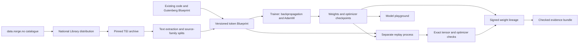

# Seed II: corpus growth and a deeper model

Seed II retains the first Seed models and their frozen implementation. It tests a larger randomly initialized model on an expanded, reproducible corpus. Model development happens in `src/dawl_seed`; the original `src/dawl_scratch` implementation remains available for exact replay.

## Norwegian source admission

The first Norwegian intake is **bokselskap.no 2023**, published by Nasjonalbiblioteket / Språkbanken and also catalogued by data.norge.no:

- Publisher: <https://www.nb.no/sprakbanken/ressurskatalog/oai-nb-no-sbr-81/>
- Catalogue: <https://data.norge.no/en/datasets/246b8421-5aa8-3efe-ac4b-3b05fe243ef3/bokselskapno-2023>
- Distribution: <https://www.nb.no/sbfil/tekst/20230119_bokselskap.no.tar.gz>
- Declared distribution licence: CC0 1.0, recorded by both catalogues.
- Archive SHA-256: `5bca77169226f9f2e9ca142cd10b7a8c39b922e43b3fd6739daba68eda00c7fb`.

The archive has 382 XML texts. Each source record retains the archive member, original XML hash, author/title metadata, release, origin links, licence, transformation and extracted-text hash. The downloader retains catalogue snapshots separately. data.norge.no is the discovery catalogue for this same distribution; it is not counted as a second copy of the corpus. Future catalogue admissions require a dataset-specific distribution and reuse basis.

The inert TEI extractor includes every outermost body in document order, omits metadata, notes, running headers and figures, selects corrected/regularized readings from `choice`, preserves paragraph/verse boundaries, and normalizes Unicode to NFC. It rejects internal entity declarations, never resolves external DTDs, and reads archive members without extracting paths. Two multi-body XML files motivated an extractor correction before the training freeze. The preliminary intake and dataset remain preserved outside the repository.

This material includes historical Norwegian/Danish spelling. It provides a literature domain rather than a balanced sample of contemporary Norwegian.

## Dataset and comparison

The final Blueprint contains 8,577 documents: 8,183 code/documentation files, 16 existing Gutenberg books, and 378 Norwegian texts. Four unresolved multi-author anthologies are quarantined with recorded reasons. Training has **61,197,933 target tokens per epoch**, compared with 22,073,339 in Seed I. Validation has 10,456,430 targets and test has 5,255,319.

The original byte-BPE tokenizer, all original source splits and token rows are unchanged. The Norwegian holdout policy resolves reviewed author aliases, unifies coauthors into connected components, and groups editions and anonymous collection/work families. This produces 99 source families. The policy and its explicit bibliographic fallbacks are part of the Blueprint. A metadata-only preliminary split was superseded after aliases and overlapping letter editions were found; its partial checkpoints remain preserved but are excluded from the release.

Exact text duplicates cannot cross splits. An additional audit found no shared stripped paragraphs of 200 or more characters across the Norwegian splits. This is a bounded exact-overlap check; broader near-duplicate detection remains a future improvement. The frozen 4,096-token vocabulary preserves comparisons, while potentially using more tokens for Norwegian than a newly fitted bilingual tokenizer.

Evaluation retains the exact original 32 windows per legacy domain and adds 32 Norwegian windows. Each domain's NLL is token-weighted within that sample; checkpoint selection uses their unweighted mean. Report legacy-domain scores separately when comparing with Seed I. The four-domain selection mean is not directly comparable to Seed I's three-domain mean. Test is evaluated at initialization and at the validation-selected checkpoint, not used to choose checkpoints. These are sampled held-out evaluations, not full-holdout passes.

## Architecture and optimization

| Property | Seed I dense | Seed II dense |
|---|---:|---:|
| Parameters | 5,773,824 | 40,645,120 |
| Transformer layers | 6 | 12 |
| Width / attention heads | 256 / 4 | 512 / 8 |
| Feed-forward width | 1,024 | 1,408 |
| Feed-forward activation | GELU | SwiGLU |
| Normalization | LayerNorm | RMSNorm, epsilon 1e-6 |
| Context / vocabulary | 512 / 4,096 | 512 / 4,096 |
| Position / output head | RoPE / tied embedding | RoPE / tied embedding |

The gated feed-forward transform is `down(silu(gate(x)) * up(x))`. Training minimizes next-token cross entropy with padding masked. The optimizer is AdamW, beta=(0.9,0.95), weight decay 0.1, gradient norm clip 1, 5% learning-rate warmup and cosine decay to 10% of the initial rate. Every epoch permutes all training windows and includes the final short batch.

The model learns its own token embedding and output weights. These are separate from the fixed reconstruction matrix used in the earlier Synapse transport/audit experiment. Corpus token IDs enter training directly; the transport demonstration's matrix is not treated as pretrained model knowledge.

BF16 autocast uses FP32 model and optimizer state. Attention is pinned in the recipe; deterministic algorithms remain enabled. FlashAttention is explicitly selected for BF16 training and math attention is used for FP32 evaluation. Same-device determinism must be demonstrated by a separate-process replay; enabling a deterministic flag alone is not an empirical verification result. This does not assert identical updates across GPU families or runtimes.

## Observability

The worker writes an atomic progress sample containing stage, execution identity, document/step counts, epoch, loss, target-token throughput, checkpoint and validation state. The host observer combines these samples with container liveness and device-wide NVIDIA measurements. Both the web monitor and TUI expose active work directly. Stale worker samples lose their live rates; loss and counts remain historical observations.

Training FLOP/s is an estimate from cumulative `6 * parameter_count * nonpadding_target_tokens`. It excludes attention overhead, padding work, evaluation and replay. GPU utilization is measured independently and never converted into FLOP/s. Namespace I/O remains observer-measured, including loopback. These operational measurements do not imply Oracle acceptance.

The local monitor is <http://127.0.0.1:8882/>. The TUI's **2 Work** view shows corpus and model jobs; its header shows active progress in every view. The playground at <http://127.0.0.1:8886/> retains the first dense and MoE models and adds Seed II checkpoints with their own Blueprint and replay coverage.

## Reproduction

The source archive, source objects, token arrays, checkpoint tensors and private signing keys remain in native experiment storage, outside the synced repository. Public evidence exports contain metadata, public keys, signed records, hashes, evaluation results and replay receipts.

The catalogue snapshots are retained in the evidence bundle as inert `.html.txt`
files, with their original URLs, byte lengths and hashes in `intake/downloads.json`.
They preserve the source/licence description observed at intake even if the live
catalogue later changes. They are not served as executable HTML.

`scripts/seed_pilot.sh` exposes `prepare`, `verify-data`, `benchmark`, `probe`, `probe-replay`, `train` and `replay`. The script pins the container runtime and enforces the approved overnight deadline. Each training initialization preserves the exact implementation and imported local data/signing dependencies. Checkpoints contain model tensors and AdamW state; the signed lineage binds the recipe, configuration and dataset. The data verifier reconstructs the added archive texts and token windows, checks the unchanged parent arrays and evaluation samples, and checks disjoint groups/content hashes.

This experiment uses one training GPU with separate trainer and replay processes. It exercises corpus and weight lineage, checkpoint publication and verification. Multi-host gradient exchange and distributed full-model backpropagation remain separate work in the roadmap.

The overnight completion pipeline runs training, initialization replay,
selected-checkpoint replay and paired evaluation in sequence. A bounded report
worker waits for successful completion, hashes every checkpoint file, exports
metadata, generates figures and seals the report. A failed stage withholds the
release. The native `report-status.json` records completion or failure; the
finished bundle is saved under `scratch-003/public-report`. It is reviewed before
being copied into the public website's evidence archive. The website build checks
the pinned operator key and complete release manifest before including it.

References: [LLaMA architecture](https://arxiv.org/abs/2302.13971), [GLU variants](https://arxiv.org/abs/2002.05202), [FlashAttention](https://arxiv.org/abs/2205.14135), [PyTorch attention backend selection](https://docs.pytorch.org/docs/stable/generated/torch.nn.functional.scaled_dot_product_attention). Source-identity review includes the publisher's [Hanna Butenschøn / Helene Dickmar introduction](https://www.bokselskap.no/boker/dickmaressays/innledning) and [Maurits Christopher Hansen bibliography](https://www.bokselskap.no/forfattere/hansen), and [Rivertonklubben's account of Sven Elvestad / Stein Riverton](https://rivertonklubben.no/om-rivertonklubben/).
