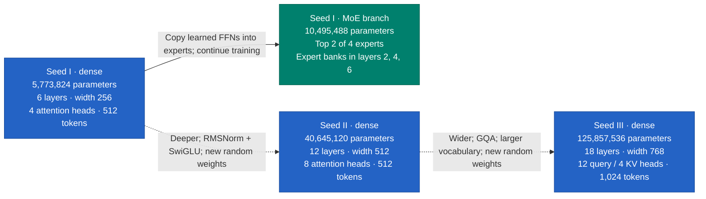
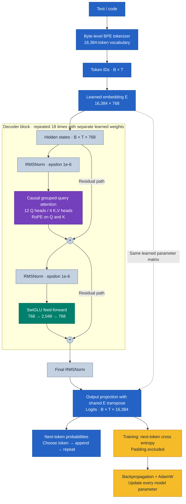
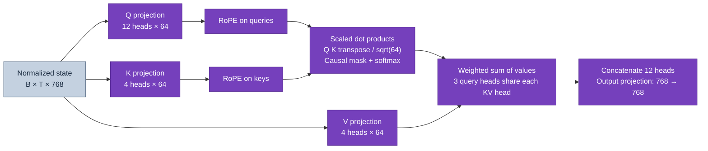
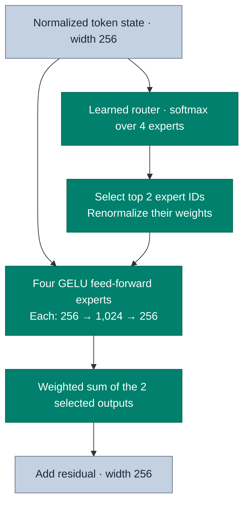
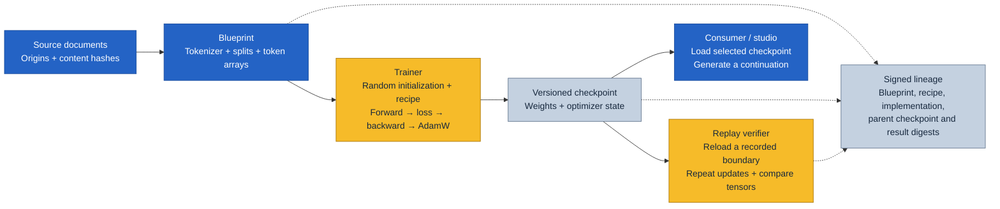

# Hypertrix Seed: our transformer family

Architecture snapshot: 16 October 2026. These diagrams describe the implemented,
trained configurations. A host crash interrupted Seed III at update 5,590 of
6,000. Its signed checkpoint at 5,500 survived with the recorded state hash;
the final replay and publication stages had not started. All three dense generations started from random
weights; the MoE branch inherits our own trained Seed I dense checkpoint.

Color key: **blue** = text, tokens and model embeddings; **violet** = attention;
**teal** = feed-forward layers and experts; **amber** = training and optimization;
**gray** = normalization, residuals and records. Labels also identify every block.

## Model family

Solid arrows below indicate weight inheritance. Dashed arrows indicate a design
change followed by a fresh random initialization, not inherited model weights.

| Configuration | Seed I dense | Seed I MoE | Seed II | Seed III |
|---|---:|---:|---:|---:|
| Parameters | 5,773,824 | 10,495,488 | 40,645,120 | 125,857,536 |
| Approximate active parameters/token | All | 7,349,760 | All | All |
| Decoder blocks | 6 | 6 | 12 | 18 |
| Residual width | 256 | 256 | 512 | 768 |
| Query / key-value heads | 4 / 4 | 4 / 4 | 8 / 8 | 12 / 4 |
| Dimensions per attention head | 64 | 64 | 64 | 64 |
| Feed-forward intermediate width | 1,024 | 1,024 per expert | 1,408 | 2,048 |
| Feed-forward activation | GELU | GELU | SwiGLU | SwiGLU |
| Normalization | LayerNorm | LayerNorm | RMSNorm | RMSNorm |
| Maximum context, tokens | 512 | 512 | 512 | 1,024 |
| Byte-level BPE vocabulary | 4,096 | 4,096 | 4,096 | 16,384 |
| Position encoding | RoPE | RoPE | RoPE | RoPE |
| Embedding / output head | Shared weights | Shared weights | Shared weights | Shared weights |

These are causal, decoder-only language models. Each predicts the next token
from the preceding tokens. The learned input embeddings are part of the model;
they are separate from the fixed Source Code Matrix used in earlier vector
reconstruction experiments. Model layers and MoE experts are tensor modules,
not network nodes.

## Seed III: from text to the next token

`B` is batch size and `T` is sequence length, up to 1,024 tokens. Training predicts
at every valid position. Generation selects a token from the final position and
feeds it back to extend the text.

The repeated block preserves width 768. Residual paths carry the current token
representation around attention and the feed-forward transform. RMSNorm rescales
each token representation before those operations. The model has no dropout;
linear projections have no biases. Residual output projections are initialized
with standard deviation `0.02 / sqrt(2 × 18)`.

## Inside attention and SwiGLU

RoPE rotates pairs of query/key coordinates according to token position; it does
not add a learned position embedding. The causal mask prevents a position from
reading future tokens. Generation caches each layer's keys and values. Four KV
heads require one third as many cached KV elements as twelve KV heads at the
same context, head dimension and precision.

For one token state `x`, the feed-forward transform is:

\[
\operatorname{SwiGLU}(x)
= W_{\mathrm{down}}\bigl[\operatorname{SiLU}(W_{\mathrm{gate}}x)
\odot (W_{\mathrm{up}}x)\bigr].
\]

Both `gate` and `up` project 768 to 2,048 dimensions. Their elementwise product
is projected back to 768. This is a dense gate over features; it does not select
experts.

## Seed I's MoE branch

Only the feed-forward part changes in blocks 2, 4 and 6. Attention, the residual
stream and the other blocks retain the Seed I structure.

At conversion, each expert copies the corresponding trained dense feed-forward
weights. Routers are newly initialized and optimizer state is reset. Subsequent
training can differentiate experts. The loss adds `0.01 × mean router balancing
loss` to next-token cross entropy. Expert choice is per token, with a stable
expert-ID tie-break. Experts execute within the same model process in this run.

## Training and the network evidence chain

The diagram distinguishes the neural architecture from its surrounding execution
and evidence system. The current main run uses one GPU with full-model
backpropagation. Distributed DDP and Oracle adapter coordination have their own
test records; model depth does not imply deployment across that many nodes.
Investigator source assessment sits after generation and outside the transformer.

## Recorded continuations and corpus investigations

The illustrated PDF includes a new [128-token sample set](results/seed-architecture-samples-002/README.md)
from all four models, with seed 42, temperature 0.7 and the identical prompt
`The traveller looked up at the stars and`. Outputs are unchanged. Each example
includes its checkpoint, sampler, sentence-span assessments and links to the
retrieved source documents. Seed III uses its selected checkpoint at update
3,750, not the last saved recovery checkpoint at 5,500.

All **19 spans** received **insufficient evidence** across **54 retrieved
passage comparisons**; one span had no candidate. No model output or threshold
was changed to obtain a missing assessment label. The original
[32-token samples](results/seed-architecture-samples-001/README.md) remain intact.
The longer samples also change the assessment unit from a whole paragraph to
exact sentence spans, so differences between the experiments cannot be
attributed solely to output length.

Source hashes, exact excerpts, Blueprint membership, answer bindings and signed
receipts verified. A fresh CPU process without a network or signing keys
reproduced all 54 raw NLI outputs and verdicts exactly. This replay covers the
Investigator, within the same hardware/runtime cohort; it does not replay the
generative models or establish causal influence from a source to a model weight.

These fictional, sometimes unfinished scenes are illustrations of the evidence
path, not a factual quality benchmark. An invented scene need not have a
supporting passage. The current retrieval and entailment evaluator also have
measured limitations, documented in [Investigator 001](results/investigator-001/README.md).

Build the vector PDF with `python scripts/build_seed_architecture_pdf.py` in an
environment containing ReportLab and the configured Arial fonts. The output is
`output/pdf/Hypertrix_Seed_Model_Architecture.pdf`.

## Implementation and run records

- Seed I: [model implementation](../src/dawl_scratch/model.py),
  [dense configuration](results/scratch-001/dense-config.json),
  [MoE configuration](results/scratch-001/moe-config.json),
  [methodology](scratch_model.md).
- Seed II: [model implementation](../src/dawl_seed/model.py),
  [trained configuration](results/scratch-003/dense/config.json),
  [completed run and replay](results/scratch-003/README.md).
- Seed III: [model implementation](../src/dawl_lab/model.py),
  [frozen recipe](results/seed-lab-001/run/recipe.json),
  [architecture and lab methodology](home_training_lab.md),
  [calibration evidence snapshot](results/seed-lab-001/README.md).
