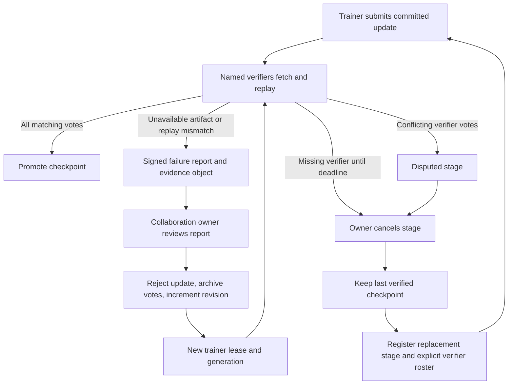

# Governed training recovery

Implemented 15 October 2026. This is an opt-in protocol extension, exercised with
signed state transitions and HTTP fault injection. It has not been activated in
the running protocol-4 demonstration network. Its historical implementation,
certificates and evidence remain unchanged.

## Contract

Protocol 6 adds recovery to a new `hypertrix.oracle-training-stage/3` under an
existing collaboration manifest. Stages using schemas 1 and 2 retain their
original transitions and quorum rules. Activation requires drained stages and
the same implementation digest as the collaboration execution contract. Use a
fresh deployment pinned to this build for the first recovery pilot; do not send
the activation to validators running the archived implementation.

The immutable stage includes:

```json
"recovery": {
  "round_timeout_blocks": 300,
  "max_rejections": 3,
  "supersedes": null
}
```

The timeout is measured in committed block heights, starts at stage registration
and resets only after a verified round. Renewing leases, reporting failures and
rejecting updates cannot extend it. A timeout makes cancellation eligible; it
does not automatically cancel the stage or declare misconduct. Consensus itself
must make progress for a block-based deadline to advance.



### Failed contribution

1. A named verifier publishes a content-addressed evidence object and sends
   `report_training_failure`. The transaction binds the stage, round, recovery
   revision, job, exact contribution transaction, reason and evidence digest.
2. An unresolved report for current work blocks checkpoint promotion. Reports
   are observations: unavailable data may reflect a partition, and a mismatch
   may reflect an execution error. They are not slashing evidence.
3. The collaboration owner, already the authorized stage publisher, can send
   `reject_training_update` referencing that report. The discarded submission
   and existing votes remain in recovery history. The round revision increases,
   and the shard becomes claimable by another admitted trainer.
4. The rejected trainer cannot reclaim that job. A new lease generation fences
   the old submission. Previously cast votes are cleared, and new candidates
   commit the new revision. Every named verifier must vote again.

Reports are bounded and deduplicated per signer/contribution. The rejection
budget is stage-wide, fixed in advance, and cannot be reset by reassignments.
Neither a reporter nor the owner can manufacture a promoted checkpoint through
recovery commands. A malicious reporter or owner can still deny service; this
is supervised recovery inside the existing admitted collaboration model.

### Missing verifier or disputed reduction

After the round deadline, the owner may send `cancel_training_stage` with reason
`round_timeout`; a disputed stage can be cancelled immediately with reason
`disputed`. Cancellation clears outstanding leases and releases the branch's
active-stage slot. It retains all contributions, votes, reports and earlier
checkpoints. Late results and votes against that stage are rejected.

A replacement stage explicitly names the new verifier set and references the
cancelled stage in `recovery.supersedes`. It extends the branch's last verified
head and adapter. Replacement verifiers must already be invited, admitted and
accepted into the same execution cohort. There are still at least two distinct
verifiers, and every verifier named in the new stage must approve. No existing
roster or checkpoint certificate is edited.

The executable manifest must match the replacement stage's initial adapter,
round count and work catalog. Recreate that manifest and its content hash for
continuation after partial progress. Worker configurations must explicitly point
to the replacement stage. Automatic stage following and automated replacement
selection remain deployment work.

## Operator interface

Run with `src` on `PYTHONPATH`, from the owner node's environment. The root must
contain its existing `cluster.json`, genesis/plan pins and, for mutations, its
private signing key. Commands require certificate-verified state reads.

```console
python -m dawl_training.recovery_cli status --root NODE_ROOT --stage STAGE_ID
python -m dawl_training.recovery_cli reject --root OWNER_ROOT --stage STAGE_ID --report REPORT_TX_ID
python -m dawl_training.recovery_cli cancel --root OWNER_ROOT --stage STAGE_ID
```

From the repository root, use `python scripts/training_recovery.py` with the same
arguments. This entry point puts the source packages ahead of the repository's
legacy command wrappers on the Python import path.

Activation is the existing publisher's signed `activate_training_recovery`
command with `{version: 6, implementation_sha256: BUILD_DIGEST}`. Register the
new schema-3 stage through `register_training_stage`. The owner CLI deliberately
does not select new participants or rewrite manifests on its own.

Workers now record missing/corrupt submitted artifacts and replay mismatches as
failure receipts in opted-in stages. Runtime exceptions remain runtime errors;
they are not attributed to trainers. Missing parent/model/input artifacts,
bootstrap discovery failures and invalid aggregate bounds can still require
operator intervention and eventual cancellation. Cancelled workers keep serving
their stored artifacts until stopped.

## Validation and remaining deployment test

`tests/test_training_recovery.py` covers rejected-update reassignment, retained
evidence, stale votes/reports/results, unauthorized recovery, immutable rosters,
full replacement quorum, wrong-cohort admission, cancelled leases, prior-head
preservation, disputed cancellation, fixed budgets and deadline progression.
Its HTTP test serves corrupt bytes, withholds an object, and supplies a healthy
fallback; corrupt content never enters the local object store. These tests use
synthetic adapter bytes, not simulated claims of GPU training.

The regression suite also replays the archived protocol-4 transaction history
and requires byte-identical final state. Next deployment test: fresh pinned
validators and workers, two actual GPU contributions, a withheld update, owner
reassignment, a missing verifier, and replacement-stage completion. That test
must record the complete transaction history and numerical replay receipts.
