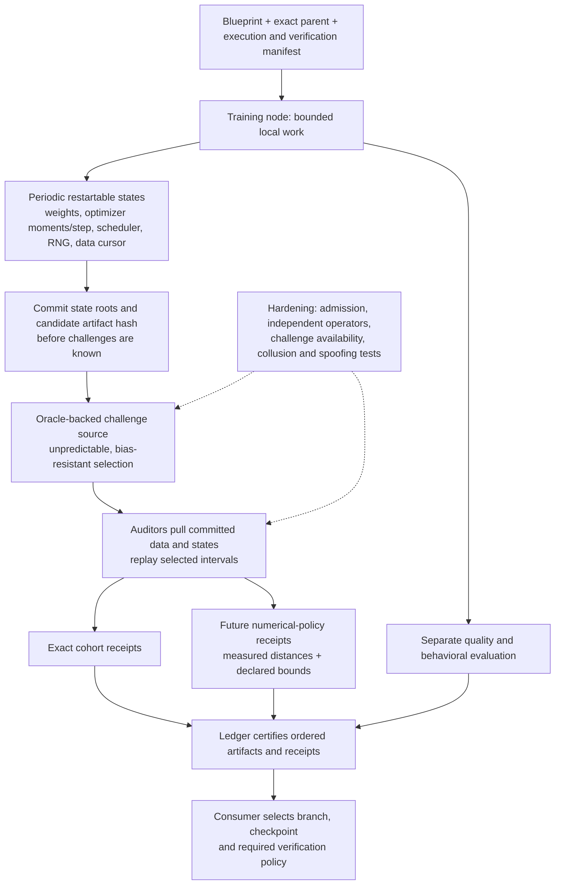

# Training verification after the Qwen replay investigation

This design keeps the existing homogeneous and heterogeneous collaboration modes. It separates exact artifact identity, reproducible computation, numerical compatibility and evidence that a particular worker performed useful work. The October 14 diagnostic is a local experiment, not an Oracle protocol upgrade. Measurements live in [the repeatability report](results/finetune-repeatability-001/README.md); the original [economics pilot](results/finetune-economics-001/README.md) retains its mismatch receipt.

## What caused the observed failure

The original BF16 Qwen recipe seeded Python, NumPy and Torch, disabled TF32 for matrix multiplication and specified SDPA attention. It did not require deterministic algorithms, pin an attention backend, set a cuBLAS workspace configuration or explicitly select optimizer and gradient-reduction implementations. SDPA is a dispatch interface rather than one arithmetic implementation.

The instrumented diagnostic uses the frozen 002 runtime, exact original initial adapters and data order. Each attempt is a fresh process. It records the first forward loss and sampled logits, gradients after the first microbatch and after accumulation/clipping, and adapter tensors after every update. The original path selected FlashAttention. The first observed divergence occurred in its backward path before the first optimizer update. Changing only attention to the math implementation removed the divergence in the short pair. Strict settings also made the automatically selected FlashAttention path match in its short pair. These are controlled observations on one GPU/software stack, not a claim of hardware corruption or malicious work.

PyTorch documents both SDPA's backend-dependent arithmetic and its reproducibility controls: [SDPA 2.11](https://docs.pytorch.org/docs/2.11/generated/torch.nn.functional.scaled_dot_product_attention.html), [reproducibility 2.11](https://docs.pytorch.org/docs/2.11/notes/randomness.html). Seeds and deterministic kernel selection solve different problems.

The laptop's standby pauses affected elapsed time. They do not explain the first-batch divergence observed in the new uninterrupted diagnostic. The original full-epoch replay did not retain its actual candidate weights, so effective-update and output comparisons in the new report refer to new short runs. The updated verifier now preserves candidates at completed boundaries, including failures.

## An exact mode we can engineer

New recipe schema 2 supports `strict-math` and `strict-auto`. These require `CUBLAS_WORKSPACE_CONFIG=:4096:8` in the process environment before CUDA initialization, deterministic algorithms with errors rather than warnings, explicit AdamW and gradient clipping without foreach/fused selection, TF32 disabled, and reduced-precision GEMM reductions disabled. `strict-math` additionally pins the math attention backend. `strict-auto` is a faster candidate on the tested device; its actual dispatched backend must remain recorded and covered by a preflight.

`src/dawl_finetune/execution.py` defines the policies. `run.py prepare --execution-policy strict-math` creates a new recipe; training reads and validates the frozen policy. Policy changes require a new recipe, image and checkpoint lineage. The original 002 image, recipe, weights and failed receipt remain unchanged. The new runtime is built with `Dockerfile.finetune-exact` and versioned independently. No new full three-epoch model has been trained by this investigation.

Before admitting a cohort, run identical short jobs in fresh processes on every proposed trainer/verifier combination. Pin the image digest, GPU capability and driver, framework/CUDA/cuDNN builds, attention backend, dtype/layout, optimizer, data order, tokenizer, batch/accumulation, clipping, schedule and random-number state. Repeat the preflight across restarts and relevant boundary shapes, including the final partial batch. Passing a short prefix is an admission test, not evidence that an entire epoch has already been replayed. The new [full-epoch run](results/finetune-strict-002/README.md) now passes all 228 updates: 392/392 tensors identical, zero relative L2 and maximum error. A separate CPU process checked the retained candidates. This schema-3 recipe explicitly spans one epoch; restart/resume qualification and other hardware remain separate tests.

A hardware or software upgrade requires a new environment identity and qualification. A same-named GPU alone is insufficient. An honest incompatible execution can create a separately verified branch. It cannot silently replace the accepted checkpoint on an exact branch.

## What should be measured when exact equality is inappropriate

For two continuations from the exact same parent, compare the learned changes:

\[
\delta_c=\theta_c-\theta_0,\qquad \delta_r=\theta_r-\theta_0.
\]

For LoRA, the effective change in a linear map is

\[
\Delta W=(\alpha/r)BA,
\]

or the difference between that product and the parent's LoRA product when continuing an existing adapter. Comparing only the A and B factors depends on their parameterization: replacing A by cA and B by B/c leaves the map unchanged. Comparing the entire frozen base plus a tiny update can dilute a substantial error in the update.

A proposed numerical policy would require finite values, exact tensor schemas, exact parent/data/recipe identities, per-layer and global bounds such as

\[
\|\delta_{c,\ell}-\delta_{r,\ell}\|_F
\le a_\ell+r_\ell\max(\|\delta_{c,\ell}\|_F,\|\delta_{r,\ell}\|_F),
\]

plus direction and magnitude checks where norms are meaningfully nonzero. Cosine alone accepts a doubled update. A global mean alone can hide one badly changed layer. Near-zero updates require absolute bounds and explicit handling, not division by an arbitrary tiny number.

The diagnostic also measures prediction distributions under a common math-attention evaluator: top-1 agreement, next-token NLL difference and

\[
D_{KL}(p_r\|p_c)=\sum_v p_r(v)\log\frac{p_r(v)}{p_c(v)}.
\]

These are behavioral measurements on specified inputs. A small KL or unchanged benchmark score cannot establish that the declared training work occurred. The current diagnostic uses only 128 token positions for logits and two validation windows per domain for loss; it is not an equivalence study.

Thresholds must be fixed in a manifest before contributions are submitted. Calibrate across legitimate environments, repeated seeds and training stages, and evaluate rejection against skipped work, wrong data, reused parents, scaled updates, layer-local perturbations and targeted poisoning. Reserve separate validation cases so the calibration set does not become a universal known challenge. This investigation implements measurements, **not an epsilon acceptance policy**; it does not select thresholds to make the existing failure pass.

Keep exact SHA256 identifiers for every artifact. A numerical verification receipt links two different artifact hashes and an explicit policy. Similarity is not an equivalence relation: A can be close to B and B to C while A is far from C. Always compare against the exact accepted parent/reference for that stage, retain all candidate identities, and prevent successive tolerance substitutions from drifting the branch head.

## Verification that scales with the Collective

Full replay is useful for cohort qualification, small research jobs and periodic reference checks. For longer jobs, commit short restartable intervals and audit a random subset after commitment. An AdamW restart needs its first and second moments and step counters, not just model weights. It also needs the schedule, RNG states, exact batch order and accumulation boundary. Boundary checks must establish that intervals connect to the same committed trajectory.

If N committed intervals contain m fixed, detectable invalid intervals and k distinct intervals are sampled uniformly, detection probability is

\[
P(\text{detect})=1-\frac{\binom{N-m}{k}}{\binom{N}{k}}.
\]

This calculation assumes the bad set is fixed before an unpredictable challenge and each sampled bad interval is detected. It does not cover adaptive forgery, a biased random source, colluding auditors, or attacks that pass the local predicate. Record sample coverage and these assumptions rather than a generic "training verified" badge. This interval protocol is proposed future work, not an implemented or adversarially validated guarantee in the current testnet.

Replay verifies a computation relation; even full replay does not establish which worker originally performed it. Copying another node's valid update is a separate incentive/admission problem. Signed receipts identify signers but do not prove their independence or hardware. Checkpoint-based proof-of-learning is relevant prior work ([Jia et al., 2021](https://arxiv.org/abs/2103.05633)), but follow-up work demonstrates spoofing vulnerabilities ([Fang et al., EuroS&P 2023](https://arxiv.org/abs/2208.03567)). Treat a reward-bearing public proof of training as a research problem, not a consequence of adding signatures or L2 thresholds.

DiLoCo addresses a different part of scaling: workers perform many local AdamW steps before an outer update with momentum ([DiLoCo](https://arxiv.org/abs/2311.08105)). Its local blocks are natural units to commit and audit. It does not supply an adversarial verification protocol. Inner training, outer optimizer state and the reduction order each need a manifest. Existing B-only aggregation cannot be reused as a mathematically equivalent average of independently trained A/B products; cross terms would change the result. Use an explicit merge contract, a shared fixed factor, effective updates or another defined representation.

## Recommended development order

1. Full-epoch strict replay is complete, including the final partial batch. Extend qualification to restart/resume and other trainer/verifier pairs. Keep exact homogeneous mode as the working baseline.
2. Add complete restart-state commitments and short-interval replay; test tampering, missing artifacts and rollback before sampling.
3. Introduce post-commitment sampling and signed scope-specific receipts, with measured detection and availability behavior.
4. Calibrate numerical policies across actual heterogeneous machines. Preserve separate branches and consumer policy selection.
5. Add DiLoCo-style local blocks and a separately verified outer optimizer. Evaluate cost and attack resistance before enabling rewards.

The ledger should distinguish **artifact checks**, **full exact replay**, **sampled interval replay**, **numerical agreement**, and **behavioral evaluation**. Each describes different evidence. Consensus can order and certify those receipts without pretending they establish the same claim.
