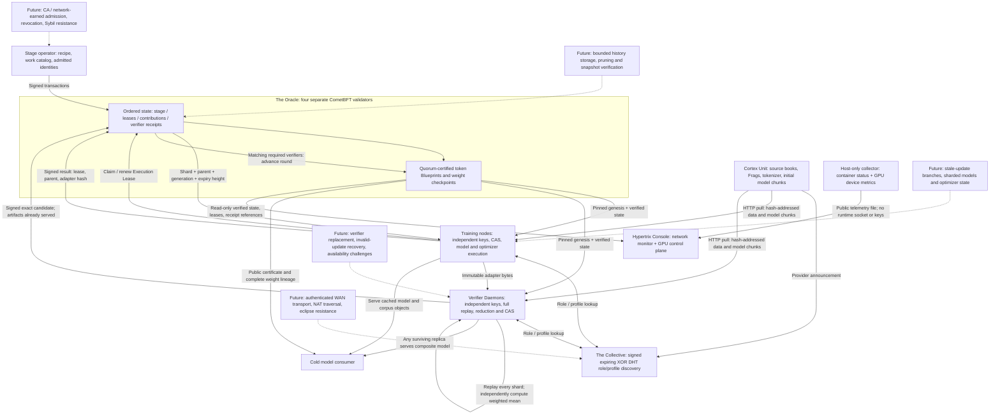

# Oracle-managed training and replicated checkpoints

Protocol 4 moves training ownership from a fixed pair of peers into the Oracle's
replicated state machine. A stage specifies bounded work; admitted trainers claim
temporary Execution Leases. A replacement identity can finish an abandoned shard.
Two or more named verifiers independently replay the training and publish matching
checkpoint commitments. The Oracle automatically commits the checkpoint and opens
the next round once every required verifier has agreed.

There is no designated trainer or checkpoint publisher. Stage creation and identity
admission remain explicit publisher privileges. The first local training branch
and its historical results remain documented in [distributed_training.md](distributed_training.md).
The [completed local testnet results](results/oracle-training-run-003/README.md)
include trainer replacement, one-validator outage, 16 exact GPU replays and a
cold download from one surviving verifier.

## Roles, protocols and data flow



The pilot DHT is a bounded Kademlia-style XOR discovery service over HTTP. Its
signed records bind a network, identity, roles, profile capabilities and expiring
endpoint. A discovered role never grants training or verification authority.
The transport currently permits only the invited local address range. This is
not an unrestricted Internet DHT or a production BitTorrent implementation.

CometBFT orders metadata, not tensor execution. Clients verify state against a
pinned genesis and a signed header with more than two thirds of validator voting
power. In the pilot, four equal-power validators tolerate one unavailable
validator for consensus progress. Training progress separately needs enough
trainers and every verifier named by the stage.

## Stage, work and acceptance contract

The stage ID hashes a body containing the certified profile and token Blueprint,
executable-manifest descriptor, imported base-model digest, initial adapter,
round count, shard count, local steps, ordered work catalog, named verifier keys
and lease duration in blocks. The manifest pins model chunks, the fixed projection,
adapter layouts, tokenizer/configuration, dataset, optimizer recipe and runtimes.
The activated protocol pins the Python source implementation.

Work uses disjoint, contiguous slices of a deterministic ordering of training
windows. The catalog binds each slice's hash, start, sequence count and valid
next-token target count. Each executing/verifying node rebuilds these windows
from the certified source lineage and retokenizes the source before training.

For each round:

1. The Oracle creates one job per shard, bound to the committed parent checkpoint.
2. A trainer claims at most one outstanding lease across stages. Each successful
   trainer may contribute at most one shard to that round. The claim transaction
   ID is the lease generation; renewals preserve it.
3. A contribution is accepted only from the current owner with an unexpired
   generation, the exact parent and the expected adapter byte length. Acceptance
   records a candidate contribution, not a verified checkpoint.
4. Each named verifier downloads every contribution, reconstructs the exact
   starting state, replays every forward/backward/SGD step, and checks an exact
   output hash. It independently checks finite values and the norm bound, computes
   the aggregate, and serves all referenced artifacts before submitting its vote.
5. The Oracle requires matching candidate commitments from every named verifier.
   The checkpoint binds ordered update transactions, parent, target-token count,
   adapter descriptor and verifier receipts. Promotion automatically enqueues the
   next round. Matching votes for the final round complete the stage.

Leases expire when the current block height exceeds their expiry. A new trainer
can then claim the same work under a new generation. The expired owner cannot
renew or submit a late result. Expiry establishes unavailability, not misconduct;
there are no rewards or slashing rules in this protocol.

Conflicting verifier candidates freeze the stage without checkpoint promotion.
A verifier that finds a numerical mismatch fails closed locally; automated
rejection receipts, contribution replacement after such a failure, and verifier
replacement are still future work. A withheld accepted artifact can also stall
verification. Durable availability challenges are not implemented.

## Mathematics and communication

This version keeps the fixed-A LoRA model from the earlier experiment:

\[
W_{\rm effective}=W_0+2BA,\qquad r=8.
\]

The base and A remain frozen. A trainer starts from the parent B and runs plain
local SGD over its assigned windows. With \(n_k\) valid targets in shard k, every
verifier computes the same canonical shard-ordered reduction:

\[
B_{t+1}=\operatorname{FP32}\left[
\sum_k \frac{n_k}{\sum_j n_j}\operatorname{FP64}(B_{t,k})\right].
\]

Because A is shared, this averages the effective low-rank updates algebraically.
Multiple local optimizer steps followed by averaging are not generally equivalent
to centralized SGD on the combined batch. The implementation also rejects any
nonfinite adapter or update with Euclidean distance from its parent above 2.

Each update is 737,280 bytes rather than a complete base checkpoint. Immutable
model chunks, Frags and configuration are cached and served by multiple nodes.
The new training transport pulls whole hash-addressed objects, with the base model
split into 8 MiB objects. Piece-level multi-source scheduling, rarest-first transfer,
partial-object resume and tree/ring reductions are not yet used by this runner.

Workers finish asynchronously **within a shared-parent round**. No stale update
is merged into a later parent. This isolates coordination correctness before
introducing asynchronous optimization, model splitting or optimizer-state sharding.

## Trust and scaling limits

The ledger proves which admitted keys committed which claims and which acceptance
rules ran. Verification receipts remain attestations, not zero-knowledge proofs
or cryptographic proof that distinct physical machines performed useful work.
This pilot uses separate containers and identities under one operator on one GPU.
It cannot demonstrate WAN throughput or independent administrative trust.

The numerical workers currently assume matching CUDA hardware behavior and the
pinned software stack. Exact replay across different GPU families or CPU/GPU
execution is not established; hardware compatibility negotiation and a rigorously
defined tolerance policy remain future protocol work.

Full replay by two verifiers is deliberately expensive: every training contribution
is computed once by its trainer and twice again by verifiers. It is a correctness
baseline. Future sampling needs a documented threat model, post-commit challenge
selection, coverage accounting and measured detection probabilities. Admission,
collusion, poisoning and copied work remain separate concerns.

The bounded state machine currently allows 8 stages, up to 16 rounds and 8 shards
per stage, 2..4 named verifiers, and 64 total actors. Historical application state
and transaction replay are retained. These are prototype limits, not capacity
claims. Larger deployments need durable artifact replicas, stage retirement,
state pruning, model-quality gates and measured network/compute bottlenecks.

## Local pilot runbook

Use a fresh three-digit `DAWL_TRAINING_RUN` for every new deployment. The completed
historical images and validator state must remain unchanged. The helper uses the
existing public profile corpus cache and the first training run's public model
objects; no old private identities are imported. The v1/v2 upgrade bootstrap is
an explicitly synthetic one-token fixture. The v3 corpus audits and v4 training
are actual executions.

```powershell
# Example fresh deployment; do not run while 003 owns the same local ports.
$pilotRun = '004'
function Pilot([string]$action) {
  wsl -d kali-linux -u root -- env "DAWL_TRAINING_RUN=$pilotRun" sh scripts/oracle_training_pilot.sh $action
}
Pilot build
Pilot prepare
Pilot up
Pilot bootstrap
Pilot source-workers
Pilot source-finish
Pilot stage
Pilot workers
# Wait for trainer-1's first contribution; the second shard remains unclaimed.
Pilot abandon
# Wait for trainer-0 to exit 75 after its certified claim of that second shard.
Pilot replace
Pilot replacement
Pilot finish
Pilot evidence
# Stop only when finished observing the network:
# Pilot stop
```

`verify_oracle_training.py` checks the exported fixed-genesis certificate and
replays all application transitions to reproduce the exact certified state hash.
Supply the genesis digest independently. `check_oracle_training_replica.py` adds
a cold download from one remaining replica, source retokenization, full base-file
hash verification, composite-model loading and a small CPU forward pass.

## Live local monitor

Run 003 remains online at [the Console](http://127.0.0.1:8882/) and
[GPU verification control plane](http://127.0.0.1:8882/gpu). Four validators,
two successful trainers, two GPU verifiers, a Cortex provider, discovery and the
Console run as separate containers. The inventory also retains two completed
source auditors and the intentionally departed trainer, with explicit stopped
states. Failed initial launches appear separately as history.

The views show fresh quorum-certified stage/lease/checkpoint state alongside
observed container liveness, CPU/memory use, DHT contacts, verifier replay records
and physical-GPU utilization. Node, job and checkpoint details are inspectable.
Telemetry is observational; it is not a consensus claim. Stale data is marked.
Both verifier containers share the host's one GPU; utilization is device-wide.

The Console is a read-only view of the control plane. It has no signing keys or
container-runtime socket. A host collector publishes only selected public data.
It binds to local loopback. Operator commands retain admission/stage privileges;
there are no unauthenticated web controls for changing the network.

```powershell
# Inspect the current deployment without changing state:
wsl -d kali-linux -u root -- sh scripts/oracle_training_pilot.sh status
wsl -d kali-linux -u root -- sh scripts/local_testnet_console.sh status
# For a fresh deployment, start its observer after the Oracle is available:
# First build the public experiment bundle from repository evidence:
# .\.venv\Scripts\python.exe scripts/build_experiment_presentation.py
# wsl -d kali-linux -u root -- env DAWL_TRAINING_RUN=004 sh scripts/local_testnet_console.sh start
```

The completed training stage remains served by trainers and verifiers. It does
not restart training automatically. A subsequent stage requires an explicit
manifest and admission transaction, followed by pointing worker configuration at
that stage and restarting those workers. Automatic stage selection is future work.

## Experiment presentation and evidence browser

The [Experiments & evidence tab](http://127.0.0.1:8882/experiments) is a local
presentation of 13 archived runs, including the interrupted protocol-3 probe.
Four chapters explain reconstruction, profile lineage, training and failure
recovery with SVG graphs and native MathML equations. Quorum toggles and the
hypergeometric sampling curve are explicitly illustrative and do not control
actual nodes. The live indicator reads current Console state independently of
the historical results.

The evidence library supports category/search filters and previews of 38 public
reports, certificates, histories and methodology documents. Each preview checks
the downloaded bytes against the presentation catalog's SHA-256. This checks
delivery integrity against that local catalog; it does not independently establish
trust in the catalog or rerun historical signature/numerical verification.

`scripts/build_experiment_presentation.py` selects explicit public archive files,
copies them into `output/testnet-presentation/evidence`, and derives chart data
from the reports. The server exposes only catalogued hash IDs, with no arbitrary
file route. The bundle mounts read-only and contains no private signing keys.
No external chart, font, equation or CDN service is required during a demo.

```powershell
.\.venv\Scripts\python.exe scripts/build_experiment_presentation.py
# Recreate only the observer container when its mounts/backend change:
wsl -d kali-linux -u root -- sh scripts/local_testnet_console.sh refresh
```

The refresh preserves observer state and all other node containers. Changes to
the mounted HTML or presentation bundle need only a browser reload. A prepared
demo starts at reconstruction, follows the chapter buttons, then opens a report
from the evidence library and switches to the live GPU verification view.
